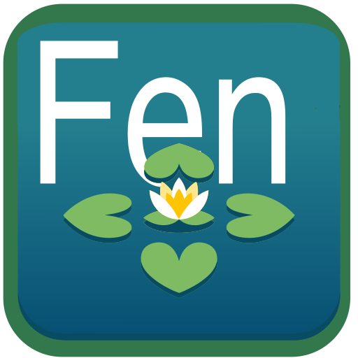
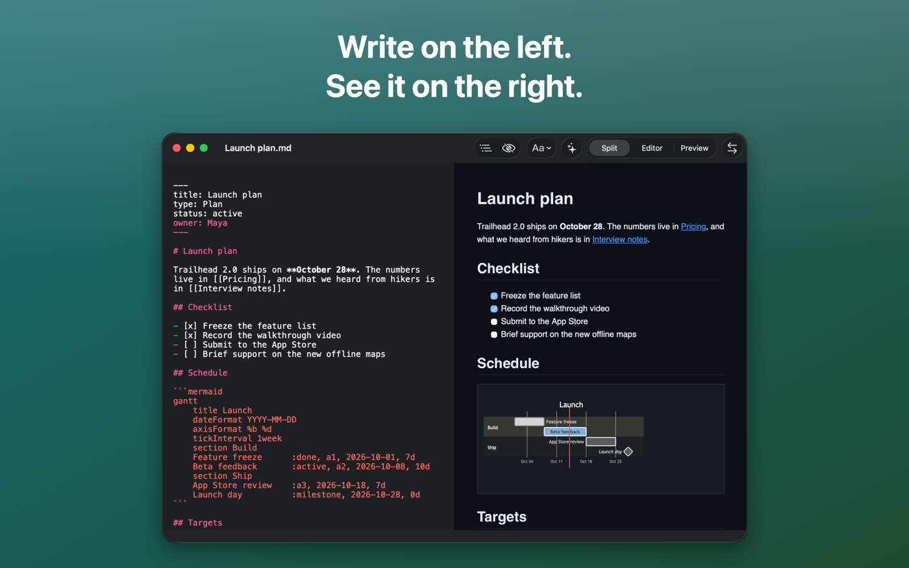
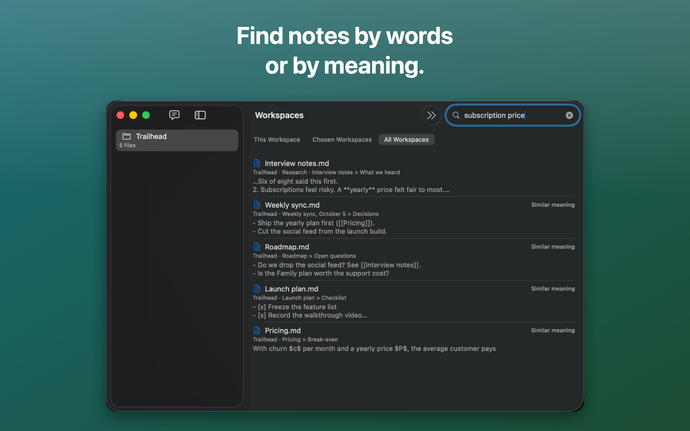
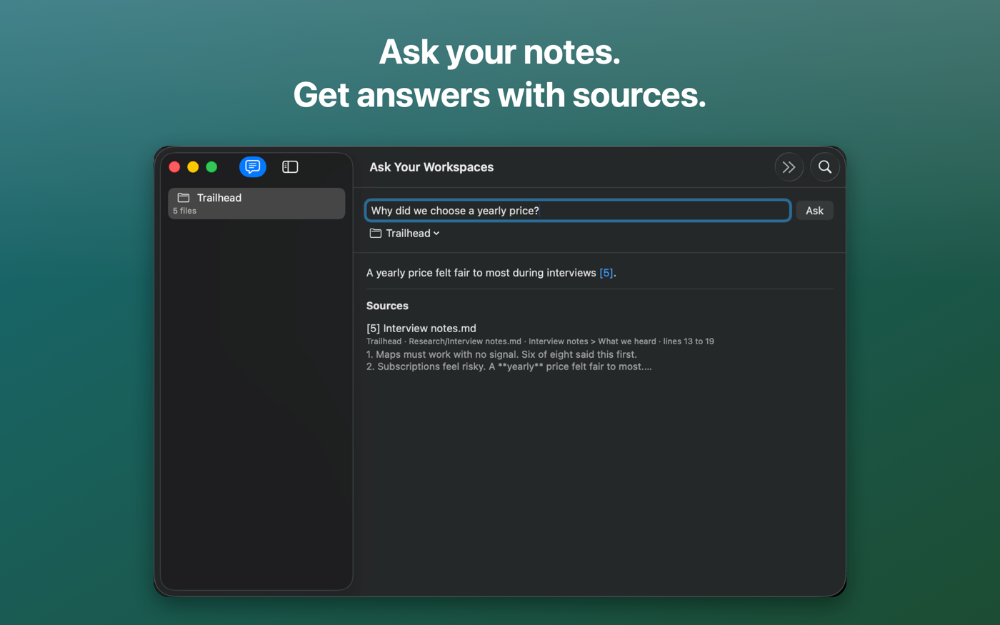

<p align="center">
  
</p>

<h1 align="center">Fen</h1>

<p align="center"><strong>A native Markdown editor for Mac, iPhone and iPad.</strong><br>Write plain <code>.md</code> files. Search them by meaning. Ask questions across them. On your device, free and open source.</p>

<p align="center">
  <a href="https://github.com/zoharbabin/fen/actions/workflows/ci.yml"></a>
  <a href="https://github.com/zoharbabin/fen/releases/latest"></a>
  <a href="LICENSE.md"></a>
  
  
</p>

<p align="center">
  <a href="#install">Install</a> ·
  <a href="https://fen.md/">Website</a> ·
  <a href="#features">Features</a> ·
  <a href="https://github.com/zoharbabin/fen/issues">Roadmap and ideas</a> ·
  <a href="CONTRIBUTING.md">Contributing</a>
</p>

<p align="center">
  
</p>

## Why Fen

- **Your notes stay plain files.** Fen reads and writes `.md` files in your own folders. There is no vault or proprietary format, so Finder, iCloud and git keep working.
- **Your notes become a knowledge base.** Search by words and meaning, follow `[[wiki-links]]` and backlinks, and ask questions that answer with sources.
- **It runs on your device.** Search and indexing never leave your Mac. Fen sends nothing to an AI service until you add one.
- **It's native.** Swift and SwiftUI, not Electron, built for Apple Silicon.
- **It's free**, open source (MIT), with no account and no telemetry. If Fen ever charges for anything, it will be a one-time purchase, not a subscription.

<table>
  <tr>
    <td></td>
    <td></td>
  </tr>
</table>

## Install

**Mac, download:** get `Fen.app.zip` from the [Releases page](https://github.com/zoharbabin/fen/releases/latest), unzip it, and drag **Fen.app** to Applications. Every release is signed with an Apple Developer ID and notarized, so it opens without Gatekeeper warnings. Fen needs macOS 15 or later.

**Mac, Homebrew:**

```sh
brew tap zoharbabin/fen https://github.com/zoharbabin/fen
brew install --cask fen
```

**iPhone and iPad:** needs iOS 18 or later. The App Store release is in review. It isn't available as a download yet.

**Updates:** choose **Fen > Check for Updates…**. Fen checks only when you ask, then downloads, verifies and installs the new version. With Homebrew, `brew upgrade --cask fen` works too. A build from source only opens the Releases page.

## Features

### Write and preview

- **Split view with scroll sync.** Markdown on one side, the rendered page on the other, tracking each other as you type.
- **GitHub-Flavored Markdown** through Apple's [`swift-cmark`](https://github.com/apple/swift-cmark): tables, task lists, strikethrough, autolinks, footnotes, `==highlight==` marks and `> [!NOTE]` alerts.
- **Math, diagrams and more.** MathJax equations, Mermaid diagrams, syntax highlighting, emoji shortcodes, GeoJSON maps (opt in) and an interactive 3D viewer for `stl` blocks. All of it renders in the preview, in exports and in the CLI.
- **Live preview mode (Experimental, Cmd+Shift+P).** Hides Markdown markers away from the caret and shows the styling they mean, while the file stays plain text. See [how it works](docs/ARCHITECTURE.md#slash-command-menu-focus-mode-live-preview-and-the-editor-gutter).
- **Writing tools.** Slash-command menu, outline sidebar (Cmd+Shift+O), focus mode (Cmd+Shift+F), synced line numbers, find and replace, a formatting toolbar, auto-pair and list continuation.
- **Vim keys (Mac, off by default).** Normal and Insert mode with basic motions. Nothing else from Vim is included.
- **Images.** Paste or drop an image and Fen saves it in a `<document>.assets` folder next to the file and links it.
- **Themes.** Light and dark pairs that follow the system, custom preview CSS, and per-document `fen:` front-matter overrides.
- **Safe HTML.** Inline HTML goes through a vendored [DOMPurify](https://github.com/cure53/DOMPurify) first, so a document can't run scripts or load remote content.

### Your notes as a knowledge base

- **Workspaces.** Add any number of folders, with or without git. Fen lists their notes without opening each file and writes nothing into them apart from an optional `.fen/schema.yaml`.
- **Search by words and meaning.** An on-device index per workspace, searched across one workspace or all of them.
- **Wiki-links and backlinks.** `[[name]]`, `[[name|text]]` and `[[name#heading]]`, with a backlinks list and a related-documents card.
- **Document types.** Typed properties from a plain `schema.yaml`, with hints that never block a save.
- **Version history.** The earlier versions the system keeps, including recent ones from your other iCloud devices.

### AI and agents, on your terms

- **Ask your workspaces.** Answers cite numbered sources with line numbers.
- **Ask AI and Enrich.** Change a note from inside it. Every change goes through one gate and can be undone.
- **AI you add yourself.** Apple's on-device model, Ollama, or an OpenAI-compatible service. With no provider added, Fen makes no AI request.
- **MCP server (Mac, off by default).** Lets an agent read and edit your workspaces. It listens on `127.0.0.1` only, with per-client tokens. Agent edits go through the same gate, on their own git branch.

### Sync, files and sharing

- **GitHub sync.** Clone a repository as a workspace, then pull and push with a token limited to that repository. The iPhone copies through the GitHub API. Conflicts wait for your choice.
- **Default `.md` editor.** Finder document icon, Open Recent and session restore on both platforms.
- **Quick Look.** Select a Markdown file in Finder and press Space to see it rendered.
- **Autosave and crash recovery.** Fen offers to restore an unsaved buffer after an unclean exit. If a file changes on disk, Fen asks whether to reload it or keep your edits.
- **Export.** HTML, PDF and Print from the same renderer as the preview. Copy as Raw HTML or Rich Text. The `fen-export` command-line tool converts files in batches.

### iPhone and iPad

- **Same shortcuts as the Mac** on a hardware keyboard (hold Cmd to list them).
- **Narrow windows** show the editor or the preview one at a time.
- **Share sheet in and out.** Open a Markdown file from another app in place, send a document out as `.md` or text, or save text as a note with **New from Clipboard**.

## Privacy and trust

Fen reads and writes only the files and folders you give it. These are the only network uses:

| What | When |
|---|---|
| Update check | You choose **Check for Updates…** |
| GitHub sync | You cloned a workspace from GitHub |
| AI providers | You added one |
| Map tiles from OpenStreetMap | You turned on the GeoJSON map preference |
| MCP server | You turned it on. It listens on `127.0.0.1` only |

Every script and style ships inside the app, with no CDN. See [ARCHITECTURE.md](docs/ARCHITECTURE.md#no-proprietary-storage-format-and-no-cloud-ai-by-default) for the reasoning and the code that enforces it.

## Build from source

You need macOS 15 or later and a recent Xcode with the Swift 6 toolchain.

```sh
git clone https://github.com/zoharbabin/fen.git
cd fen

swift build                  # build the package
swift test --no-parallel     # run the test suite
swift run Fen                # launch the Mac app
./scripts/build-app.sh       # produce dist/Fen.app
```

See [RELEASING.md](docs/RELEASING.md) for signing, notarization and cutting a release.

## Project layout

```
Shared/        FenCore: model, rendering, editor, preview, search, AI, sync
macOS/         Mac app (DocumentGroup, menus, Settings)
iOS/           iPhone and iPad app
FenQuickLook/  Quick Look extension for .md files
FenShare/      iOS share extension
CLI/           fen-export command-line tool
Dependency/    Vendored Highlightr
Tests/         Swift Testing suite
UITests/       UI tests (xcodegen project, see CONTRIBUTING.md)
Casks/         Homebrew cask
assets/        Demo documents and store screenshots
scripts/       Build, release and CI scripts
site/          fen.md landing page (GitHub Pages)
docs/          Architecture, release and debugging docs
```

See [ARCHITECTURE.md](docs/ARCHITECTURE.md) for why things are shaped this way.

## Get involved

- **Found a bug?** [Open an issue](https://github.com/zoharbabin/fen/issues/new?template=bug_report.md).
- **Want a feature?** [Suggest it](https://github.com/zoharbabin/fen/issues/new?template=feature_request.md). Check the [open issues](https://github.com/zoharbabin/fen/issues) first. [Issue #3](https://github.com/zoharbabin/fen/issues/3) tracks the AI and knowledge layer.
- **Want to code?** Read [CONTRIBUTING.md](CONTRIBUTING.md). Issues labeled [good first issue](https://github.com/zoharbabin/fen/labels/good%20first%20issue) are a good start.
- **Found a vulnerability?** Don't post it in a public issue. Use [GitHub's private vulnerability reporting](https://github.com/zoharbabin/fen/security/advisories/new).
- **Like Fen?** Star the repo and tell a friend. It helps other people find it.

Everyone taking part follows the [Code of Conduct](CODE_OF_CONDUCT.md).

## License

Fen is MIT licensed ([LICENSE.md](LICENSE.md)). The license texts for third-party components are in [`LICENSE/`](LICENSE/), and next to each vendored resource under `Shared/Resources/`.

## Origin and thanks

Fen grew out of a full rewrite of [MacDown](https://github.com/MacDownApp/macdown), the open-source Markdown editor for macOS. **[Tzu-ping Chung](https://github.com/uranusjr)** and contributors created MacDown, drawing inspiration from [Chen Luo](https://twitter.com/chenluois)'s [Mou](http://mouapp.com). Fen is an independent rewrite, not a fork. The original hasn't shipped an update in years, and Apple is winding down support for Intel-only apps. We keep every original copyright and the MIT License intact. We also take inspiration from Typora, iA Writer, Bear and Obsidian.

These editor themes and CSS files come from Mou, courtesy of Chen Luo:

* Mou Fresh Air / Fresh Air+
* Mou Night / Night+
* Mou Paper / Paper+
* Tomorrow / Tomorrow Blue / Tomorrow+
* Writer / Writer+
* Clearness / Clearness Dark
* GitHub / GitHub2

Fen also builds on [swift-cmark](https://github.com/apple/swift-cmark), [swift-collections](https://github.com/apple/swift-collections), [Yams](https://github.com/jpsim/Yams), [Sparkle](https://sparkle-project.org), [Highlightr](https://github.com/raspu/Highlightr), [highlight.js](https://highlightjs.org), [MathJax](https://www.mathjax.org), [Mermaid](https://mermaid.js.org), [three.js](https://threejs.org), [Leaflet](https://leafletjs.com), [topojson-client](https://github.com/topojson/topojson-client), [DOMPurify](https://github.com/cure53/DOMPurify), and GitHub's [gemoji](https://github.com/github/gemoji) shortcode data.
