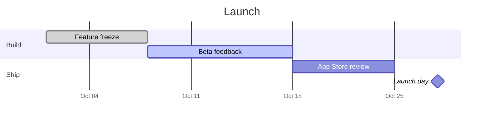

# Launch plan

Trailhead 2.0 ships on **October 28**. The numbers live in [[Pricing]], and what we heard from hikers is in [[Interview notes]].

## Checklist

- [x] Freeze the feature list
- [x] Record the walkthrough video
- [ ] Submit to the App Store
- [ ] Brief support on the new offline maps

## Schedule

## Targets

| Metric | Today | Goal |
|---|---:|---:|
| Weekly active hikers | 12,400 | 20,000 |
| Offline map downloads | 3,100 | 9,000 |
| Trial to paid | 4.1% | 6.0% |

> Keep the first screen simple. One map, one button.
