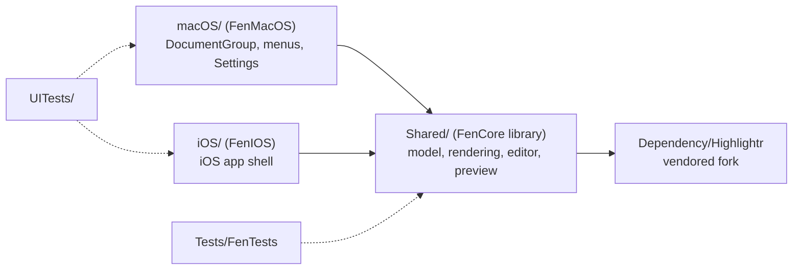
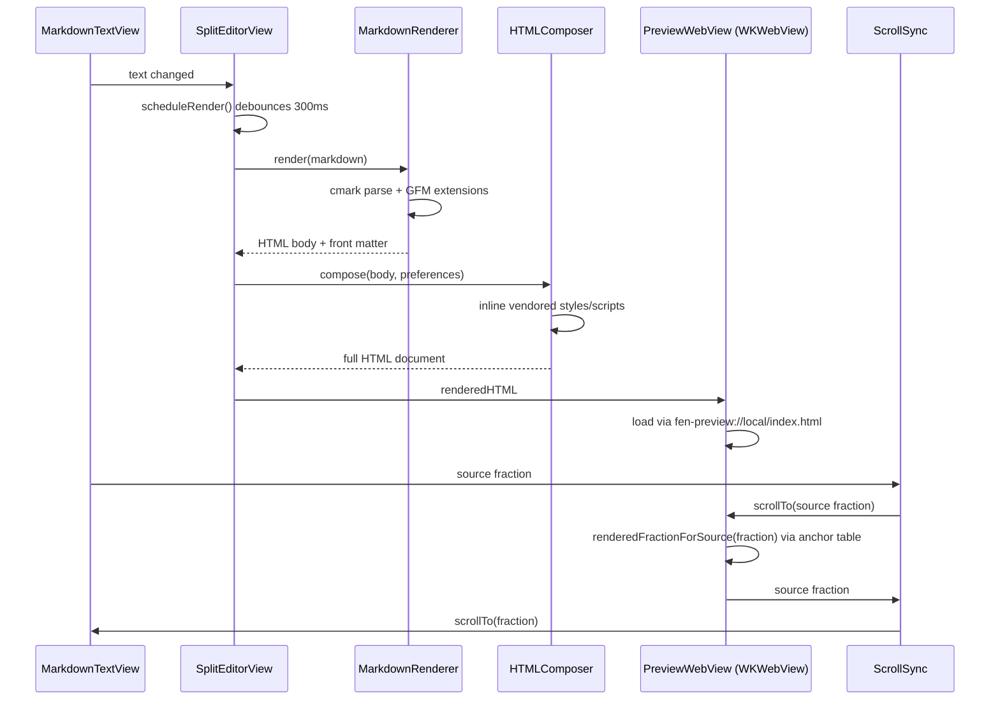
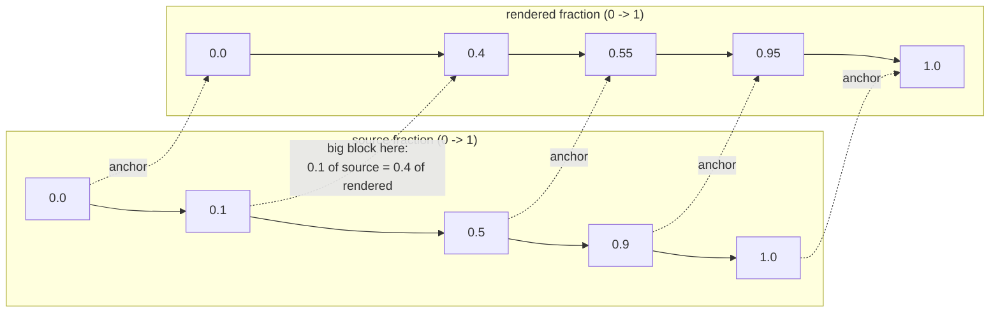
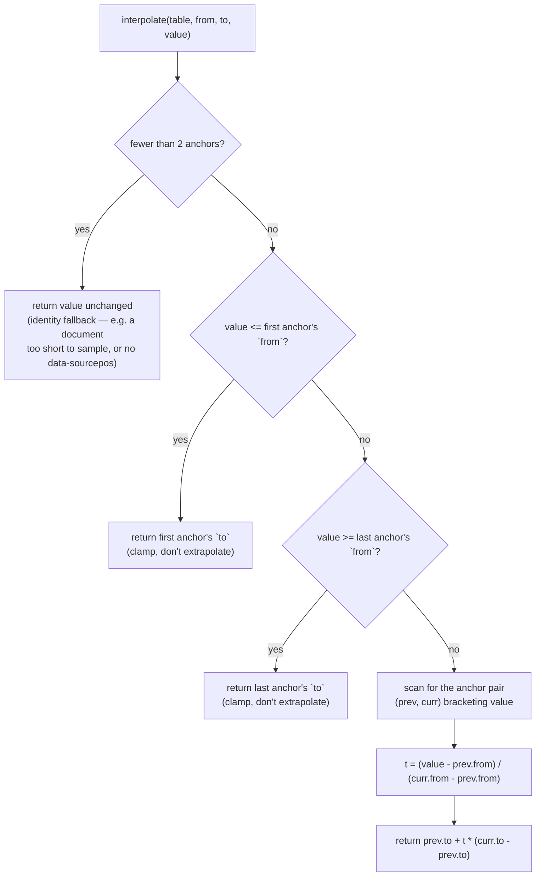
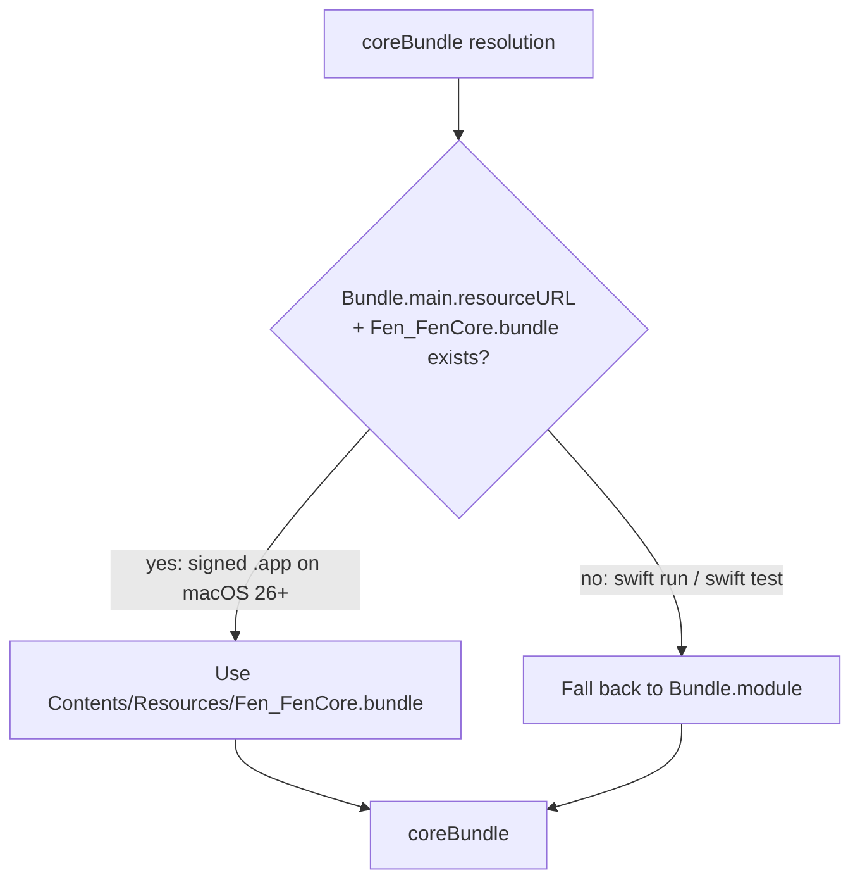
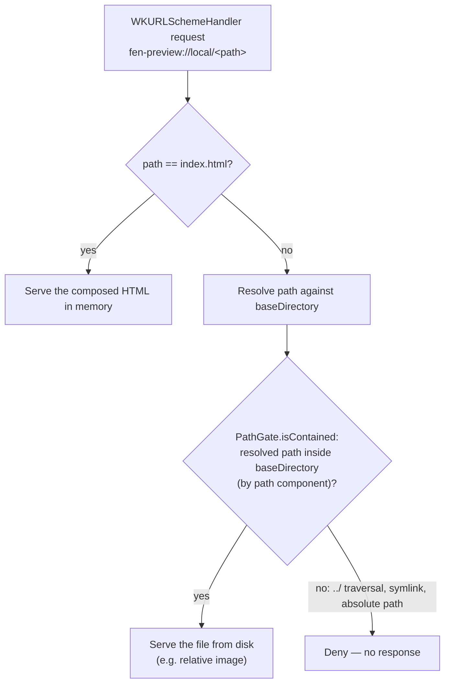
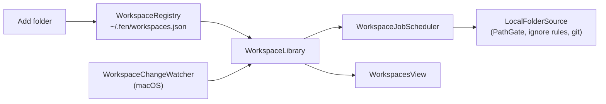
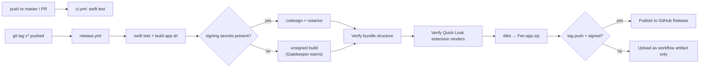

# Architecture

This covers the decisions that aren't obvious from reading the code — why things are shaped the way they are, and the bugs that shaped them. For what's planned and in progress, see the [GitHub Issues list](https://github.com/zoharbabin/fen/issues). For project layout, see [README.md](../README.md#project-layout).

## FenCore: one model, two platforms

`Shared/` builds as the `FenCore` library target. `macOS/` and `iOS/` are thin executable targets that depend on it — `FenMacOS` wires up `DocumentGroup`, menus, and `Settings`; `FenIOS` wires up the iOS shell. Neither platform target should carry business logic: if code doesn't need `AppKit` or `UIKit`, it belongs in `FenCore` so both platforms get it for free. See [CONTRIBUTING.md](../CONTRIBUTING.md#coding-style) for the enforcement rule.



## Editing to preview: the rendering pipeline

Typing in the editor doesn't re-render on every keystroke. `SplitEditorView.scheduleRender()` cancels any in-flight render `Task`, waits 300ms (skipped if `preferences.markdownManualRender` is set), then runs the document through `MarkdownRenderer` and `HTMLComposer` before handing the result to the `WKWebView`-backed preview. `ScrollSync` mirrors scroll position between the two panes as a fraction (0.0–1.0) of the *source* document, guarded by an `isUpdating` flag so each pane's update doesn't re-trigger the other.

A plain-text source line and its rendered HTML rarely take up the same proportion of their pane — a fenced code block, an image, or a table can occupy very different vertical space in the editor than in the preview. `SplitEditorView` renders with `MarkdownRenderer.Options.sourcePositions = true`, which makes cmark-gfm emit `data-sourcepos` on every block element; `Shared/Resources/ScrollSync/scroll-sync.js` (vendored into the preview via `HTMLComposer`) reads those attributes to build a table mapping source-line fraction to rendered-pixel fraction, then interpolates between the two piecewise-linearly. That table is marked dirty — never compared against a cached scalar snapshot, which can alias between two genuinely different layouts mid-resize — by a `ResizeObserver` on `document.documentElement`, a `MutationObserver` on `document.body`, the Mermaid/MathJax ready-promises resolving, and an explicit call from the font-scale zoom write (issue #110), then actually rebuilt lazily on the next lookup; so a window resize, a split-divider drag, a font-size zoom, or an async Mermaid/MathJax render growing the page doesn't leave later lookups predicting from a stale layout. The preview's `PreviewWebView` routes every scroll fraction through `window.__fenScrollSync.sourceFractionForRendered`/`renderedFractionForSource` before it reaches or leaves `ScrollSync`, so `ScrollSync` itself only ever deals in source-document fractions — the editor needs no translation, since its plain-text layout is already a reasonable proxy for source-line fraction.

`PreviewWebView`'s macOS `Coordinator` applies an incoming scroll fraction by setting `document.documentElement.scrollTop` through `evaluateJavaScript`, which itself triggers a DOM `scroll` event — WebKit dispatches that event asynchronously, around the next frame, well after `evaluateJavaScript`'s own completion handler runs on the Swift side. A guard flag cleared from that completion handler races the real event and can clear before it fires, letting the assignment's own self-triggered scroll leak back through the `scroll` listener as a "user scroll," feeding a slightly-off fraction back into `ScrollSync` on every sync round-trip — this is what compounded into visible drift the deeper a document went, even after the anchor-table fix above. An earlier fix tried clearing a `window.__fenSuppressScrollEvent` flag after two nested `requestAnimationFrame` callbacks instead of from the Swift completion handler, tying the guard to the same frame timing WebKit uses to actually dispatch the event — but `requestAnimationFrame` never fires at all in a window with no live display link, which includes the off-screen `NSWindow` `Tests/FenTests/PreviewScrollRaceVerifyTest.swift` uses under `swift test` (no running `NSApplication` event loop). `scrollAssignmentJS` now instead records the exact pixel value it's about to write to `window.__fenExpectedScrollTop`; `scrollObserverJS`'s listener suppresses only the one `scroll` event whose `scrollTop` matches that value, then clears the expectation immediately — tied to the assignment's own effect, not to whether or when a frame renders. `PreviewScrollRaceVerifyTest.swift` proves this against a real, attached `WKWebView` — a paced, synthetic UI-test scroll gesture waits for the app to go idle after each step, which is slow enough to hide this exact race, so this had to be caught with a test that lets the browser's real asynchronous event timing run.



## Anchor-table interpolation: the shared math

Both anchor tables are sorted lists of `(source, rendered)` pairs, where both fields run 0→1 and increase monotonically. They sample the same breakpoints — `MarkdownRenderer.render()` extracts `blockStartLines`, the document-ordered list of source lines where a rendered block starts, from the same `data-sourcepos` attributes `scroll-sync.js`'s `computeAnchors()` walks in the DOM — so `computeEditorLineAnchors` (fed `blockStartLines` via `SplitEditorView` → `MarkdownTextView`/`MarkdownTextView_iOS`) and `computeAnchors()` disagree only on each breakpoint's *rendered* position (`NSLayoutManager` line-fragment geometry vs. DOM layout, which is where word wrap and other layout differences actually show up), never on *which* source lines they sample (issue #113 — sampling at an independently-chosen fixed line stride instead let the two tables' breakpoints drift out of step, compounding into visible per-row disagreement on long documents). Between two documents that share content but differ in per-block density, the two axes drift apart: a block that's short in the source but tall once rendered (an image, a table, a big fenced code block) pulls the `rendered` value for every anchor after it further ahead of `source`. Mapping a fraction from one axis to the other means walking the table to find the two anchors it falls between, then interpolating linearly within that segment — never extrapolating past the first or last anchor.



`interpolateEditorAnchor` (Swift) and `interpolate` (JS) both implement the same lookup, deliberately kept in lockstep — `Tests/FenTests/CrossLanguageInterpolationTest.swift` runs identical tables and probe values through both to prove they agree:



Both implementations rebuild their table lazily rather than once: `computeEditorLineAnchors` is only re-run when the editor's text, laid-out height, or visible (viewport) height changes (`refreshAnchorsIfNeeded` in `MarkdownTextView.swift`/`MarkdownTextView_iOS.swift` — all three, since `rendered` is normalized against `totalHeight - visibleHeight`, and a pane-height-only resize shifts that normalization even with `totalHeight` unchanged), and `scroll-sync.js`'s `refreshAnchorsIfStale` rebuilds on the next lookup whenever a dirty flag set by `ResizeObserver`/`MutationObserver`/an async render's ready-promise/a font-scale write is set — see the "instead of predicting from a stale layout" note above for why a table cached forever, or one gated behind a scalar comparison that can alias mid-resize, caused visible drift after a reflow.

A font-size zoom (Cmd+/Cmd-/Cmd+0) is a second way the editor's layout can change without `ScrollSync` knowing: zoom writes straight to `preferences.fontSize` and never calls `ScrollSync.editorDidScroll`, so the *fraction* `Coordinator.applyScrollFraction` receives is identical before and after a zoom step even though the font change just grew or shrank every line's height. A guard that only compared the incoming fraction to the last one it applied would skip reapplying the scroll position in that case, leaving the editor's pixel offset stale relative to the new layout — the preview's `fontScaleAssignmentJS` already re-derives its scroll target on every zoom step, so this desynced the two panes. `Coordinator` now also tracks the last-applied total/content height (`lastAppliedTotalHeight` on macOS, `lastAppliedContentHeight` on iOS) and re-applies whenever that changes, even if the fraction didn't.

## Slash-command menu, focus mode, live preview, and the editor gutter

Four editor features share one shape: a pure, platform-independent logic module in `Shared/Editor/` (`SlashCommandMenu.swift`, `FocusModeEditing.swift`, `LivePreviewEditing.swift`), plus a `MarkdownTextView+<Feature>.swift`/`MarkdownTextView+<Feature>_iOS.swift` pair of `Coordinator` extensions that wire that logic into the real `NSTextView`/`UITextView`. Keeping the logic pure means every rule is unit-testable without constructing a live text view, and keeps `MarkdownTextView.swift`/`MarkdownTextView_iOS.swift` from growing past the project's `file_length` lint limit as features accumulate.

- **Slash-command menu** (issue #1): typing `/` at the start of a line, or after whitespace, opens a filterable popup (`SlashCommandMenuView.swift`) offering the fixed 7-entry block-type list in `SlashCommandMenu.entries`, applying the same `FormattingAction` the toolbar/menu commands already use. `MarkdownNSTextView` gained `accessibilityOverlaySubviews`/an `accessibilityChildren()` override — `NSTextView` otherwise exposes only its text content to the accessibility tree, making a plain `addSubview` popup invisible to VoiceOver and XCUITest even though it renders correctly on screen.
- **Focus/typewriter mode** (Cmd+Shift+F, issue #19; refined in issue #127): dims every paragraph except the one containing the caret, and recenters the caret's line vertically as you type. Runs off the same selection/text-change hooks the other three features use, touching only the changed paragraph's dim state rather than re-rendering the whole document on every keystroke. Dimming and centering are independent preferences (`editorFocusModeDimsText`, `editorFocusModeCentersCaret` in `Preferences.swift`) — either can be off while focus mode itself is on. The active range (`FocusModeEditing.activeDisplayRange`) is a Markdown-block-aware extension of the caret's paragraph: it pulls in a heading directly above the paragraph (separated only by blank lines, not by another paragraph), so editing a paragraph never strands its own heading in the dimmed region. The preview pane mirrors the editor's active range rather than computing its own: `MarkdownTextView+FocusMode.swift`'s `notifyFocusRangeChangeIfNeeded` converts the active `NSRange` to raw 1-based source line bounds (`FocusModeEditing.lineRange(forCharacterRange:)`) and hands them to `PreviewWebView` as a `FocusLineRange`; `PreviewWebView.Coordinator` diffs it against the last value and calls `scroll-sync.js`'s `setFocusRange(startLine, endLine)` via `focusRangeAssignmentJS`, which toggles a `.fen-focus-dim` class (`opacity: 0.35`, defined in `HTMLComposer.swift`) on every leaf `data-sourcepos` element outside that range — the same leaf set `scroll-sync.js` already computes for scroll-position anchors, so a table's per-cell `data-sourcepos` doesn't get dimmed cell-by-cell.
- **Live preview / WYSIWYG-in-source mode (Experimental)** (Cmd+Shift+P, issue #2; single-pane behavior and fenced-code exclusion added in issue #128): hides markdown marker characters (`**`, `#`, `` ` ``, list bullets, and more) off-focus and applies the visual weight/size/color they imply directly to the surrounding text, entirely within the editor's own `NSTextStorage` — there's no separate rendered view and no re-parsed AST; the source text remains the single source of truth, and toggling the mode off restores the exact original attributes it stashed before hiding a marker (`livePreviewOriginalForegroundColor`/`livePreviewOriginalFont` on `NSAttributedString.Key`). This is a lightweight single-pass heuristic, not a CommonMark parser — it only needs to recognize enough structure to style it, never enough to round-trip it. It's labeled experimental, and Settings discloses this directly, because inline `$x$` math still shows as source and a table or list is styled, not laid out, which falls short of the "every construct renders inline" bar the feature is meant to hit (issue #135). `LivePreviewEditing.fencedRanges` finds every fenced code block's full extent (opening/closing ` ``` `/`~~~` delimiter lines included, an unterminated trailing fence extending to the document's end) so `restyleLines` never styles those lines' text — code content like Python's `**kwargs` must never be misread as emphasis syntax. Live preview implies the single editor pane: enabling it forces `SplitEditorView`'s `viewMode` to `.editorOnly`, stashing whatever mode it overrode so disabling it restores that mode, and manually switching away from `.editorOnly` while live preview is on turns it back off — this two-way invariant lives in `SplitEditorView+LivePreviewMode.swift`, split out to keep `SplitEditorView.swift` under swiftlint's file-length limit. Horizontal rules, list hanging indents and footnotes (issue #135) are styled by `LivePreviewBlockStyle` (`Shared/Editor/LivePreviewBlockStyle.swift`), attributes only, with no overlay views, so macOS and iOS share it. A rule's text is hidden and tagged with the `fenBlockDecoration` attribute. `DecorationLayoutManager`, the text view's layout manager, draws the line at draw time, so it follows every resize and wrap. The styler stashes the paragraph style it replaces (`livePreviewOriginalParagraphStyle`), and `LivePreviewBlockStyle.restore` undoes it with the rest of `clearLivePreviewStyling`. An unordered list marker (`-`, `*`, `+`) that isn't part of a task item is hidden the same way and `DecorationLayoutManager` draws a round bullet over it (`BlockDecoration.bullet`). The dash keeps its width, so the hanging indent still lines up. Ordered numbers stay literal. Front matter and setext underlines are never rules. Detection lives in `LivePreviewBlocks.swift`. Fenced code gets a rounded panel (`codeBlock`) and its text is never touched. A pipe table (header, a delimiter line with the same cell count, body lines) gets a shaded bold header, the delimiter line collapses to a rule, each separator `|` is hidden and drawn as a column line, and each cell is styled for inline Markdown on its own. `LivePreviewBlockContext` classifies every line once per restyle (text, front matter, code, table role). A line with a `|` that isn't in a real table is now styled like any other line. Column lines follow the pipes as typed, so a table whose columns aren't aligned in the source has ragged lines. Mermaid fences, `geojson`/`topojson` fences and `$$` math (`RenderedBlock`, found by `LivePreviewEditing.renderedBlocks` in `LivePreviewRenderedBlocks.swift`) show as pictures while the caret and selection are away from them. `LivePreviewSnapshots` (`LivePreviewSnapshots.swift`) renders each block once in an offscreen web view, through the export pipeline (`MarkdownRenderer`, `HTMLComposer.composeForExport` with `appearanceOverride`, `PDFRenderer.loadOffscreenWebView`), so the picture matches the preview and uses only vendored scripts. Renders run one at a time. The cache is keyed by kind, source, width (in 40 pt steps) and light or dark, and holds 32 pictures. A block taller than 1600 pt is scaled down to that height, not cropped. A block that fails to render (a Mermaid syntax error, a `mjx-merror`) is remembered, and its source stays visible. While a picture renders, the source stays visible too. `LivePreviewBlockStyle+Rendered.swift` hides the block's text, sets the first line to the picture's height and tags it `fenBlockImage`, and `DecorationLayoutManager` draws the picture. Each kind follows its preview setting (`htmlMermaid`, `htmlMathJax`, `htmlGeoJSONMaps`), so there is no new network call. Maps are the existing documented exception. Positioning overlay views (e.g. an image attachment) must happen after `NSTextStorage`'s `endEditing()` call, not inside the `beginEditing()`/`endEditing()` block — calling `rect(forCharacterRange:)` while the text storage is still mid-edit triggers a glyph-generation crash.
- **Editor gutter / line numbers** (issue #21): an optional `editorShowLineNumbers` preference draws line numbers in the editor (`EditorGutterRulerView`, an `NSRulerView` on macOS) and, independently, in the preview pane (`scroll-sync.js`'s `computeLineNumberAnchors()`/`renderLineNumberGutter()`, gated by `window.__fenShowLineNumbers`). Both sides derive numbers from the same underlying source: the editor from `computeLineStartOffsets` over the visible line range, the preview by walking the same `data-sourcepos` block metadata the scroll-sync anchor table already uses — reading each element's *starting* source line, not counting every leaf, since cmark-gfm annotates every table cell with its own `data-sourcepos` and naively treating each as a leaf numbers a multi-column row once per cell instead of once per row.

## Split dividers and the outline sidebar bleeding into the toolbar (macOS 26 Liquid Glass)

macOS 26's Liquid Glass window chrome makes `HSplitView`'s backing `NSSplitView` (and its private `NSSplitDividerView`) deliberately extend its own frame up into the toolbar's safe area (WWDC25 session 310: "NSSplitView will extend that item's frame beneath the sidebar and then apply a safe area layout guide"). A plain SwiftUI `List(...).listStyle(.sidebar)`'s backing `NSScrollView` inherits the same overflowing frame. Each pane's own *content* insets itself below the toolbar automatically via that safe-area guide, but the divider's own drawing and the sidebar list's rows don't get the same treatment — so the divider hairline, and sidebar text, paint straight through the toolbar into the title bar (issue #111).

`clipsToBounds` does nothing here: the overlap is in the view's own *frame*, not something outside its bounds, so clipping a view to its own bounds removes nothing. The fix (`Shared/Views/SplitDividerToolbarClip.swift`) has to clip against `window.contentLayoutRect` externally, via a `CALayer` mask sized to `view.bounds.intersection(view.convert(window.contentLayoutRect, from: nil))` and assigned to `view.layer?.mask`. It walks the real AppKit tree for every `NSSplitDividerView` and `NSScrollView` and masks each one, re-masking on every `frameDidChangeNotification`.

Neither `viewDidMoveToWindow` nor SwiftUI's `updateNSView` reliably fires when a *new* split or scroll-view subtree bridges into the tree later — e.g. toggling the outline sidebar open, which starts hidden and only creates its `NSSplitView`/`NSScrollView` on first show. `updateNSView` is kept as a fast-path hint, but the mechanism that actually catches this is a self-driven `Timer` that rescans on a fixed cadence for as long as the probe view is in a window; `apply()` is idempotent, so a tick that finds nothing new costs almost nothing.

**If you add a new AppKit view type inside an `HSplitView`/toolbar-bearing window** (a future custom list or table view, say) and it bleeds into the toolbar the same way, extend `SplitDividerToolbarClip.apply()`/`clip(_:to:)`/`observe(_:window:)` to cover it rather than writing a parallel mechanism.

## Resource bundle resolution (`Shared/CoreBundle.swift`)

SwiftPM's generated `Bundle.module` accessor resolves resources against `Bundle.main.bundleURL`. That's correct for `swift run` and `swift test`, but wrong for a signed, distributed `.app`: macOS 26 requires nested resource bundles to live under `Contents/Resources/` (`Bundle.main.resourceURL`), not the bundle root. A build that only used `Bundle.module` crashed on file open on macOS 26 — fixed in v0.2.0–v0.2.4 (see `CoreBundle.swift`'s doc comment for the full resolution order).

`coreBundle` checks `resourceURL` first, falling back to `Bundle.module` for local dev builds. `scripts/build-app.sh` and the `release.yml` workflow both verify the resulting bundle layout after building (see `release.yml`'s "Verify bundle structure" step) so this can't regress silently.



**If you add a new SPM resource target or bundle**, make sure it lands in `Contents/Resources/` with an `Info.plist` in the packaged `.app`, and add a check for it in `release.yml`.

## Preview: a custom URL scheme, not `loadHTMLString(baseURL:)`

The live preview (`Shared/Preview/PreviewWebView.swift`) renders through `WKWebView`. The obvious approach — `loadHTMLString(_:baseURL:)` — sets the document's base URL for resolving relative links, but does **not** grant the web view read access to that directory. Relative-path images in a Markdown document (``) silently failed to load under that approach.

Instead, `PreviewSchemeHandler` implements `WKURLSchemeHandler` for a custom `fen-preview://` scheme. The main document loads from `fen-preview://local/index.html`; every other request resolves against the document's directory on disk (`baseDirectory`) through the shared `resolvedFileURL(for:baseDirectory:)` helper, which asks `PathGate.isContained(_:in:)` (`Shared/Workspaces/PathGate.swift`, shared with workspaces) whether the candidate sits inside `baseDirectory`. The gate resolves symlinks on both sides and compares whole path components, not strings: a symlink planted inside `baseDirectory` can't point outside it, and a sibling folder that only shares a name prefix (`notes-evil` next to `notes`) isn't "inside" `notes`. The old string-prefix check let that sibling through. Keep that check load-bearing — it's the only thing standing between a crafted Markdown file and arbitrary local file reads.



The same `resolvedFileURL` guard backs `internalLinkTarget(for:)`, which a clicked preview link runs through first: a same-page anchor (`#section`) returns `nil` and stays on `fen-preview://local/index.html`, while a link that resolves to a *different* file on disk returns that file's URL. `PreviewWebView.Coordinator` cancels the in-place navigation for the latter and opens it as its own document instead — `openDocument(at:)` on macOS, `UIApplication.shared.open(_:)` on iOS — rather than letting `WKWebView` load that file's raw text as if it were HTML.

A second `WKUserScript`/message-handler pair, alongside the scroll-position one described below, reports which link the pointer is over: `Shared/Preview/LinkHoverJS.swift`'s `linkHoverObserverJS` posts a hovered link's raw `href` through a `linkHoverHandler` channel, which `SplitEditorView` shows in a status bar under the preview (macOS only) and clears on mouseout.

## External file changes: telling Fen's own save from someone else's

`ExternalChangeController` (`Shared/Models/ExternalChangeController.swift`) watches a document's `fileURL` via `ExternalFileChangeMonitor` and prompts to reload or keep the in-memory buffer when the file changes on disk (issue #20). `NSFilePresenter`'s self-write exemption — the mechanism that would normally let a presenter ignore writes it made itself — only covers a *coordinated* write made through that same presenter instance. SwiftUI's `DocumentGroup`/`ReferenceFileDocument` save machinery coordinates its own writes independently and has no knowledge of this presenter, so Fen's own save still fires the external-change callback (confirmed empirically). `handleExternalChange` compares the file's new on-disk content against the in-memory buffer instead of trusting the presenter's exemption: if they already match, the change was Fen's own save (or a no-op external touch) and no prompt is shown. A second guard coalesces rapid successive external writes into whichever reload/keep-mine alert is already showing, rather than stacking a second one.

## Autosave and crash recovery

`AutosaveController` (`Shared/Models/AutosaveController.swift`, issue #22) persists a document's unsaved buffer to a recovery file under `Application Support/Fen/Recovery/` and offers to restore it the next time that document is opened after an unclean exit. It's keyed off content divergence, not a crash/pid-liveness signal: a recovery entry is written whenever the in-memory buffer differs from what's on disk, and deleted the instant they match again — whether because the user saved, or because a restore was accepted or declined. That means no `NSApplicationDelegate`/quit-hook wiring is needed: if the app disappears uncleanly, a recovery entry is simply left behind for the next launch to find. Writes are debounced (an idle timer after the last edit, with a ceiling timer guaranteeing a write at least every 30s even under continuous typing that never lets the idle timer fire), and identity is a SHA-256 hash of the resolved absolute path so two paths that resolve to the same real file share one entry.

Both recovery checks (`checkForSavedDocumentRecovery`/`checkForUntitledDocumentRecovery`) defer presenting the restore prompt to the next run loop turn via `DispatchQueue.main.async`, rather than calling it inline from `start(for:)`. `start(for:)` runs from `SplitEditorView.onAppear`/`.onChange(of: document.fileURL)`, before the document's window has become key — and `NSAlert.runModal()` silently no-ops (returns immediately, never shows the alert) when called before there's a key/main window to attach to. Tests that assert on the prompt's effect poll for it (`pollUntilTrue`) rather than asserting synchronously right after `start(for:)` returns, for the same reason.

## Pasted and dropped images: sidecar asset folders

Pasting or dragging an image into the editor writes it to disk rather than embedding it inline (issue #18). `ImageSidecarWriter` (`Shared/Editor/ImageSidecarWriter.swift`) writes into `<document-basename>.assets`, a folder sibling to the document itself — namespaced per document so multiple documents sharing a folder never collide, and visible (not dot-prefixed) so it shows up in Finder like `.xcassets`/`.bundle`. Before writing, it resolves symlinks on the *sidecar directory itself* — not the not-yet-existing destination file (whose `resolvingSymlinksInPath()` would silently no-op since `realpath(3)` needs an existing leaf), and not the unresolved document directory — then checks that the resolved sidecar path still starts with the resolved document directory, mirroring `PreviewSchemeHandler`'s symlink guard in the write direction. Filenames are `image-N.<ext>`, always re-derived from the filesystem on every write (no cached counter) so concurrent writes from independent instances never share or skip numbers, bounded to 10,000 attempts.

On macOS, `MarkdownNSTextView.preferredPasteboardType` overrides AppKit's default pasteboard-type negotiation: a raw image copy (e.g. a screenshot) offers both a modern UTI and a legacy pasteboard-type alias for the same bytes, and AppKit's own negotiation can pick the legacy alias, which `readSelection` doesn't recognize as image data — the paste then silently falls through to AppKit's default attachment handling instead of `ImageSidecarWriter`. The override forces preference for the modern types whenever they're on offer, and orders `.png` ahead of `.tiff` so a PNG source's bytes survive the round trip unchanged instead of being re-encoded through AppKit's TIFF representation.

## Custom CSS and per-document front-matter overrides

`Preferences.customCSS` (issue #26) is inlined directly into the composed preview and export HTML inside a `<style>` tag with no HTML escaping — the first feature where externally-authored text lands inside the preview's `WKWebView`. `HTMLComposer.sanitizeCustomCSS` (`Shared/Rendering/HTMLComposer.swift`) strips three things as plain-text substitution (never a full CSS parse, so malformed input can't throw): every `@import` rule and every non-`data:` `url(...)` reference, so custom CSS can never trigger a network fetch and break Fen's zero-runtime-network-load trust model; and every `</style` occurrence (with or without a trailing `>`), case-insensitively, so custom CSS can't close the `<style>` tag early and get the rest of its own text parsed as live markup or script. It also truncates to `customCSSCharacterLimit` (8,000 characters) as a defensive bound against pathological input.

`DocumentPreviewOverrides` (`Shared/Models/DocumentPreviewOverrides.swift`, issue #27) lets a single document override the preview theme and table-of-contents rendering via a `fen:` key in its own YAML front matter (e.g. `fen: { theme: GitHub2 Dark, toc: true }`), parsed fresh on every render and never persisted or written back to `Preferences`. The `{ key: value }` braces are YAML's flow-mapping style, not JSON — YAML's flow syntax is a superset of JSON's, so it reads like JSON but is parsed by the same YAML library (Yams) as the rest of the front matter; the equivalent indented block style (`fen:\n  theme: GitHub2 Dark\n  toc: true`) parses identically. Parsing degrades field-by-field rather than failing outright: an unrecognized theme name or a `toc` value of the wrong type is ignored, not passed through unchecked. Overrides only apply when `Preferences.htmlDetectFrontMatter` is on — otherwise the front-matter block renders as literal content, and a `fen:` key inside it must not silently still drive rendering. Its `theme` value is still an exact bundled filename (e.g. `GitHub2 Dark`), not a theme family — `HTMLComposer.resolveEffectiveStyleName` converts it to a family via `familyName(forFileName:)` before applying Appearance's light/dark polarity, so an overridden theme still goes through the same pairing every other theme does (issue #98).

## Theme families, and independent print/export Appearance

`Preferences.htmlStyleName`/`printStyleName` store a theme *family* name (e.g. `"GitHub2"`, `"Solarized"`), not an exact CSS filename — `HTMLComposer.themeFamilies` (`Shared/Rendering/HTMLComposer+Appearance.swift`) maps each family to a light filename and an optional dark filename (`GitHub` has none, so forcing dark on it stays visibly light — a documented limitation, not a bug). The Settings Theme pickers (Preview Style and Print/PDF Theme) list families only; there's no separate Light/Dark entry to pick. Each of those two sections also has its own Appearance picker (Follow System / Light / Dark): `Preferences.previewAppearanceMode` governs the live preview, and `Preferences.printAppearanceMode` independently governs Print… and Export to PDF… (issue #98). `printAppearanceMode` defaults to `nil` ("Same as Preview"), meaning it follows `previewAppearanceMode` until set — the same nil-means-follow-preview convention `printStyleName` already used for theme family. Setting it to `.light`/`.dark`/`.system` pins print/export's polarity independently, so a user can preview dark on screen and print light (or vice versa) without touching the live preview at all. `HTMLComposer.resolveEffectiveStyleName` is the one shared function that resolves a family + appearance mode down to the exact filename to load, taking an optional `appearanceOverride` parameter; `compose` (preview) never passes one and always follows `previewAppearanceMode` directly, while `composeForPrint` passes `printAppearanceMode`. `loadHTMLDefaults` normalizes any pre-#98 persisted filename (e.g. a literal `"GitHub2 Dark"` from before this redesign) to its family name via `HTMLComposer.familyName(forFileName:)`, a one-time migration on load.

Syntax highlighting and Mermaid follow the same Appearance settings but get no picker of their own (issue #100). `Preferences.htmlHighlightingThemeName` stores a highlighting theme *family* name (`atom-one`, `github`, `solarized`, `xcode`, or `default`, which has no dark counterpart) — `HTMLComposer.highlightThemeFamilies` maps each to its light/dark highlight.js CSS file, and `resolveEffectiveHighlightThemeName` resolves it using the exact same `wantsDark` computation (`resolveWantsDark`) that `resolveEffectiveStyleName` uses for the CSS theme, so a document's code blocks always match the CSS theme's polarity for that render path without a separate Light/Dark choice to make. Mermaid needs no equivalent resolver: `mermaidTags` already derives its diagram theme from the CSS theme's *resolved* filename (`effectiveStyleName.contains("Dark")`), so it was already inheriting rather than choosing independently.

## Export, print, and the CLI reuse the preview's rendering pipeline

"Export to HTML…", "Export to PDF…", "Print…", "Copy as Raw HTML"/"Copy as Rich Text Formatted", and the `fen-export` CLI (`Shared/CLI/ExportCLIRunner.swift`) all render through the same `HTMLComposer` the live preview uses, rather than a separate renderer — `composeForExport` and `composeForPrint` share `HTMLComposer`'s style/script assembly with `compose` (the preview path), so a fix or feature added to one output (Mermaid, MathJax, syntax highlighting, custom CSS) reaches all of them for free. `composeForPrint` accepts a `styleNameOverride`/`appearanceOverride` pair, letting Print… and Export to PDF… use `Preferences.printStyleName`/`printAppearanceMode` instead of the live preview's `htmlStyleName`/`previewAppearanceMode` (issues #82, #98) — HTML export has no separate theme or appearance, since the exported file is meant to carry the reader's own styling choices. Both resolve through the same `resolveEffectiveStyleName` the preview uses (see above), just with different inputs.

PDF export and Print… both load the composed HTML into an offscreen `WKWebView` through `PreviewSchemeHandler` — the same local asset-access pipeline the live preview uses — then read the result back out via `WKWebView.pdf(configuration:)`/AppKit's print machinery. That offscreen load has to wait for more than `WKNavigationDelegate.didFinish`: Mermaid and MathJax render asynchronously *after* the page finishes loading, so capturing immediately after `didFinish` could produce a PDF with blank diagram/equation placeholders (issue #84). `HTMLComposer.renderCompletionTags` injects a `window.__fenRenderComplete` flag that Mermaid/MathJax's own render-complete callbacks flip to `true`; `PDFRenderer.waitForRenderCompletion` polls that flag (never a fixed sleep, per the no-fixed-duration-sync rule linked from [CONTRIBUTING.md](../CONTRIBUTING.md#tests)) up to a bounded `loadTimeout`, after which it gives up and captures whatever is on screen rather than hanging the export forever. A document with neither feature enabled — where the flag is never set at all — reads as already-complete (`!== false`), so this never delays a plain document's export.

`DocumentPreviewOverrides`' `fen:` front-matter key resolves through export, print, and the CLI the same way it resolves in the live preview (issue #85): all three call the same `peekFrontMatter` → `DocumentPreviewOverrides.parse` path `SplitEditorView` uses, so a document's own theme/table-of-contents override travels with it regardless of which output path renders it.

## Highlightr fork (`Dependency/Highlightr`)

The editor's live syntax highlighting uses a vendored fork of [Highlightr](https://github.com/raspu/Highlightr), not the upstream package, because upstream resolves its bundled JS/CSS against `resourceURL` in a way that broke under the same macOS 26 resource lookup change described above. See the fork's own commit history for the exact patch. The fork also forwards attribute reads and edits, and `beginEditing()` and `endEditing()`, to its inner storage (`CodeAttributedString`). Without that, each attribute write fixed attributes on its own and cost more as the note grew, so Live Preview took about 5 seconds to style 6000 lines. `LivePreviewPerformanceTests` guards this. HTML-export syntax highlighting is separate — it loads the same underlying [highlight.js](https://highlightjs.org) library directly (core script, theme CSS, and an init script) through `HTMLComposer`, rather than going through Highlightr's JavaScriptCore wrapper.

## HTML sanitization: fail closed, not fail open

cmark-gfm renders raw HTML blocks/inline HTML verbatim (`CMARK_OPT_UNSAFE`) — without a sanitization pass, a pasted or authored `<script>` or `onerror=` attribute would reach the preview's live `WKWebView` unchanged. `HTMLSanitizer` (`Shared/Preview/HTMLSanitizer.swift`, issue #118) runs the fully composed body through the vendored DOMPurify (`purify.min.js`) inside its own hidden `WKWebView`, invoked via `evaluateJavaScript` — DOMPurify needs a real DOM (`document.implementation.createHTMLDocument()`) to walk, so it can't run in a plain `JSContext`, and `evaluateJavaScript` has no synchronous variant (by design, to avoid a main-thread deadlock), which is why `sanitize(_:)` is `async`. `sanitize-config.js`'s `fenSanitize` allowlists the union of GitHub's raw-HTML passthrough tag set (`<details>`, `<sub>`, `<kbd>`, and others, so Markdown source renders the same as it does on github.com) and every tag/attribute Fen's own render pipeline legitimately emits (cmark-gfm core, GFM extensions, and `MarkdownRenderer`'s alert/TOC/highlight post-processing) — sanitizing runs over the whole composed body, not just literal raw-HTML fragments, so a narrower allowlist would strip Fen's own output alongside the unsafe content.

The sanitizer fails closed: if the hidden web view fails to load, times out (a 5s bound in `makeWebView`), or `evaluateJavaScript` itself fails, `sanitize(_:)` returns `dirtyHTML` escaped as inert text (`escapeAsPlainText`) rather than the original markup unchanged — returning it unchanged on failure would make sanitization skippable simply by making the sanitizer fail, which defeats the whole point (issue #118 rule 2.1). A failed load also doesn't wedge the sanitizer permanently: `loadedWebView()` clears its cached `loadTask` on failure, so a transient WebKit failure only fails the calls in flight at that moment, not every `sanitize(_:)` call for the rest of the process's life. Each `HTMLSanitizer` instance owns its own hidden web view with no module-level mutable state (rule 1.1), so `SplitEditorView`'s per-editor instance and the shared `HTMLSanitizer.shared` used by `DocumentHTMLExporter`/`DocumentPDFExporter` never interfere with each other. `HTMLSanitizer.mayContainRawHTML(_:)` lets callers skip the async round-trip entirely for the common case: cmark-gfm only recognizes raw HTML that begins with a literal `<`, so a markdown source with no `<` at all is guaranteed to render identically whether or not it's sanitized — this matters most on `SplitEditorView`'s live-preview path, where it saves an awaited hop on most keystrokes.

## Emoji shortcodes: a post-processing pass, not a cmark extension

`:rocket:` → 🚀 isn't cmark-gfm syntax — no such extension exists upstream — so `MarkdownRenderer+Emoji.swift` (issue #119) applies it as a regex-driven post-processing pass over the already-rendered HTML, following the exact precedent `applyHighlightMarkup` (`==mark==`) established. `emojiShortcodes` is a `[String: String]` table generated from GitHub's MIT-licensed `gemoji` project (`db/emoji.json`, `Shared/Resources/Emoji/emoji-shortcodes.json`), scoped to the ~1,913 aliases that map to an actual Unicode codepoint — GitHub's ~23 non-Unicode custom branding shortcodes (`:octocat:`, `:shipit:`), which are actually PNGs hosted at `github.githubassets.com`, are out of scope by design, since resolving them would mean a network fetch and break Fen's local-first, zero-runtime-network trust model.

`applyEmojiShortcodes` matches `:shortcode:` spans with the same tag/code-skipping technique `applyHighlightMarkup` uses: one regex alternation matches `<pre>...</pre>` blocks, `<code>...</code>` blocks, any HTML tag, or a shortcode pattern, and only the last alternative's capture group gets substituted — so a literal `:shortcode:`-looking string inside a fenced code block, or inside an HTML tag's own attributes, is left untouched. An unrecognized shortcode (no match in the table) is left as literal text rather than stripped, since a typo'd or unsupported shortcode disappearing silently would be more confusing than seeing it verbatim.

A run of 3+ colon-separated hex groups (a MAC address's 6 groups, or an IPv6 address's up to 8) also matches the tag/code-skipping alternation before the shortcode alternative gets a chance — otherwise a hex byte that happens to equal a hex-valued alias (`ab`, `cd`, `de`) would convert to that emoji mid-address (issue #125), since the shortcode alternative alone has no way to tell a genuine `:de:` from one embedded in `3c:0b:59:de:37:25`.

## STL 3D viewer: preference-gated, and two WebGL rendering bugs

`` ```stl `` fenced code blocks render as an interactive 3D model, using the vendored three.js plus its `STLLoader` and `OrbitControls` add-ons (issue #120). `HTMLComposer.stlViewerTags` gates this behind two conditions before it inlines a single byte of script: `Preferences.htmlSTLViewer` (off by default, matching `htmlMermaid`/`htmlMathJax`'s off-by-default convention for heavier optional renderers) must be on, *and* the composed body must actually contain `class="language-stl"` — the exact class cmark-gfm's fenced-code renderer emits for an `stl`-tagged block. A document with the preference on but no `stl` block still loads zero extra script, mirroring `mermaidTags`'/`taskListTags`'s "only pay the cost when the feature is actually used" pattern.

`stl-viewer-init.js` gives each `` ```stl `` block its own `Scene`/`Camera`/`WebGLRenderer`/`OrbitControls` instance scoped to its own container — no shared module-level three.js state, so orbiting one viewer never affects another's camera, whether they're in the same document or two different preview `WKWebView`s. STL source text is read via `.textContent` and handed to `STLLoader.parse()` as a plain string, which only ever produces numeric vertex/normal float arrays — it never interprets its input as markup, so a model containing HTML-special byte sequences in a comment or metadata field can't become an injection vector. A facet-count cap (`MAX_FACETS`, 500,000) falls back to an error panel instead of parsing: an ASCII STL that large is 1.5M+ float coordinates, enough to risk a multi-second synchronous parse on the main thread and freeze the rest of the document.

Two rendering bugs surfaced during development and drove specific fixes still worth knowing about if this code changes again. First, the initial material used three.js's default `FrontSide`, which silently culls whichever triangle faces point away from the camera — STL files don't guarantee consistent outward-facing winding order, and the viewer's fixed initial camera angle isn't guaranteed to face a model's "front," so some models rendered as an all-black frame with every visible triangle backwards. The fix was `MeshNormalMaterial({ side: THREE.DoubleSide })`, which renders both faces of every triangle regardless of winding. Second, the `WebGLRenderer` needed `preserveDrawingBuffer: true` — the default `false` lets the browser clear the drawing buffer between frames for a performance win that assumes nothing outside the WebGL context ever needs to read it back, but export/print's `PDFRenderer` captures the page via `WKWebView.pdf(configuration:)`/AppKit's print machinery *after* the animation loop has already rendered a frame, and without this flag that captured buffer could read back blank. A wireframe toggle button (issue #122) flips the material's own `wireframe` flag in place rather than replacing or re-parsing the geometry — `canvas.__fenGeometry` and `canvas.__fenOrbitChangeCount` exist purely so `STLViewerIsolationTests.swift`/`STLViewerE2ETest.swift` can assert that toggling wireframe or orbiting one viewer never mutates another's geometry or camera state, without depending on a real `requestAnimationFrame` callback, which an offscreen or backgrounded `WKWebView` may never fire.

## The GeoJSON/TopoJSON map preference is the one deliberate exception

`` ```geojson ``/`` ```topojson `` fenced code blocks render as an interactive Leaflet.js map with a live OpenStreetMap tile basemap (issue #121) — matching the feature set GitHub.com's own renderer provides (Leaflet + a live tile basemap, simplestyle-spec styling, click-to-popup on feature properties, pan/zoom), minus GitHub's embed/gist-specific chrome, which has no meaning for a local Markdown file. `HTMLComposer.geoJSONMapTags` gates this behind the same two conditions `stlViewerTags` uses: `Preferences.htmlGeoJSONMaps` (off by default) must be on, *and* the composed body must actually contain `class="language-geojson"` or `class="language-topojson"`. A document with the preference on but no matching block still loads zero extra script.

This is Fen's first and only runtime network call: turning the preference on makes the vendored Leaflet.js fetch basemap tile images from `tile.openstreetmap.org` at render time, from inside the preview's `WKWebView` — not a native `URLSession` call, so it doesn't show up in the `grep -r "URLSession" Shared macOS iOS` check the [security section](../CLAUDE.md#security--compliance) otherwise relies on. Every other Fen feature stays fully offline; this one preference is the sole, explicitly labeled exception, off by default, with in-UI copy in `SettingsView`'s "GeoJSON & TopoJSON Maps" section stating plainly that enabling it fetches tiles from OpenStreetMap over the internet.

`geojson-map-init.js` gives each block its own `L.map()` instance scoped to its own container — no shared module-level Leaflet state, so panning or zooming one map never affects another. Source text is parsed with `JSON.parse`, never `eval`, so malformed content can only throw, never execute; TopoJSON is converted to a GeoJSON `FeatureCollection` via the vendored `topojson-client` before sharing the same render path as a native GeoJSON block. Feature `properties` used for popup content (simplestyle-spec's `title`/`description`, or a fallback property list) are built via `textContent` and DOM methods only, never `innerHTML` or a Leaflet `bindPopup(string)` call, so no property value can execute as markup. A source-length cap (`MAX_SOURCE_LENGTH`, 5 MB) falls back to an error panel instead of risking a multi-second synchronous parse. A tile fetch failure (offline, or the deliberately unreachable host `GeoJSONMapE2ETest.swift` points at) never blocks the shape/marker layer from rendering — `L.tileLayer` and `L.geoJSON` are independent layers added to the same map, so one failing has no effect on the other.

Leaflet 1.9.4 (BSD-2-Clause) and topojson-client 3.1.0 (Bostock's ISC-style permission license) are vendored into `Shared/Resources/Extensions/` the same way as every other third-party script — see the next section — with one adaptation: Leaflet's CSS references its marker/layer icons via relative `url(images/...)` paths, which would 404 under `PreviewSchemeHandler`'s document-relative asset resolution (the preview loads through `fen-preview://local/index.html` and resolves relative paths against the Markdown document's own directory, not app bundle resources). `leaflet.css` inlines all five icons as base64 `data:image/png;base64,...` URIs instead, following the same self-contained-vendored-file precedent MathJax's inlined SVG glyphs set.

## Workspaces: any number of granted folders

A workspace is a folder you grant to Fen. You can add as many as you like. Fen lists their Markdown files without opening each one (`Shared/Workspaces/`).

| Piece | What it does |
|---|---|
| `WorkspaceRegistry` | The list of granted folders, saved atomically in `~/.fen/workspaces.json`. Refuses overlaps, your home folder, a volume root, and `~/.fen`. Keeps a security-scoped bookmark per folder. If the file can't be read, Fen won't save over it, and adding a workspace is off until you fix or move it. |
| `PathGate` | The one containment check for the app. `isContained`, `resolve(relativePath:in:)` and `overlaps` follow symlinks (including dangling ones) and compare whole path components. The preview handler and every workspace read go through it. |
| `LocalFolderSource` | A `WorkspaceSource` for a folder. Read-only. Skips hidden files, `.gitignore`d files, secret-looking names, binaries, files over the size limit, and symlinks that leave the folder. Never follows a symlinked folder. |
| `GitRepository` | Reads branch, ignore rules and dirty state straight from `.git`. It runs no `git` process: the system `git` doesn't exist on iOS, and on a Mac without developer tools it opens an install prompt. A test greps `Shared/Workspaces` for `Process()`, and only `Agents/GitTool.swift` may use it (see [Agent branches](#agent-branches-an-mcp-client-commits-to-its-own-branch-your-checkout-stays-put)). Staged-but-uncommitted changes aren't detected. |
| `WorkspaceJobScheduler` | One concurrency cap for all workspaces. The frontmost workspace goes first. Jobs run at utility priority off the main actor. Background jobs wait while paused or in Low Power Mode. Listing jobs have their own lane, so the sidebar still fills in. |
| `WorkspaceChangeWatcher` | macOS: one FSEvents stream per workspace, batched into relative paths. iOS: no live watch. The library refreshes when the app returns to the foreground. |
| `WorkspaceLibrary` | What the UI observes: workspaces, file lists, git state, scan progress. With no workspaces it reads the registry and does nothing else. |
| `WorkspaceAccessPolicy` | Decides which workspaces a model-bound query may touch. A workspace with AI data access set to None is dropped from every such query, even for "all workspaces". |



## Storage and git rules: zero footprint in folders, state in `~/.fen`

Fen's own state lives in one folder, `~/.fen` (`FenHome`). In a sandboxed macOS build, `~` is the app container, so the layout is the same at a different absolute path. On iOS the top of the container is read-only, so the folder is `Library/.fen` there (`FenHome.root(inContainer:onPhone:)`). Nothing is created until something writes.

```
~/.fen/
  workspaces.json        granted folders and their settings
  ai-providers.json      AI providers (keys are in the Keychain)
  workspaces/<id>/
    index/               search.sqlite: words and vectors. A cache, safe to delete.
    history/             pre-images and activity.jsonl. Worth keeping.
    proposal-stats.json  how often you keep each kind of proposal. Counts only.
    conflicts.json       the last conflict check: file hashes, passage hashes, open flags. Safe to delete.
  models/                downloaded model weights
  write-policy.json      the global "pause auto-approve" switch
```

| Action | What it deletes |
|---|---|
| Clear Caches (Workspaces, More) | Every `index/` folder. Fen rebuilds them. |
| `FenHome.clearHistory(id:)` | One workspace's `history/`. Call it only from an action that warns first. |
| Remove a workspace | That workspace's `workspaces/<id>/` folder. Your folder is not touched. |

Every feature that touches a workspace follows these rules.

1. **Zero footprint until you opt in.** Adding a folder writes nothing into it. No `.fen/` folder, no `.gitignore` edit.
2. **Derived state goes in `~/.fen`, never in the folder.**
3. **In-folder files exist only because you made them.** `.fen/schema.yaml` appears when you create a schema, so a team can share it through the repo. Nothing else Fen-owned goes in your folder. See [Document types](#document-types-a-plain-schema-file-typed-properties-nothing-forced).
4. **No committed index or manifest.** Graphs and indexes are computed at runtime.
5. **`git log` is the changelog.** Fen keeps no parallel change log in the repo.
6. **Small, deliberate diffs.** No auto-touched `modified:` dates or other noise. Every write is something you'd want to see in `git diff`.
7. **Fen runs no mutating git command on your branch by itself.** Commits and branches come only from the flows that own them: [agent branches](#agent-branches-an-mcp-client-commits-to-its-own-branch-your-checkout-stays-put) and sync. Agent branches only add refs under `refs/heads/fen/` and `refs/fen/`. Read-only git use is fine.
8. **AI writes keep their provenance in the activity log** and in commit trailers on commits Fen creates, never inline in files.

How the rules are enforced:

- The `FenHome` root is a parameter, and tests pass a temp one. CI fails if `~/.fen` exists after `swift test` (`.github/workflows/ci.yml`).
- `FolderSnapshot` (`Tests/FenTests/StorageRulesTests.swift`) records a folder's files and contents. `StorageRulesTests` adds, lists, reconfigures, clears and removes a workspace in a real git repo, then checks the snapshot is unchanged and `git status --porcelain` is empty. A new feature that reads or writes near a workspace adds a step to that test.
- A second test edits one note with a workspace open and checks git sees that one file change and nothing else.

Per-workspace settings (`WorkspaceSettings`): AI data access (None, Local providers only, Any configured provider; default Local only), approval mode (Ask, Auto-approve, Off; default Ask) with its write policy (see [AI writes](#ai-writes-one-gate-every-change-reversible)), MCP access (Off, On; unavailable when AI data access is None), include and exclude globs, and a maximum file size. They're stored with the workspace in `workspaces.json`.

## No proprietary storage format, and no cloud AI by default

Fen reads and writes plain `.md` files straight through the filesystem — never a proprietary "library" or vault format. Every feature that adds structure on top (search index, tag layer, graph view) stores that structure as metadata *alongside* plain `.md` files, never as a replacement for them; that's what keeps Fen iCloud- and Finder-friendly by construction. The same holds for [workspaces](#workspaces-any-number-of-granted-folders): Fen's own state for a workspace lives in `~/.fen`, never inside your folder.

This audience skews actively anti-cloud-AI, not merely indifferent: Bear's developer publicly declined in-app AI specifically because it would mean uploading user notes to a server they don't control, and Obsidian users describe keeping LLMs out of their vault as central to that tool's value. Fen's AI & Knowledge Layer epic ([issue #3](https://github.com/zoharbabin/fen/issues/3)) works within that constraint: with no provider set up, no AI feature runs. Local providers are the default, remote providers are opt-in, and AI edits are non-destructive: each workspace's approval mode decides whether you approve them or Fen applies them. See that issue for the full reasoning and the features built on it.

## AI providers: one gate, no provider reachable around it

Nothing in `Shared/AI/` runs until you add a provider in Settings, AI. With none added, Fen makes no AI request and writes no AI file. This is the second place Fen talks to the network, after the [map preference](#the-geojsontopojson-map-preference-is-the-one-deliberate-exception). It only happens for a provider you set up, and the Settings row names the host when it isn't this Mac.

| Piece | What it does |
|---|---|
| `AIService` | The only entry point. Picks the selected provider, calls `AIGateway`, then sends. |
| `AIGateway` | Checks the AI data access of every workspace that contributed context, before any connection opens. A workspace set to None blocks all providers. Local only blocks remote ones. Unknown workspaces are refused. |
| `AIProvider` | Internal protocol. Providers are not `public`, so a feature can't skip the gateway. |
| `OnDeviceProvider` | Apple's system model (FoundationModels) inside Fen's process. No server, no download. Local. |
| `OllamaProvider` | Must be on this Mac. Local. |
| `OpenAICompatibleProvider` | LM Studio, OpenRouter, OpenAI, and similar. Local or remote, decided by `AIEndpoint`. |
| `AIEndpoint` | Parses the address. Loopback means `localhost`, `127.0.0.0/8` and `::1` only. LAN and public hosts count as remote. Plain `http` works only for loopback and private-network hosts (`10.x`, `172.16` to `172.31`, `192.168.x`, `169.254.x`, `*.local`). Every other host needs `https`. |
| `AIHTTP` | One `URLSession` for all providers. It refuses redirects, so a key or document can't be forwarded to another host. |
| `SecretStore` | API keys live in the keychain, never in `ai-providers.json`. |
| `ModelStore` | Downloads or imports model weights into `~/.fen/models`. A download needs a confirmation that names the host and size. Size and SHA-256 are checked against the descriptor before the file is moved into place. |
| `EmbeddingProviderRegistry` | Refuses any embedding provider that runs off device. |

The provider list is `~/.fen/ai-providers.json`. Tests drive the real providers against a loopback HTTP server (`Tests/FenTests/AITestSupport.swift`). The on-device test runs only where the OS model is available.

## AI writes: one gate, every change reversible

AI features never write to a workspace themselves. They build a `ProposedChange` and give it to `WriteGate` (`Shared/Workspaces/Writes/`). Nothing in that folder touches the network, and a test greps for it.

**What a change can be.** `EditOperation` is a fixed list: `createFile`, `append`, `insertBelow`, `setFrontMatter`, `replaceText`, `overwrite`, `delete`, `move`. `EditResultParser` turns a model's JSON into that list and rejects anything else (it does not accept `insertBelow`. Only Fen's own code builds that one, see Ask AI and Enrich below): unknown operations, extra fields (a URL, a scope, a tool name), paths outside the run's scope, more than 100 edits. Document text is data. It can only end up as the text of an edit.

| Tier | Operations | Rule |
|---|---|---|
| Additive | `createFile`, `append`, `insertBelow`, `setFrontMatter` for a new key | Auto-approve allowed once you opt in. |
| Replacing | `replaceText`, `setFrontMatter` for an existing key | Auto-approve needs a separate opt-in per operation name (`autoApproveReplacing`). Schema migrations pass `exemptFromReplacingOptIn`. |
| Destructive | `overwrite`, `delete`, `move` | Always asks, in every mode, even for a change you started. |

**What the gate does with each change**, in this order:

1. The workspace must exist. Every path must be in the run's `scope` and resolve inside the root through `PathGate`. Hidden parts (`.git`, `.env`), secret-looking names, quotes and control characters, paths the workspace leaves out (`.gitignore`, exclude globs), binary files and files over the size limit are refused.
2. The file must still hash to `baseHash` (compare-and-swap). If you or another tool changed it, the write fails with `targetChanged`. Nothing is overwritten. Take the hash with `WriteGate.contentHash` when you read the file for the model.
3. `WritePolicy.mode` picks the mode, then `decide` returns apply, ask or block (below).
4. Apply: save the old bytes to `history/preimages/<path hash>-<content hash>`, write atomically with the same permissions, append to `history/activity.jsonl`.

**Modes and overrides.** The workspace default is `WorkspaceSettings.approvalMode`. Rules in `WritePolicy.overrides` match an MCP client, a path pattern, a document type or an operation. The most specific kind that matches wins (client, path, type, operation). Two matches of one kind resolve to the stricter. Off blocks. A change you start yourself counts as approved, except a destructive one.

**What forces Ask.** Auto-approve is Ask until you confirm it once, for the workspace and for each rule. The global pause (`WriteGate.setPaused`, `~/.fen/write-policy.json`) turns every auto-approve into Ask. A run over `maxFilesPerRun`, or a replacing edit that changes more than `maxChangedFraction` of a document, drops to Ask. A change that carries a `ProposalBasis` with a confidence below `WritePolicy.autoApproveMinConfidence` (default 0.8) also drops to Ask (`AskReason.lowConfidence`). A change you start yourself skips this check. Changes without a basis, like Enrich, are not affected.

**Undo.** `WriteGate.undo` restores the saved bytes only if the file still hashes to what Fen wrote, so it never overwrites your later edit. `revertRun` undoes every change of one run, newest first, and lists the ones it left alone. The log and pre-images survive a restart. `Provenance.commitTrailer` gives the `AI-Assisted-By:` line for a commit you write. Fen adds no markers to files, and `FrontMatterEditor` changes one line and keeps every other byte.

Tests: `WritePolicyTests` (matrix, precedence, parser, injection fixtures, front matter, diff) and `WriteGateTests` (CAS, scope, symlinks, caps, pause, restart, undo, and a real git repo and a plain folder end to end). The approval list and undo are in the Workspaces window, Activity. Approve All skips destructive changes, so you approve each delete, move and overwrite by hand.

## Search: one index per workspace, words and meaning, nothing leaves the Mac

`WorkspaceSearch` (`Shared/Search/`) builds and queries a search index for each workspace. You search without opening any file. The index is `~/.fen/workspaces/<id>/index/search.sqlite`. It is a cache: delete it and Fen builds it again. Nothing is created for a workspace until its first index run, and nothing is ever written inside your folder.

**Indexing.** `WorkspaceLibrary` asks for a run after each scan and each file change. The run is a `.background` job in `WorkspaceJobScheduler`, so it shares the concurrency cap and waits in Low Power Mode and while background work is paused. `WorkspaceIndexer` removes vanished files, then reads only files whose size or time changed, or that a file event named. It hashes the content, and a file with the same hash is not parsed or embedded again. If the embedder fails on a file (not just "no vector for this text"), the file is stored by words and read again on the next run. A new `.git/HEAD` triggers a rescan. Stop Indexing keeps the progress and stays in force through file changes and rescans until you pick Resume Indexing or relaunch. Clear Caches closes the indexes, deletes them, lifts any stop and starts the runs again, even if the delete fails.

**Chunks.** `MarkdownChunker` splits a file at headings into pieces of up to 1,200 characters (and at most 2,000 per file). Each chunk keeps its heading trail and start line. A long line can split into several chunks that share a start line, so a chunk is looked up by its id, not by its line. A `data:` URI payload is cut out before chunking, and a huge run of base64-like text is skipped. Front matter is searchable by words but is not embedded. The chunker also extracts links, including those in headings, which feed a small ranking boost. Inbound counts are recomputed only after a link was added, removed or retargeted. A save that changes only text patches the in-memory vectors and does not reload them.

**Storage.** SQLite through the system `SQLite3` module, in WAL mode. Tables: `docs`, `chunks`, `links`, and `chunks_fts`, an FTS5 table (`porter unicode61 remove_diacritics 2`) kept in step by triggers. A vector is stored as 4 bytes of scale plus one `Int8` per dimension, normalized before it is scaled. The index also stores a signature (schema version, embedder id, dimension). If it does not match, Fen drops the tables and rebuilds, so vectors from two models are never mixed. A damaged file is deleted, with its `-wal` and `-shm` files, and rebuilt.

**Query.** Words: a strict AND of the query terms, then a loose OR if that finds nothing, ranked by BM25. Meaning: the query is embedded, and a brute-force cosine search runs over the vectors held in memory. `HybridRanker` fuses the two ranked lists across all queried workspaces with reciprocal rank fusion, so BM25 scores and cosines need no tuning against each other. Two boosts, for files that other files link to and for files near the one you are in, are capped so they only break ties. A file appears once, with its best chunk.

**Who may be searched.** `WorkspaceAccessPolicy.eligible` filters the workspaces first. A scope never overrides a workspace's AI data access. Every search must pass a `SearchDestination`. `.model(_)` drops workspaces that don't allow that destination. The Workspaces window and related documents pass `.shownToUser`, and the MCP `search` tool passes `.mcpClient`. Searches read the indexes only, never your files.

**Scope in the search box.** The Workspaces window offers This Workspace, Chosen Workspaces (a checklist of your workspaces) and All Workspaces. `SearchScopeSelection` (`Shared/Search/SearchScopeSelection.swift`) turns that choice into a `WorkspaceScope`: ids of removed workspaces drop out, and "This Workspace" falls back to all when none is selected. Every result row names its workspace, except in This Workspace.

**The embedder.** `AppleSentenceEmbeddingProvider` uses the sentence model that ships with the OS. It loads on first use, runs in-process, needs no download and sends nothing out. English only. Where it gives no vector, a file is still found by words. The choice, the measurements and what we did not measure are in [docs/spikes/embedding-model.md](spikes/embedding-model.md).

**Launch and typing latency.** Headless proxy tests time the main-actor work behind launch and typing (`LaunchLatencyProxyTests`, `TypingLatencyProxyTests`). The numbers, what they don't cover and the Live Preview cost in a long note are in [docs/spikes/latency-proxies.md](spikes/latency-proxies.md).
Tests: `MarkdownChunkerTests`, `VectorStoreTests`, `SearchIndexTests`, `HybridRankerTests`, `WorkspaceIndexerTests`, `WorkspaceSearchTests` (library end to end, including a real git repo that stays clean), `SearchQualityTests` (real model, hybrid beats each half), `SearchPerformanceTests`, `SearchScopeSelectionTests` and `IndexingNoNetworkTests`. The last one indexes a folder with the real model while a `URLProtocol` spy and a `URLSession` creation counter watch the process. Both must stay at zero. It cannot see traffic from outside the process, such as a system service, so the source scan in `WorkspaceSearchTests.noNetwork` stays as well.

## Related documents: a card on request, never a panel

`WorkspaceSearch.related` (`Shared/Search/RelatedDocuments.swift`) finds documents that touch the text you are working on. It uses only the search index above. It calls no model and no network, and it works for files you have not opened. It never leaves the workspace that holds your file, and it never returns that file.

**Relatedness.** The few longest words of the text become an any-word query. The whole text (first 600 characters) is embedded for the meaning side. `HybridRanker` fuses both, as in search. A file that links to your file, or that your file links to, gets a small extra score, and each suggestion lists why it appeared: links here, linked from here, similar passage, shares words, same folder. Links come from `SearchIndex.linkedPaths`.

**Triggers.** The editor reports what it sees through `onSelectionChange` (`MarkdownTextView` on both platforms): text you selected (at least 12 characters), the paragraph you are writing (only within 3 seconds of a keystroke, at least 40 characters), or a heading you rest the pointer on in the outline (or choose "Show Related Documents" in its menu). `EditorSelection` holds the pure rules. `RelatedController` (`SplitEditorView+Related.swift`) waits a short, cancelable moment, drops stale lookups, and shows one dismissible card. It hides when the selection clears or you keep typing, and a dismissed card stays away for the same text.

**Nothing changes without a click.** "Open" opens the file. "Insert Link" hands the editor an `EditorInsertion`: the selection becomes `[your words](relative/path.md)`, or ` [Title](relative/path.md)` goes after your paragraph. The editor applies it through `insertText`, so Undo takes it back. It skips the edit if the text under it changed.

Tests: `RelatedDocumentsTests`, `EditorSelectionTests`, `RelatedControllerTests`, `RelatedEditorE2ETests` (a real `NSTextView`, including Undo) and `RelatedPrecisionTests` (real model, hand-labeled; `FEN_SPIKE=1` prints the numbers).

## Wiki links and backlinks: one resolver, the preview and the panel agree

`[[name]]`, `[[name|text]]` and `[[name#heading]]` work in any file that sits in a workspace. `WikiLinkResolver` (`Shared/Rendering/WikiLinkResolver.swift`) matches a name the way the search index does (`MarkdownChunker.wikiKey`: lowercase, no extension, against a file name or the whole path). It is built from one workspace's file list, so a name cannot reach a file in another workspace. When two files share a name, the one nearest to the open document wins, then the shorter path, then the first alphabetically.

**Rendering.** `applyWikiLinks` (`MarkdownRenderer+WikiLinks.swift`) is a post-processing pass like the emoji one. It skips code, existing links and tags. A found name becomes a normal relative link, so the preview opens it through the same internal-link path as any `[text](file.md)`. A missing name becomes a muted span. A file outside every workspace, or a workspace not listed yet, keeps the text as written, and `WorkspaceLibrary.listingRevision` re-renders the preview when the list arrives. `#heading` is accepted and ignored for now, because the target document only gets heading ids when its own TOC is on.

**Backlinks.** `WorkspaceSearch.backlinks` (`Shared/Search/Backlinks.swift`) reads the `links` table of the index, so it lists files that are not open. A `[[name]]` counts only when the resolver sends it to this file, so a same-named file in another folder does not claim the link. `BacklinksSection` shows the list under the outline, only when it has rows. Nothing is written to the folder: the index stays in `~/.fen`.

Tests: `WikiLinkTests` (including a real `WKWebView`) and `BacklinksTests`.

## Document types: a plain schema file, typed properties, nothing forced

A workspace can define document types in `.fen/schema.yaml`. A document picks one with `type: Name` in its front matter. Until you create the file, the workspace uses the built-in types (`SchemaStarters.defaultSchema`: Person, Project, Meeting, Task, Journal, Reference). Starter packs for Sales, Engineering, Writer and Student are in `SchemaStarters.packs`.

**The file.** `DocumentSchema(yaml:)` and `.yaml` (`Shared/Schema/DocumentSchema+YAML.swift`) read and write it. Fields use JSON Schema words: `type: string | number | boolean | array`, `format: date`, `enum: [...]`, `required: true`. The writer is hand-built so the layout is stable and diffs stay small. Unknown keys are ignored, so a newer minor version still loads. `schema_version` is the version of your own types, not of the file format.

**Versions.** `SchemaDiff` sorts every change into additive or breaking. A new type, a new optional field, an added choice value, a relaxed `required` and description or visibility edits are additive and bump the minor version. A removed type or field, a changed kind, a removed choice value and a new required field are breaking. `SchemaStore.save` refuses a breaking change unless the major version went up, and refuses any change that does not raise the version.

**The folder.** `SchemaStore` reaches the file only through `PathGate`, so a `.fen` symlink that leaves the workspace is refused. Loading never writes. `create` runs only after the confirmation in `SchemaSettingsView` and never overwrites an existing file. This is the only file Fen adds to a workspace (see [Storage and git rules](#storage-and-git-rules-zero-footprint-in-folders-state-in-fen)).

**Migration.** A breaking change opens `SchemaReviewView`. `SchemaMigration.suggestedRenames` proposes renames, `preview` lists the documents each one would touch without writing, and Save stays disabled until you have seen that list. `apply` sends one `.replaceText` per document through `WriteGate` as a user-invoked `schema-migration` run, so each change is in Activity and "revert this run" undoes the lot. A file that changed since the preview is not overwritten.

**Properties.** `PropertiesSnapshot` computes the rows and the text each edit produces. `FrontMatterEditor.setRaw`, `renameKey` and `removeKey` change one line and keep every other byte. `PropertiesSection` hands the new text to `EditorInsertion.minimalEdit`, which cuts the shared start and end, and the editor applies the result like typing, so undo works. A list stored as a block is shown and not edited.

**Hints.** `SchemaHints` warns about a near-miss `type:` value, a near-miss field name, and a misspelt `type` key (edit distance with swaps). It advises only. It never blocks a save, rejects a value or edits the file. "Fix" is an undoable editor edit you click. A document with an unknown type, or none, gets no panel and opens like any other file.

Tests: `SchemaTests`, `SchemaDiffTests` (including random edits), `SchemaStoreTests`, `SchemaHintsTests`, `PropertiesSnapshotTests`, `SchemaMigrationTests`, `SchemaDraftTests`. The SwiftUI views (`PropertiesSection`, `SchemaSettingsView`, `SchemaReviewView`) are compiled on macOS and iOS but not driven by a UI test.

## Ask your workspaces: retrieve, then answer with sources, read-only

`AskController` (`Shared/Ask/AskController.swift`) answers a question from the search index. The Workspaces window shows it through the "Ask" toggle, and the menu command "Ask Your Workspaces…" opens it. It reads only: it writes no file, and the index stays in `~/.fen`.

**Flow.** `AIService.destination()` says where the provider sends content. Without a provider the controller stops there, and nothing connects. `WorkspaceAccessPolicy` then drops every in-scope workspace whose AI data access does not allow that destination, and the controller lists those names in `skipped`. The few longest words of the question become an any-word query, the whole question is the meaning side, and `WorkspaceSearch.search` fuses both (see Search above). `WorkspaceSearch.passages` reads the best chunk of each result from the index, never from the file. `AskPrompt.fitting` keeps at most 6,000 characters. If nothing is left, the answer is "Not found in the selected workspaces." and the model is not called. Otherwise `AIService.send` streams the answer. `AIGateway` still checks the same rule a second time.

**Citations.** The model sees numbered documents, `[1] Workspace/path > Heading`, and is told to cite by number and to reply with the exact not-found text when the documents do not answer. `AnswerReading` (`AskAnswer.swift`) reads the reply: a number with no passage is invalid and never becomes a link, and a statement with no valid number raises the "Some statements have no source" warning. Each valid `[n]` becomes a `fen-passage://n` link. Clicking one calls `DocumentJumps.request` and opens the file, and the editor scrolls to the line once the document has rendered (`SplitEditorView+Jumps.swift`).

**Line numbers.** A `Passage` carries the line where its text starts, from `MarkdownChunker`. The chunker points at the first line of text, not at the blank lines after a heading. A test reads the real file and checks that the cited lines hold the cited text.

Tests: `AskAnswerTests`, `AskControllerTests` (loopback provider: citations, not found, no write to the folders, no text from a workspace set to None, a remote provider, cancel), `MarkdownChunkerTests` and `AskPrecisionTests` (real model, hand-labeled; `FEN_SPIKE=1` prints the numbers).

## Ask AI and Enrich: you start it, one edit, one Undo

`InlineAIController` (`Shared/InlineAI/`) rewrites the selection (or the paragraph at the caret) and enriches bullets. The toolbar's sparkles button opens the panel (`Shared/Views/InlineAIView.swift`). It is off in Preview mode, and so are the Properties controls, because their edits go through the editor. A slash-menu entry is not built yet.

**One edit.** The answer streams into the panel (`streamed`). The document is not touched until the answer is complete. Then the controller builds one `EditorInsertion` and hands it to the editor (`SplitEditorView+InlineAI.swift`), which applies it through the text view's undo stack, so one Cmd+Z restores the original. If the text under the range changed while Fen worked, the edit is refused. "Preview before applying" (`Preferences.inlineAIPreviewFirst`, in the panel and in AI settings) holds the edit until you click Apply. It never changes the workspace approval mode.

**Context.** The default scope sends only the selected text (`InlineRewrite.request`). "Whole document" sends the document for that call, up to 60,000 characters.

**What may run.** `InlineAIAccess.reason` is the one check, for the editor and for files: a provider must be set up (#4), the workspace approval mode must not be Off, and the workspace AI data access must allow the provider's destination. A file in no workspace is shown to a local provider only. `AIGateway` checks again at send time.

**Enrich.** `Enrichment.bullets` finds list items outside code fences. `EnrichmentPipeline` searches the workspace for passages per bullet (never the file itself, and never a file on disk, only the index) and stops with a reason when none support them. It sends the numbered passages and `Enrichment.facts` keeps a fact only if it cites an existing passage and shares a content word with it. `Enrichment.apply` puts each kept fact right under its bullet as `    - fact ([Heading](relative/file.md#slug))`. Original lines are never changed. Running it twice adds nothing. `HeadingAnchor.slug` is the same function the preview uses for heading ids, so the link lands on a real anchor.

**Whole files and the write rules.** `FileEnricher` enriches the short bullets (up to 12 words) of one workspace file from the file list's context menu ("Enrich Bullets"). Nobody watches that run, so the change goes to `WriteGate` with `invokedByUser: false`, operation `enrich`, and `insertBelow` (additive). The workspace mode decides: Ask queues a diff and writes nothing, Auto-approve writes and logs it with undo, Off does nothing and sends nothing. The gate's hash check refuses the write if the file changed after Fen read it. **Enrich on save** is an optional per-workspace setting (`WorkspaceSettings.enrichOnSave`, off by default). `MarkdownDocument` reports each save to `EnrichOnSave` (`Shared/InlineAI/`), which waits for a quiet period, then runs the same `FileEnricher` as a background job under the shared job cap, so the approval mode decides as above. A burst of saves runs once. A file whose content Fen last wrote, or already looked at, is skipped, so a write by Fen never starts another run. With no provider, or when AI data access says no, nothing runs. **Enrich on a schedule** (`WorkspaceSettings.enrichSchedule`: Off, Daily or Weekly) runs only while Fen is open. `EnrichOnSave.runDueSchedules()` checks every 15 minutes. A due run is one background job per workspace. It takes the files whose modification time in the workspace listing is newer than a saved cursor, oldest first, at most 20 per run, and sends each through the same path as on-save, with the same skips. The files left over wait for the next run. The last run time and the cursor live in `Workspace.scheduledEnrich` in `~/.fen/workspaces.json`, not in the settings, so saving the settings form never resets them. Turning a schedule on only starts its clock. A run with no provider, AI data access None, or approval Off leaves that state alone. The job scheduler already holds background jobs in Low Power Mode.

Tests: `InlineAITests` (target, prompt, reply cleaning, bullets, fact checks, placement, heading slug), `InlineAIControllerTests` (streaming never touches the document, Stop, preview, stale text, scopes, provider and workspace rules, citations that resolve to a real file and heading, no supporting note), `InlineAIEditorE2ETests` (a real text view: one Undo), `FileEnricherTests` (Ask queues, Auto-approve writes and undoes, Off does nothing, hash check, `insertBelow` rules).

## Types and links: a local guess first, the model only for close calls

`ClassificationRun` (`Shared/Classify/`) reads a workspace's notes through the same `WorkspaceSource` as the index and proposes three kinds of change. Every one is a `ProposedChange` with `invokedByUser: false` and a `ProposalBasis` (method, confidence, detail, evidence). The gate decides. "Types and Links" in the workspace header starts a run. The run is a cancelable task, and Stop keeps what was already submitted.

| Operation | Edit | Tier | Basis |
|---|---|---|---|
| `classify` | `setFrontMatter(type)` | Additive for an untyped note. Replacing for a typed one (only with "Also re-check notes that have a type") | The type's name and description, or the model's answer, with the start of the note as evidence |
| `resolve-links` | `replaceText` of the front matter head | Replacing | The field, the mention, the note it matched and how (title, file name, part of a name) |
| `create-stub` | `createFile` | Additive | The field with the most resolved names. The stub copies the type and folder of its siblings |

**Types.** `TypeClassifier` compares the note's embedding (`WorkspaceSearch.embedding(of:)`, on this device, no network) with each type's name and description. Notes already typed in the workspace count too: up to ten per type are blended in (`TypeClassifier.blend`), so a type is matched by what its notes look like. A clear winner is a proposal. A close call between types goes to the provider, but only if `InlineAIAccess.reason` allows it, with the close types as the only choices (`ModelClassification` rejects any other answer). Without a provider, or without access, the top type is proposed at 0.5 and waits. A re-check ignores the examples, so a note's current type cannot vote for itself. The model call cap per run is `Options.maxModelCalls`.

**Confidence.** An on-device match claims at most `ClassificationRun.embeddingCeiling` (0.75), below the default threshold. The spot check with the real model (`TypeClassifierPrecisionTests`, `FEN_SPIKE=1` prints it) showed that description matches alone are often wrong, so by default they wait for you. A provider's "high" is 0.9. Lower the threshold in the workspace settings once the Activity view shows you keep most of what Fen proposes.

**Links.** `LinkPlanner` reads the text and list fields of typed notes, never the body. A name resolves to a note by exact title (0.95), file name (0.9) or part of a name (0.7), through `LinkResolver`. A name that matches several notes is left alone and reported. A rewritten value is the quoted wiki link `"[[Jane Doe]]"`. Changing a field is Replacing, so it needs `autoApproveReplacing` to include `resolve-links`. A stub is offered only for a field where at least two names resolved, so a free-text field does not fill the folder with notes. It is never applied on its own (0.6), and `createFile` on an existing path fails, so an existing note is never overwritten. An `overwrite` is Destructive and always asks.

**Duplicates and stats.** A second run does not queue a change that already waits for the same operation and path. `WriteGate` counts what happens to each operation (`auto`, `accepted`, `dismissed`) in `~/.fen/workspaces/<id>/proposal-stats.json` (`ProposalStatsStore`). Counts stay on this device. The Activity view shows the kept share per operation.

Tests: `TypeClassifierTests`, `LinkResolutionTests` (pure parts), `ClassificationRunTests` and `ClassificationLinkRunTests` (a real library, gate and loopback provider: queue, threshold, per-type and per-path rules, retyping, stubs, stats, no request without access), `TypeClassifierPrecisionTests` (real model, loose bounds).

## MCP server: a loopback listener, off by default, reads through the index, writes through the gate

Fen can serve your workspaces to a tool on the same Mac over [MCP](https://modelcontextprotocol.io) (issue #10). It is the one place Fen **listens** for network traffic. It makes no outbound request, and no tool takes a URL or a command, so a client can't use it to make Fen fetch anything. The `URLSession` grep in [CLAUDE.md](../CLAUDE.md#security--compliance) does not see a listener, so grep `NWListener` too: it may appear only in `Shared/MCP/MCPServer.swift`.

| Part | Job |
|---|---|
| `MCPServer` | Carries bytes. `NWListener` bound to `127.0.0.1` with `requiredLocalEndpoint`, so no other address answers. One request per connection. Caps on open connections and on time to send a request. The time limit ends once the request is in, so a slow answer is not cut off |
| `MCPHTTPParser` | Reads one request. Hard limits on header size, header count and body size. Refuses chunked bodies, repeated headers and bad lengths |
| `MCPRequestGuard` | The checks every request passes, in order. Pure functions |
| `MCPEndpoint` | Runs the guard, then the method. No socket, so tests call it directly |
| `MCPTools` | The tools. The one place that decides which workspaces a client may reach (`accessible(to:)`) |
| `MCPClientStore` | Clients and tokens in `~/.fen/mcp-clients.json` |
| `MCPController` | Starts and stops the server. Mac only: iOS never starts one |

**Guard order.** Host must be `127.0.0.1`, `localhost` or `[::1]` on the listener's port, or the answer is 403. A request with an `Origin` must come from that same address. This is what stops DNS rebinding: a web page that rebinds a name to `127.0.0.1` still sends the attacker's name as `Host`. Then the path (`/mcp`), the method (POST), the bearer token (401), the content type, and the JSON-RPC shape. The `Mcp-Method`, `Mcp-Name` and `_meta` version must agree with the body. The Host check runs before the token check, so a page learns nothing about tokens.

**Protocol.** Fen speaks MCP revision 2026-07-28 and answers 2025-11-25 clients too. Both are stateless: no session id, no GET stream, no server push. `server/discover` and `tools/list` set `ttlMs` to 0 and `cacheScope` to `private`, because the list depends on the client. Revisions and field names come from the public MCP specification. Check them again before you change this code.

**Who sees what.** A client reaches a workspace only when all three hold: the client lists it, the workspace's Agent access is On, and its AI data access is not None. Asking for a workspace the client can't reach gives the same error as asking for one that doesn't exist. The server is off until you turn it on in Settings, and a new client sees nothing until you pick workspaces for it. Clients have a level: Read only, or Read and propose changes. A read-only client does not see `propose_edit` and can't call it.

**Reads.** `search` uses the shared index, so it finds files nobody has open. `get_document` and `get_links` read through the workspace's `LocalFolderSource`, which refuses hidden files, secret-looking files, files over the size limit and anything outside the granted root, symlinks included. Enabling the server widens nothing beyond that. Document text comes back as data, and the server's instructions tell the client not to follow instructions inside it.

**Writes.** `propose_edit` builds a `ProposedChange` (operation `mcp.<op>`, `invokedByUser: false`, client name, provider `mcp`) and submits it to `WriteGate`, the same gate as every other AI write. `EditResultParser` checks the edit, and a path outside the edit's own scope is refused. `baseHash` (the `contentHash` from `get_document`) is required except for `createFile`, so a stale view can't overwrite newer text. `WritePolicy.mode` caps a client's change at Ask unless a rule of kind client names that client, so the workspace default and path or type rules can't auto-approve it. Activity shows the client's name on each change. A client can have up to 50 changes waiting for review (`WriteGate.maxPendingPerClient`). Past that, `propose_edit` returns an error until you review some.

**Tokens.** A token is `fen_` and 32 random bytes. Fen shows it once and stores only its SHA-256 hash, in a file only you can read. A new token replaces the old one at once. Removing a client ends its access on the next request. A damaged client file leaves no client able to connect.

Tests: `MCPRequestGuardTests` and `MCPHTTPParserTests` (every rule, no socket), `MCPClientStoreTests`, `MCPEndpointTests` (a real library and gate: scoping, reads, Ask, rules, bad edits), `MCPWritePolicyTests`, and `MCPServerTests` (real sockets: bound to loopback, rebinding Host, size cap, slow client, slow answer, connection cap).

## Agent branches: an MCP client commits to its own branch, your checkout stays put

In a git workspace, a Read-and-propose MCP client (issue #93) does not write to your files. Each client gets one branch, `fen/<client>`, and every applied change is a commit on it. You merge when you want: `git merge fen/claude`. Two agents never share a checkout, so one can't overwrite the other.

**What Fen does in your repo.** Fen builds each commit with plumbing (`hash-object`, a private temporary index, `write-tree`, `commit-tree`) and moves the branch with `update-ref <ref> <new> <old>`. Your `HEAD`, index and working tree are never touched, and no hook runs. The branch starts at your current `HEAD`. When you merge it, the next change moves it forward to `HEAD` again. This is the only place Fen writes to `.git`, and the commit author is the client, so `git log` shows who did what.

| Part | Job |
|---|---|
| `GitTool` | The only code that starts a process. Finds a real `git` (never `/usr/bin/git`, which opens an install prompt without developer tools). Hooks, fsmonitor, signing and gc are off. macOS only: on iOS there is no `git`, so there are no agent branches |
| `AgentBranches` | Branch names, reads, commits, claims. Knows nothing about approval |
| `WriteGate+AgentBranches` | `submitRouted`, `approveRouted`, `undoRouted`, `revertRunRouted`, `agentRead`. Same policy, pre-images, provenance and activity log as in-place writes. The commit carries the `Fen-*` trailers and `AI-Assisted-By` |
| `AsyncLocks` | One writer at a time per branch inside Fen |

**What an agent sees.** `get_document` returns the file as the agent's branch has it (with a `branch` field), or your version if the agent hasn't changed it. A branch read follows the same rules as your files: hidden, ignored, excluded, not-included and secret-looking paths are refused. `propose_edit` checks `baseHash` against that view.

**Safe when agents race.**

- A commit is a compare-and-swap on the branch tip. If the tip moved, the write fails with `branchMoved`, and nothing is lost.
- Two writes to one file from one agent: one wins, the other gets `targetChanged`. Both errors reach the client with `"retry": true` and a hint to read the file again and repeat the edit.
- Two agents editing the same file each keep their own change on their own branch. Git reports a conflict when you merge both. What a collision means is up to you. [Conflict checks](#conflict-checks-whats-new-against-whats-near-a-cheap-pass-first-a-fix-only-through-the-gate) can flag the notes that disagree.
- **Claims.** A new file is claimed by the agent that creates it, for 10 minutes, in `refs/fen/claims/*`. Another agent that tries the same path gets an error that names the holder. Claims are advisory and cover only new paths, not every write.

**When Fen falls back to in-place.** `WorkspaceSettings.agentBranches = .inPlace`, a folder with no git repo or no commit yet, or a file git doesn't track. Those changes go through the normal write flow, in your files, with the usual approval rules. The Activity view shows the branch and commit of each routed change, and Undo adds a reverse commit (it refuses if the branch file changed since).

Tests: `AgentBranchesTests` (real git: no-touch guarantee, CAS, claims), `WriteGateAgentBranchTests` and `WriteGateAgentBranchUndoTests` (races, create, move, delete, undo, restart), `MCPAgentBranchTests` (end to end over the tools, plus an eight-agent load test).

## Conflict checks: what's new against what's near, a cheap pass first, a fix only through the gate

"Conflicts" in the workspace header (issue #94) finds notes that now disagree, such as "ship every 2 weeks" in one note and "every 4 weeks" in another. A run never reads the whole workspace. It compares what changed since the last run with the notes near it. It writes nothing to your folder.

**Delta.** `ConflictDeltaFinder` lists the notes changed since the last run. In a git workspace it runs `git diff --name-only <last-run commit>` plus untracked files (read-only, through `GitTool`). Each candidate is then checked against the content hash saved in `conflicts.json`, so a commit that touched a file without changing it costs nothing. With no git, or when the saved commit is gone, the hashes alone decide. The first run takes the 40 most recently modified notes (`Options.maxDocuments`) and the rest wait. The saved commit moves forward only when nothing was left waiting. Inside a changed note, only passages whose hash is new are checked (`ConflictPassage`: paragraphs and top-level list items, not headings, code or front matter).

**Neighborhood.** For each changed note, `ConflictNeighborhood` takes up to 8 notes: the ones it links to or from, then the ones whose meaning is close to its new passages (`WorkspaceSearch.related`), then notes in the same folder. Notes with the same type are not used (it costs a schema read per note for little gain).

**Two tiers.**

| Tier | Where | What it does |
|---|---|---|
| 1. Candidates | On this device, no network, no model call | Embeds the new passages and the neighbors' (cached by passage hash), keeps pairs at cosine 0.6 or more, then keeps pairs with a mark of contradiction (`ConflictSignals`: one side negates, the numbers differ, an opposite word pair, a "no longer" cue in the new text) or a near copy at 0.85 or more |
| 2. Judge | Your provider, only if `InlineAIAccess.reason` lets it see both notes | One call per candidate, up to `Options.maxModelCalls` (20) per run. The reply is strict JSON (`ModelConflictJudge`). "No conflict" drops the pair |

Without a provider, or without access, a pair with a mark is flagged from the marks alone, at a confidence of at most 0.5 (`ConflictRun.signalCeiling`). A near copy with no mark is not flagged. The run says when no model was used and why.

**Cost.** A full pass compares every passage with every other, which grows with the square of the workspace. A run grows with the size of the edit. `ConflictCostTests` builds a 40-note workspace with 161 passages, runs once, edits one note and runs again with `measureFullCorpus`. A full pass would compare 12,880 pairs. The second run compared 32, kept 8 as candidates (the most model calls it can make) and found the planted conflict. Run `swift test --filter ConflictCostTests` to print the numbers on your machine. The test workspace is synthetic and the stand-in embedder is a bag of words, so use it for the shape, not as a benchmark.

**Quality.** `ConflictPrecisionTests` runs 20 hand-labeled pairs (10 real conflicts, 10 that are not) through tier 1 with no model. The stand-in embedder gets full precision and recall on them. The test with the real on-device model has loose bounds, and `FEN_SPIKE=1` prints its numbers. Known false alarms: two sentences that are near copies with different numbers about different subjects, and a double negation ("never ... do not") that reads as a different polarity. The judge tier exists to catch those, so set a provider for best results.

**Flags.** A flag keeps both passages' text and content hashes. `ConflictFlag.locate` finds a passage again by its hash, wherever it moved in the file. If a passage no longer exists, the flag is stale and the next run removes it. Commits in between do not matter. A dismissed pair is remembered by a key of both hashes and is not flagged again. State is `~/.fen/workspaces/<id>/conflicts.json` (`ConflictStore`). There is no log or index in the repo.

**Fixes.** `ConflictResolver` asks the model to rewrite one side so it agrees with the side you keep, for a passage or for the whole note body. It drafts from, and hashes, the version the fix lands on: the note on `fen/conflicts` (`WriteGate.agentRead`), or the file on disk when there is no branch. So a note with edits you haven't committed can still be fixed, and your edits stay. The draft is checked before it is queued: it must change the text, stay close in length, and add no link, web address or wiki link. The result is one `replaceText` change (operation `resolve-conflict`, `invokedByUser: false`, a `ProposalBasis` with the flag's confidence and explanation, `branchAs: "Conflicts"`).

- **Default: Ask.** Replacing text asks unless the workspace's `autoApproveReplacing` includes `resolve-conflict`. With no opt-in, nothing is written.
- **Auto-approve** needs that opt-in and a git branch. The fix is then its own commit on `fen/conflicts` (see [Agent branches](#agent-branches-an-mcp-client-commits-to-its-own-branch-your-checkout-stays-put)), with trailers that name the agent. Fen never merges that branch. Without a git branch the fix asks (`AskReason.noBranch`).
- A rewrite that changes more than `maxChangedFraction` of the note asks even with the opt-in.
- **Revert.** Undo from Activity, or "Undo Fix" in the Conflicts sheet, at both scopes. It adds a reverse commit, and the flag opens again. A rejected fix opens the flag again too.

Tests: `ConflictPassageTests`, `ConflictDeltaTests` (real git), `ConflictDetectorTests`, `ConflictUnitTests`, `ConflictRunTests` and `ConflictGitRunTests` (a real library, gate and loopback provider: no write to the folder, idle second run, caps, cancel, git boundary, stale flags), `ConflictResolverTests` (the default never writes, opt-in, branch commit, a target with uncommitted edits, undo, bad drafts), `WriteGateBranchAsTests`, `ConflictPrecisionTests` and `ConflictCostTests`.

## Version history: the system keeps versions, Fen shows them

Fen stores no history of its own for a single document. `DocumentGroup` saves through `NSDocument` with autosave in place, and the system adds an `NSFileVersion` on each save (we measured it: the count of `otherVersionsOfItem` grew with every save). That is the whole macOS history, and issue #59 only makes it easy to find.

| Platform | What you get |
|---|---|
| macOS | File > Browse Version History… (`macOS/FenApp_macOS.swift`) sends `browseVersions:` to the front document, the same action as Revert To > Browse All Versions…. Revert To Saved works too. |
| iOS | `VersionHistoryButton` in the toolbar opens `VersionHistoryView` (`Shared/Versions/`). It lists the versions, shows the text of one, and restores it after a confirmation by setting `document.text`, which you can still undo and which saves like any edit. |

`FileVersionHistory` is read-only. `versions(of:)` merges `otherVersionsOfItem` and `getNonlocalVersionsOfItem`, newest first, without the current version. `text(of:)` reads through `NSFileCoordinator`, which downloads an iCloud version first.

Limits you should know:

- iOS cannot create versions (`addVersionOfItem` is macOS only), so an iOS document has history only when iCloud made it.
- The system drops versions when you copy or move a file to another volume, duplicate it, Save As, move it into or out of iCloud, or restore from a backup.
- Since macOS Monterey, iCloud does not sync the shared version history ([Eclectic Light, 2022-08-05](https://eclecticlight.co/2022/08/05/how-macos-versions-help-you-recover-from-errors/)). Assume the other device has its own local versions plus the latest synced one. We have no iCloud account or second device in CI, so cross-device version sharing is untested.

Tests: `FileVersionHistoryTests` (real `NSFileVersion`s: newest first, current version excluded, missing file, reading changes nothing). The menu item and the iOS sheet compile on both platforms. Their UI isn't covered by a test.

## GitHub sync: clone, pull and push with the git you have, a scoped token in the Keychain

A GitHub workspace is a normal git work tree (issue #60). You clone a repository into a new folder, and the folder becomes a workspace like any other (#5). Fen adds no file to it: no index, no manifest, no timestamps touched on sync. `git log` is the history, and a sync commit holds only the notes you changed.

| Step | What runs (`Shared/Sync/GitSync.swift`) |
|---|---|
| Clone | `git clone` into an empty folder Fen made. `GitHubCloner` checks the folder against your other workspaces first, and removes the folder it made if anything fails. |
| Pull | `git fetch`, then `git merge --ff-only`. It never creates a merge commit and never overwrites a file you edited. If both sides have new commits, it stops and says so. Merging is conflict handling, which comes later. |
| Commit | One commit for the changed notes. Files that look like secrets (`.env`, keys, `secrets.md`) are never added. |
| Push | `git push` of the current branch. It never forces. If GitHub has new commits, it says to pull first. If GitHub turns the push down for another reason, such as a protected branch or a rule, it shows GitHub's reason (`SyncError.pushRefused`). |

Opening a GitHub workspace pulls once, when that is safe. The Sync button pulls, commits and pushes, and stops at the first step it can't do safely.

**Which folders sync.** A repository's own `.git/config` can run programs (`filter.*`, `core.sshCommand`, `core.fsmonitor`) or send requests elsewhere (`url.*.insteadOf`, `http.proxy`), and those would run with the token in their environment. So before each open, pull or sync, `GitSync.refusal(at:)` (`Shared/Sync/GitSync+Trust.swift`) checks the folder:

- The workspace folder must be the top of the repository. A folder inside a repository is refused, because git names paths from the top.
- A folder Fen cloned (`WorkspaceSettings.clonedByFen`, set by `GitHubCloner`) syncs.
- Any other folder syncs only when every key in its `.git/config` (read with `--no-includes`) is on a short safe list: core basics, `remote.<name>.url`/`fetch`, `branch.*`, `user.*`, `pull.*`, `push.*`. Anything else, including `include.path`, `credential.helper` and hook or filter settings, turns sync off for that folder.

A refused folder shows an orange warning with the reason, and no git command for it gets the token. `GitSync.environment(at:)` runs the same check, so a caller that skips the model still can't hand the token over.

**Token.** A fine-grained token for one repository (or a GitHub App token) is the only kind Fen accepts. A classic `ghp_` token is refused, because it reaches every repository you have. The token lives in the Keychain (`KeychainSecretStore`, service `app.fen.github`, one item per repository, this device only), and is saved only after a clone or a token check worked. It reaches git as an HTTP header in the process environment, for `https://github.com/` only. It is never in a command line, in `.git/config` or in a URL, and stored git logins are switched off. Errors are cleaned of the token, and of its base64 header form, before you see them.

**Network.** This is the one place besides AI providers where Fen talks to a server for your files, and only for a workspace whose `origin` is on GitHub and that passes the check above. Git talks to the one remote you cloned from. The only `URLSession` call is `GitHubREST` (`Shared/Sync/GitHubAPI.swift`), used by "Review with pull requests" below. It talks to `api.github.com` and nowhere else, follows no redirect, and sends the token in the `Authorization` header of those requests only.

**macOS only for now.** iOS can't run the `git` program, so the Clone menu and the sync controls don't appear there. A cloned folder you open on iOS (through iCloud or Files) is a plain folder. Syncing on iOS needs a git library, which is a separate decision.

Tests use a local bare repository in place of GitHub (`GitSyncTests`, `GitHubSyncModelTests`, `GitSyncTrustTests`): clone, fast-forward pulls, diverged and blocked pulls, one-file commits with a one-line diff, the secret filter, no force push, a refused push with its reason, the token header going to github.com only, a folder whose settings run a program never seeing the token, a folder inside a repository, and that Fen writes nothing into the folder. The real GitHub round trip, with a token, is not covered by CI.

### Sync modes: back up, or review with pull requests

You pick a mode per workspace (issue #61, `WorkspaceSettings.syncMode`). Both use the same git steps above.

| Mode | What it does |
|---|---|
| Back up to GitHub (`directCommit`, default) | Commits your changes to the branch you cloned and pushes. Once you pick this mode, it backs up about 20 seconds after your last change. Nothing in the text says "commit" or "push". |
| Review with pull requests (`pushAsPR`) | Commits to a working branch `fen/changes-yyyyMMdd-HHmmss` (UTC), pushes it and opens a pull request through the GitHub API. It needs a token. You merge on GitHub. |

**AI changes are held back by default.** A note with uncommitted changes and an in-place AI edit (not on an agent branch, not undone) newer than the note's last commit stays out of the commit. Turn on "Back up AI changes too" for a workspace to include them, or use "Back Up AI Changes Now" once. Fen commits with `git commit --only` and a pathspec list, so held files and files you staged yourself never go in by accident.

**Working branch.** While a pull request is open, Fen keeps committing to its branch. When the pull request is merged, new edits move to the default branch. Edits on a closed pull request, or switching to back up while a pull request is open, stop with a message. Back up also stops on a review branch that has commits GitHub doesn't have, even one that was never pushed, so it never switches away from them. Fen resets a branch to the remote only when its commits are already on the pull request branch.

**REST client.** `GitHubREST` makes two calls: list the pull requests for a head branch, and open one. It reads `html_url` only if it is an https `github.com` address. A 401, 403 or 404 shows as a token problem.

### Conflicts: no silent pick, no merge tool

Issue #62. Every audited git-sync competitor loses edits when two devices change the same note. Fen never picks a side.

| Mode | What happens |
|---|---|
| Review with pull requests | GitHub does the merge. `GitHubREST` asks for the pull request's `mergeable` state. If it can't merge, the header says so and the pull request button turns orange and opens GitHub, where its resolver is. Fen has no merge tool. GitHub works the answer out in the background, so it can be unknown for a moment. |
| Back up to GitHub | `GitSync+Merge.swift` merges what git can merge. A note both sides changed keeps both versions as conflict markers in the file, and nothing is pushed until you edit them away. |

The direct-commit steps: fast-forward when you can. If GitHub and this Mac both have new commits, or your edits are in the way, Fen commits your changes (AI changes held back stay out) and runs `git merge`. Notes that merge cleanly need no input. A conflict leaves `<<<<<<<` and `>>>>>>>` markers in the note, so the editor shows both versions, and git history keeps both as the two parents of the merge. When no note has markers left, the next back up finishes the merge commit and pushes. Any one marker line left (`<<<<<<< `, `=======` or `>>>>>>> `) keeps the note in conflict. A `=======` line doesn't count when a version of the note in the merge already had one, because Markdown uses it to underline a heading.

A file that can't hold markers (an image) keeps your version, and GitHub's version is saved next to it as `name (GitHub copy).ext`. If one side deleted a note the other edited, the note stays. A held-back AI note that GitHub also changed stops the merge before Fen touches it.

Tests: `ConflictSyncTests` (two clones of one remote standing in for two devices, the `mergeable` states in `GitHubRESTTests`). Fen's sync controls are macOS only, so conflict handling is not verified on iOS.

Tests: `SyncModeTests`, `PushAsPRTests` and `GitHubRESTTests` (a `URLProtocol` stub, including a redirect that must not be followed). Real GitHub is not covered by CI.

## iPad and keyboard shortcuts: one set of commands, one pane when narrow

`Shared/Commands/EditorCommands.swift` defines `FormattingCommands` and `ViewCommands` once. macOS adds them in `macOS/FenApp_macOS.swift` and iOS in `iOS/FenApp_iOS.swift`, so the shortcuts match. Each command posts a notification, and `SplitEditorView` handles it (`ViewCommandReceivers`). iPadOS shows the commands in the menu bar and in the list you get by holding Cmd. Find (Cmd+F, Cmd+G) comes from the system: the iOS text view sets `isFindInteractionEnabled`.

A notification reaches every open window, so each window checks it is the one in use. On macOS that is the key window. On iPad, both apps in Split View are foreground-active, so `CommandTarget` (`CommandTargetTests`) also asks for the key window, and for an editor its first responder, once two scenes are active. A single window behaves as before. Without that check, Bold in one document also edits the others (`FormattingTargetsKeyWindowTests`). Commands that change a shared preference or act on one document run only in that window: Toggle Focus Mode, Toggle Live Preview, Print, the exports and the copies. `onWindowCommand` (`HostWindowProbe.swift`) does that check. Without it, two windows would flip one preference twice (`HostWindowProbeTests`). The other view toggles (`Toggle Outline`, `Toggle Preview` and `Toggle Editor`) change per-window state and still reach every window.

Layout follows the horizontal size class (`SplitEditorView+Layout.swift`). A regular width, such as a full-screen iPad, shows the editor and preview side by side. A compact width, such as a phone or a narrow Split View, shows one pane at a time, and the picker offers Editor and Preview only. The stored mode stays `.split`, so the window gets its two panes back when it widens.

### Share sheet: files in place, a `.md` file out

Other apps open a Markdown file in Fen because `iOS/Info.plist` declares the document type (`net.daringfireball.markdown` and plain text, role Editor) and sets `LSSupportsOpeningDocumentsInPlace`. Fen edits the original file, not a copy. `ShareDocumentTests` checks that every type `MarkdownDocument` can read is declared there.

The share button sends `SharedMarkdown` (`Shared/Models/SharedMarkdown.swift`). It is the open buffer, not the file on disk, so unsaved edits go along. File-taking apps get a temporary `.md` named after the file or the first heading, with `/`, `:` and `\` removed. Text-only apps get the Markdown text. HTML and PDF export stay in the export menu.

The temporary copy lives in a `fen-share-<UUID>` folder. Nothing tells Fen when the receiving app is done with it, so `ShareTemporaryFiles.removeStale` deletes `fen-share-*` folders older than an hour. It runs at launch and before each new share (`ShareDocumentTests`).

Text from another app (a Safari selection, Notes) is not a file, and a `DocumentGroup` only opens files. The launch screen has a **New from Clipboard** button instead (`ClipboardNoteButton` in `iOS/FenApp_iOS.swift`). It reads `UIPasteboard.general.string` when you tap it, so iOS may ask to allow the paste. `SharedTextImport` (`Shared/Models/SharedTextImport.swift`, `SharedTextImportTests`) turns that string into the note text: line endings become `\n`, control characters and byte order marks go, leading blank lines and trailing whitespace go, and one final newline is added. It adds no front matter or heading. Text over 2 MB of UTF-8 is refused with an error, not cut off. An empty clipboard shows a message and saves nothing. Fen saves the text itself as a `.md` file in its Documents folder, named from the first heading or line and never overwriting (`SharedTextInbox.write`). It does not use `NewDocumentButton(prepareDocument:)`, because on iOS 27 that closure never runs and you get an empty document. Fen is also in the share sheet: a Share Extension (`FenShare/`) leaves the text in an App Group inbox, and Fen moves it into Documents as a note at launch and each time the app becomes active. See [IOS-SHARE-EXTENSION.md](IOS-SHARE-EXTENSION.md).

## Vim keys: a small Normal/Insert subset, macOS only, off by default

`editorVimMode` is off by default and has no iOS counterpart. The software keyboard has no Escape key, and a text view there never sees which key was pressed. When it's on, `MarkdownNSTextView.keyDown` hands each key to `handleVimKey` (`MarkdownNSTextView+Vim.swift`) before AppKit sees it. In Normal mode the key is a command and is never typed. That is why auto-pair, list continuation and smart Home (`MarkdownTextView+KeyHandling.swift`) can't fire from a letter: they only run on typed text.

The key map and the caret math are plain functions in `Shared/Editor/VimMotion.swift`. `j` and `k` use AppKit's `moveDown` and `moveUp`, so they follow wrapped lines on screen. Command shortcuts, arrows and the function keys go to AppKit as usual. Control keys and Forward Delete are swallowed in Normal mode, because AppKit would run their Emacs bindings (Ctrl-K, Ctrl-D) and edit text. On a layout that types no ASCII, such as Hebrew or Cyrillic, `VimCommand.asciiCharacters(forKeyCode:shift:)` maps the physical key to its US character, so `h j k l` work where the keys are on a US keyboard (`VimKeyTests`). Esc goes through `cancelOperation`, so it closes the slash menu first and leaves Insert mode only when no menu is open. The caret is a half-transparent block in Normal mode.

Left out on purpose, as in [#102](https://github.com/zoharbabin/fen/issues/102): Visual mode, counts, operators, text objects, registers, `:` commands, `.` repeat and Vim-style undo. Undo is the normal Cmd-Z. Full Vim is a different-sized project, tracked in [#23](https://github.com/zoharbabin/fen/issues/23).

## Check for updates: Sparkle installs a build you asked for

**Fen > Check for Updates…** (issue #39, macOS only) goes through `AppUpdater` (`macOS/AppUpdater.swift`). `UpdateChannel.resolve(info:)` (`Shared/Updates/UpdateChannel.swift`) picks the channel from `Info.plist`.

| Channel | When | What happens |
|---|---|---|
| `sparkle` | `SUPublicEDKey` is 32 bytes of base64 and `SUFeedURL` is an https `github.com/zoharbabin/fen/releases/` URL. | [Sparkle](https://sparkle-project.org) reads the appcast, shows its update window, downloads the zip, checks the EdDSA signature, replaces the app and relaunches. |
| `releasePage` | Anything else: a run without the app bundle (`swift run`), or a plist without the keys or with another feed. | `UpdateChecker` asks `api.github.com/repos/zoharbabin/fen/releases/latest`, compares tags and offers to open the release page. Nothing is installed. |

| Rule | Why |
|---|---|
| It runs only when you choose the menu item. `SUEnableAutomaticChecks` and `SUAllowsAutomaticUpdates` are `false`, and the updater is created on the first click. | Fen stays offline unless you ask. |
| Sparkle needs a valid key and a feed on this project's releases, or Fen doesn't start it. | An updater that can't verify its download must not run. |
| The `releasePage` channel sends no token, no document and no identifier, follows no redirect, and offers only an https `github.com/zoharbabin/fen/releases/` page. | A bad answer can't send you somewhere else. |
| A build from source (`0.0.0-dev`) says so and compares nothing. | There is no release to compare with. |

**Release side.** `release.yml` signs `Fen.app.zip` with `scripts/make-appcast.sh` and the `SPARKLE_PRIVATE_KEY` secret, and uploads `appcast.xml` next to the zip. The feed is `https://github.com/zoharbabin/fen/releases/latest/download/appcast.xml`, so it always points at the newest release, and the appcast holds one item. Its `sparkle:version` is `CFBundleVersion` (the commit count), which is what Sparkle compares. The public key is in `macOS/Info.plist`. The private key stays in the secret and in the owner's Keychain.

**Local and fork builds.** `scripts/build-app.sh` copies `macOS/Info.plist` into every bundle it makes, including ad-hoc, local and fork builds. They all carry the key and the feed, so they all use the `sparkle` channel against this project's feed. If the newest release has a higher `CFBundleVersion` than your build, **Check for Updates…** offers it. Installing it replaces your build with the official Fen, because the official key signed it. A fork that wants its own updates must change `SUFeedURL`, `SUPublicEDKey` and `UpdateChannel.feedPathPrefix`. With another feed, `resolve(info:)` returns `releasePage`.

**Bundle.** `scripts/build-app.sh` copies `Sparkle.framework` into `Contents/Frameworks`, adds `@executable_path/../Frameworks` to the executable's rpath and removes Sparkle's `XPCServices` (they are for sandboxed apps, and Fen isn't one). It signs inside-out, without `--deep`: `Autoupdate`, `Updater.app`, the framework, `FenQuickLook.appex`, then the app. `release.yml`'s "Verify bundle structure" step checks the framework, the rpath, the removed services and the key.

**Network.** Sparkle's own requests come from inside the framework, not from our `URLSession` calls, so the `grep` rule in `CLAUDE.md` still holds. They go to the feed URL and the zip URL on `github.com`, and only after you choose the menu item.

The Mac App Store build gets its updates from the store, so it leaves this command and the framework out (see [Mac App Store: scope and plan](APP-STORE.md)).

Tests: `UpdateChannelTests` (key and feed rules, and the shipped `macOS/Info.plist`) and `UpdateCheckerTests` (the fallback: version order, the request, pages outside the releases path, garbage and errors, a refused redirect) with a `URLProtocol` stub. The Sparkle window, the in-place install and the menu item are not covered by a test. Installing an update needs two signed releases, so you can only check it by hand.

## Every third-party resource is vendored, not loaded from a CDN

Fen's trust model is local-first: it reads and writes only inside files and folders you have granted (documents you open and workspaces you add), and — with the documented exceptions, the opt-in GeoJSON/TopoJSON map preference, [GitHub sync](#github-sync-clone-pull-and-push-with-the-git-you-have-a-scoped-token-in-the-keychain) (git, and the GitHub API for pull requests) for a workspace Fen cloned or a plain repository that passes the sync check, the [update check](#check-for-updates-sparkle-installs-a-build-you-asked-for) you start from the menu (Sparkle, and a release-page fallback), and [AI providers you add yourself](#ai-providers-one-gate-no-provider-reachable-around-it) — it makes no runtime network calls. `HTMLComposer` (`Shared/Rendering/HTMLComposer.swift`) composes the preview and export HTML entirely from files bundled inside `Fen.app` — highlight.js lives in `Shared/Resources/Highlight/`, while Mermaid, MathJax, DOMPurify, three.js (plus `STLLoader`/`OrbitControls`), Leaflet, topojson-client, and the task-list script live in `Shared/Resources/Extensions/` (or `Styles`/`Templates` alongside them); emoji shortcode data lives in `Shared/Resources/Emoji/`. All of them load through `loadResourceFile(name:ext:subdirectory:)`, never through a `<script src="https://...">` tag — Leaflet's own basemap *tile images*, not its script, are the one exception, and only when the user has explicitly opted in.

MathJax used to be the exception: earlier builds pulled `MathJax.js` from `cdnjs.cloudflare.com` at render time. That meant a delay on first render, a broken feature offline, and an unnecessary network call from a documented local-first app. It's now vendored the same way as Mermaid — `Shared/Resources/Extensions/mathjax-tex-svg.js` bundles MathJax v3's `tex-svg` output (SVG glyphs, no separate web-font files, so it stays a single self-contained file), with attribution in `LICENSE/mathjax.txt` (Apache License 2.0, compatible with bundling into an MIT-licensed app).

**If you add any feature that loads a remote script, style, or font, vendor it into `Shared/Resources/Extensions/` (or the appropriate `Resources/` subdirectory) instead** — see `mermaidTags()` and `mathJaxTags()` in `HTMLComposer.swift` for the pattern. `Package.swift`'s `.copy("Resources/Extensions")` picks up new files in that directory automatically, no build config change needed.

## CI and releases

`.github/workflows/ci.yml` runs three jobs on every push to `master` and every pull request (any base branch, so stacked PRs get checked): `swift test --no-parallel` (plus `swiftformat --lint`/`swiftlint`), `build-ios` (compiles the iOS app for the simulator, since `swift test` only builds the macOS side), and a separate `docs-links` job that runs `lychee` over every `.md` file and `site/*.html` to catch dead links left behind by a rename or move. `.github/workflows/release.yml` runs on a `v*` tag push (or manual dispatch): it builds and tests the same way, then signs and notarizes only if the signing secrets are present, verifies the resulting bundle structure (see [Resource bundle resolution](#resource-bundle-resolution-sharedcorebundleswift) above), zips it, and publishes it to a GitHub Release. See [RELEASING.md](RELEASING.md) for cutting a release by hand when secrets aren't configured in CI.

`scripts/build-app.sh` builds the app in two passes: `swift build` for the main executable and its SwiftPM resource bundles, then `xcodegen generate` + `xcodebuild -scheme FenMacOSApp` for `FenQuickLook.appex` — SwiftPM has no app-extension concept, so the Quick Look extension can only come from the Xcode project `project.yml` already declares for `UITests/`. The extension is signed with its own entitlements before the main app is signed (Apple requires nested code signed first), and the main app's own signing step drops `--deep` so it doesn't re-sign the extension under the wrong entitlements. `release.yml`'s "Verify bundle structure" step asserts `Contents/PlugIns/FenQuickLook.appex` exists and verifies with `codesign`; a separate step registers it with `pluginkit` and renders a real thumbnail through it with `qlmanage -t`, so a build that produces a broken or unsigned extension fails release, not just a future bug report (see [issue #114](https://github.com/zoharbabin/fen/issues/114)).

Both workflows pass `--no-parallel`: several suites (`ZoomOutScrollPositionVerifyTest`, `PreviewReloadRaceVerifyTest`, `PreviewLinkHoverVerifyTest`, `FontSizeLiveUpdateVerifyTest`, `PreviewScrollRaceVerifyTest`, `ScrollSyncVerifyTest`, and others) drive a real `WKWebView`, and Swift Testing's default parallel mode runs multiple instances at once — GitHub's macOS runner doesn't have the cores to keep their real-time JS evaluation from slipping under that much concurrent load, which reproduced as a different failing subset on 4 of 4 consecutive CI attempts on the same commit before serializing fixed it. This is a separate concern from timing correctness within a single test: those suites poll for the actual condition they need (`Tests/FenTests/WebViewPreviewTestSupport.swift`'s `pollUntilTrue`, either against JS state or an arbitrary Swift-side condition) rather than sleeping a fixed duration and hoping it was long enough — see [CONTRIBUTING.md](../CONTRIBUTING.md#tests) for that rule. Local `swift test` (parallel, faster) is fine for day-to-day work since a real machine has more headroom; rerun with `--no-parallel` to reproduce a CI-only failure locally.



## Versioning has no single source of truth in-repo

Marketing version comes from the git tag at build/release time (`scripts/build-app.sh`, `RELEASING.md`); it's not stored in `Package.swift` or `project.yml`. `site/index.html`'s JSON-LD `softwareVersion` is a separate, manually maintained string for SEO — update it when you cut a release, and treat it as informational rather than a guaranteed match to any specific build.
