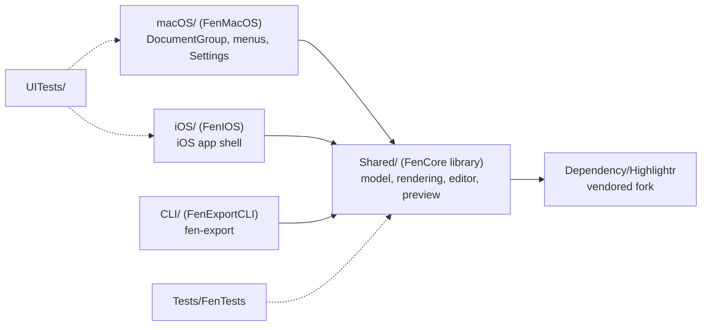
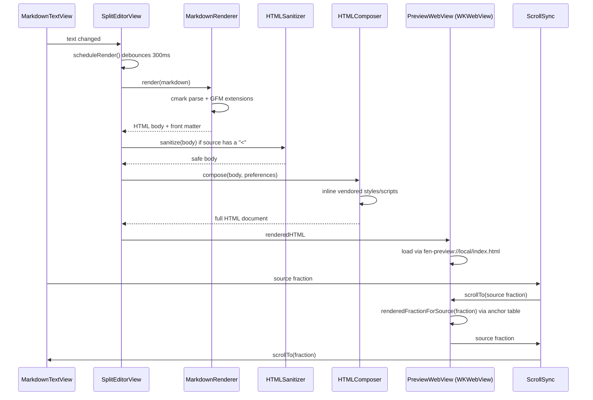
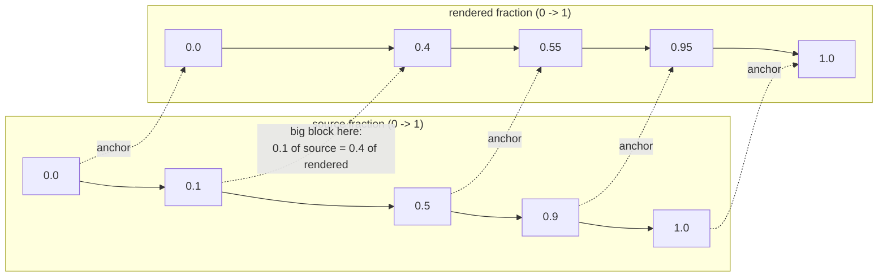
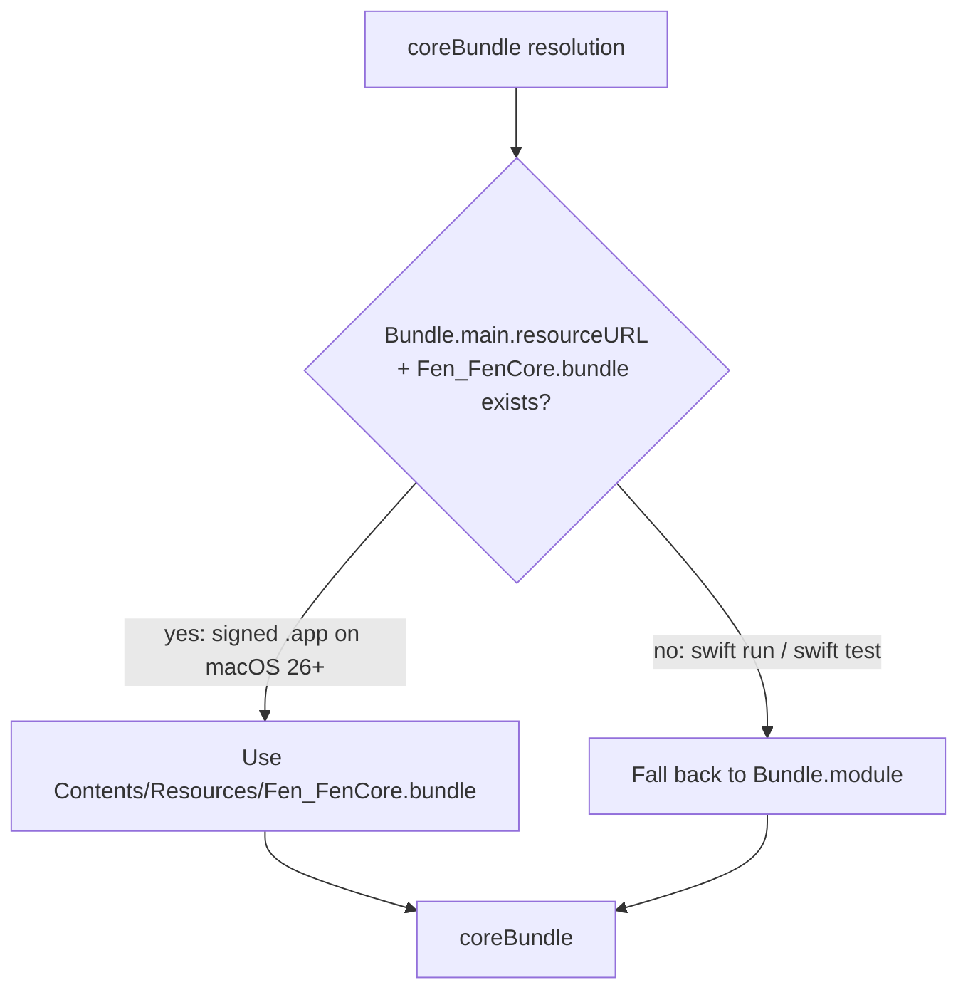
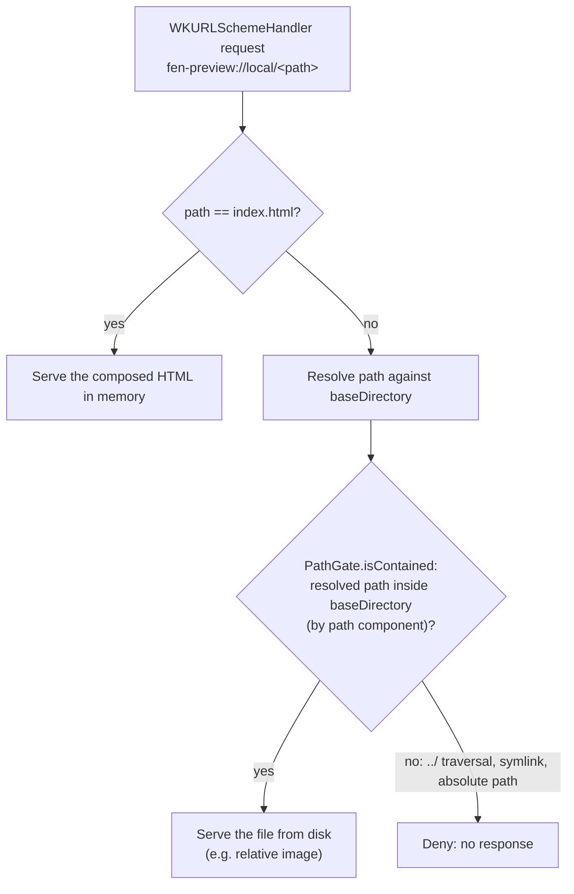
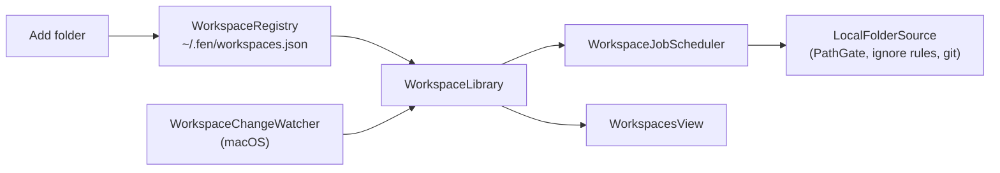
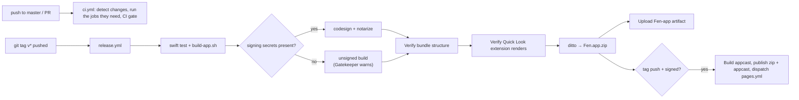

# Architecture

This covers the decisions that aren't obvious from reading the code: why things are shaped the way they are. For what's planned, see the [GitHub Issues list](https://github.com/zoharbabin/fen/issues). For project layout, see [README.md](../README.md#project-layout).

## FenCore: one model, two platforms

`Shared/` builds as the `FenCore` library. The macOS app, the iOS app and the `fen-export` CLI are thin targets on top of it.

- `FenMacOS` wires up `DocumentGroup`, menus and Settings. `FenIOS` wires up the iOS shell. `FenExportCLI` parses arguments and calls `FenCore`.
- If code doesn't need `AppKit` or `UIKit`, it belongs in `FenCore`, so both platforms get it. See [CONTRIBUTING.md](../CONTRIBUTING.md#coding-style).



## Editing to preview: the rendering pipeline

Typing renders after a 300 ms pause, and scroll sync runs on source-line fractions, not raw pixels.

- `SplitEditorView.scheduleRender()` cancels any in-flight render, waits 300 ms (skipped when `Preferences.markdownManualRender` is on), then runs `MarkdownRenderer`, `HTMLSanitizer` and `HTMLComposer`. The result goes to the `WKWebView` in `PreviewWebView`.
- `renderGeneration` drops a render that finishes after a newer one started, because the sanitize step is async.
- `ScrollSync` mirrors scroll position between the panes as a fraction (0.0 to 1.0) of the *source* document. An `isUpdating` flag stops each pane's update from re-triggering the other.
- Each pane converts between its own pixel fraction and the source fraction. The editor uses `Shared/Editor/EditorScrollAnchors.swift`. The preview uses `window.__fenScrollSync.sourceFractionForRendered` and `renderedFractionForSource`, both from `scroll-sync.js`.

**Why an anchor table.** A source line and its rendered HTML rarely take the same share of their pane. A code block, an image or a table can be tall in one and short in the other.

- `SplitEditorView` renders with `MarkdownRenderer.Options.sourcePositions = true`, so cmark-gfm emits `data-sourcepos` on every block.
- `Shared/Resources/ScrollSync/scroll-sync.js` reads those attributes to build a table of source fraction to rendered fraction, and interpolates between its points ([next section](#anchor-table-interpolation-the-shared-math)).
- The table is marked dirty by a `ResizeObserver` on `document.documentElement`, a `MutationObserver` on `document.body`, the Mermaid and MathJax ready-promises, and the font-scale zoom write. It is rebuilt on the next lookup. After a resize, WebKit clamps `scrollTop`, so `reconcileScroll` re-homes the preview to the last known source fraction.
- Don't cache the table forever, and don't skip a rebuild because a scalar (height, width) looks unchanged. A scalar can match two different layouts mid-resize.

**Scroll feedback loop.** Setting `document.documentElement.scrollTop` from `PreviewWebView` fires a DOM `scroll` event. WebKit dispatches it after `evaluateJavaScript`'s completion handler has already run. Without a guard, that event reads as a user scroll and feeds a slightly wrong fraction back into `ScrollSync`. The error grows the deeper you scroll.

- `scrollAssignmentJS` writes the exact pixel value to `window.__fenExpectedScrollTop`. The listener in `scrollObserverJS` drops only the one `scroll` event whose `scrollTop` matches, then clears the value.
- `ExternalScrollGuard` gives each assignment a generation token, so a late completion handler can't clear the gate of a newer assignment.
- Don't clear the guard from the Swift completion handler (it can fire too early). Don't tie it to `requestAnimationFrame` either: that never fires in a window with no display link, such as the off-screen window the tests use.
- `Tests/FenTests/PreviewScrollRaceVerifyTest.swift` covers this with a real, attached `WKWebView`. A paced UI-test scroll gesture is too slow to show the race.



## Anchor-table interpolation: the shared math

Both anchor tables are sorted lists of `(source, rendered)` pairs. Both fields run from 0 to 1 and only increase. Mapping a value means finding the two anchors it falls between and interpolating linearly. It never extrapolates past the first or last anchor.

- **Same breakpoints.** `MarkdownRenderer.render()` extracts `blockStartLines` from the same `data-sourcepos` attributes that `computeAnchors()` in `scroll-sync.js` walks. `SplitEditorView` passes them through `MarkdownTextView` and `MarkdownTextView_iOS` into `computeEditorLineAnchors`. So the two tables sample the same source lines and differ only in each line's *rendered* position (`NSLayoutManager` geometry in the editor, DOM layout in the preview).
- **Don't** sample the editor at its own fixed line stride. The breakpoints drift apart on long documents (issue #113).
- **Why the axes drift.** A block that's short in source but tall rendered (an image, a table, a big code block) pushes the `rendered` value of every later anchor ahead of `source`.



`interpolateEditorAnchor` (Swift) and `interpolate` (JS) implement the same lookup. Keep them in lockstep: `Tests/FenTests/CrossLanguageInterpolationTest.swift` runs identical tables and probe values through both.


**When each table rebuilds.** Both rebuild lazily, not once.

- Editor: `refreshAnchorsIfNeeded` (in `MarkdownTextView.swift` and `MarkdownTextView_iOS.swift`) re-runs `computeEditorLineAnchors` when the text, laid-out height, visible height or breakpoints change. Visible height counts because `rendered` is normalized against `totalHeight - visibleHeight`. A resize that only changes the pane height shifts it.
- Preview: `refreshAnchorsIfStale` in `scroll-sync.js` rebuilds on the next lookup after a dirty flag is set (see [the previous section](#editing-to-preview-the-rendering-pipeline)).

**Font zoom.** Font zoom (Cmd Plus, Cmd Minus, Cmd 0) changes the editor's layout without `ScrollSync` knowing. Zoom writes `preferences.fontSize` and never calls `ScrollSync.editorDidScroll`, so the fraction that `Coordinator.applyScrollFraction` receives is the same before and after a step, while every line height changed. A fraction-only guard would skip the re-apply and leave the editor offset stale against the preview. So the `Coordinator` also tracks the last applied total or content height (`lastAppliedTotalHeight` on macOS, `lastAppliedContentHeight` on iOS) and re-applies when it changes. The preview side re-derives its target on every step in `fontScaleAssignmentJS`.

## Slash-command menu, focus mode, live preview, and the editor gutter

Each editor feature is a pure logic module plus thin wiring.

- Logic lives in `Shared/Editor/` (`SlashCommandMenu.swift`, `FocusModeEditing.swift`, `LivePreviewEditing.swift`) and doesn't touch a text view. You can unit-test it without one.
- Wiring lives in a pair of `Coordinator` extensions, `MarkdownTextView+<Feature>.swift` and `MarkdownTextView+<Feature>_iOS.swift`. It also keeps the main text view files under the `file_length` lint limit.

**Slash-command menu** (issue #1)

- Typing `/` at the start of a line or after whitespace opens a filterable popup (`SlashCommandMenuView.swift`). It lists the block types in `SlashCommandMenu.entries` and runs the same `FormattingAction` the toolbar uses.
- `NSTextView` exposes only its text to accessibility. `MarkdownNSTextView` adds `accessibilityOverlaySubviews` and an `accessibilityChildren()` override. Without them, a popup added with `addSubview` is invisible to VoiceOver and XCUITest.

**Focus/typewriter mode** (Cmd+Shift+F, issues #19 and #127)

- It dims every paragraph except the one with the caret, and recenters the caret line as you type. Only the changed paragraph's dim state updates on each keystroke.
- Dimming (`editorFocusModeDimsText`) and centering (`editorFocusModeCentersCaret`) are separate preferences.
- `FocusModeEditing.activeDisplayRange` extends the caret's paragraph to the heading directly above it, so a heading never ends up dimmed while you edit its text.
- The preview mirrors the editor's range and doesn't compute its own. `notifyFocusRangeChangeIfNeeded` (in `MarkdownTextView+FocusMode.swift`) converts the range to source line bounds with `FocusModeEditing.lineRange(forCharacterRange:in:)`. `PreviewWebView` passes them as a `FocusLineRange` to `setFocusRange` in `scroll-sync.js` (through `focusRangeAssignmentJS`). That toggles `.fen-focus-dim` on every leaf `data-sourcepos` element outside the range. It uses the same leaf set as the scroll anchors, so table cells aren't dimmed one by one.
**Live preview / WYSIWYG-in-source mode (Experimental)** (Cmd+Shift+P, issues #2, #128, #135)

Live preview styles the Markdown in place, inside the editor's own `NSTextStorage`. There is no second view and no re-parsed AST. The source text stays the single source of truth.

- It hides marker characters (`**`, `#`, list bullets and more) away from the caret and applies the weight, size and color they imply.
- Turning it off restores the attributes it stashed (`livePreviewOriginalForegroundColor`, `livePreviewOriginalFont`, `livePreviewOriginalParagraphStyle`).
- It is a single-pass heuristic, not a CommonMark parser. It needs enough structure to style text, never enough to round-trip it.
- Settings labels it experimental: tables and lists are styled, not laid out, which falls short of "every construct renders inline" (issue #135).
- `LivePreviewEditing.fencedRanges` finds every fenced code block, including an unterminated one that runs to the end. `restyleLines` never styles those lines, so Python's `**kwargs` isn't read as emphasis.
- It implies the single editor pane. Enabling it forces `viewMode` to `.editorOnly` and stashes the previous mode. Switching away from `.editorOnly` turns it off. The rule lives in `SplitEditorView+LivePreviewMode.swift`.

`LivePreviewBlockStyle` styles blocks with attributes only, no overlay views, so macOS and iOS share it. `DecorationLayoutManager` draws the decorations at draw time, so they follow every resize and wrap. `LivePreviewBlockContext` classifies each line once per restyle.

| Construct | How it shows |
|---|---|
| Horizontal rule | Text hidden and tagged `fenBlockDecoration`. The layout manager draws the line. Front matter and setext underlines are never rules. |
| Bullet (`-`, `*`, `+`, not a task) | Marker hidden, round bullet drawn over it (`BlockDecoration.bullet`). The dash keeps its width, so the hanging indent lines up. |
| Ordered list | A marker with the wrong number (`1. 1. 1.`) is hidden and the right one is drawn over it, right-aligned (`BlockDecoration.number`, `LivePreviewEditing.listOrdinals`). A right marker stays as typed. |
| Fenced code | Rounded panel (`codeBlock`). The text is never touched. |
| Pipe table | Shaded bold header, delimiter line collapsed to a rule, `|` separators drawn as column lines, each cell styled for inline Markdown. `alignTable` (`LivePreviewBlockStyle+TableColumns.swift`) adds a `.kern` to each cell's last character so the columns line up. While the caret is in a table, it shows its plain source. |
| Mermaid, `geojson`/`topojson`, `$$` math, inline math | A picture while the caret and selection are away. See below. |

**Rendered pictures.** `LivePreviewRenderedBlocks.swift` finds the blocks (`RenderedBlock`). `LivePreviewSnapshots` renders each one in an offscreen web view through the export pipeline (`MarkdownRenderer`, `HTMLComposer.composeForExport` with `appearanceOverride`, `PDFRenderer.loadOffscreenWebView`). The picture matches the preview and loads only vendored scripts.

- Each kind follows its preview setting (`htmlMermaid`, `htmlMathJax`, `htmlGeoJSONMaps`), so there is no new network call. Maps keep their [documented exception](#the-geojsontopojson-map-preference-is-the-one-deliberate-exception).
- Block pictures render one at a time. They are cached by kind, source, width (40 pt steps), light or dark, and a stamp of the preview style and custom CSS. The cache holds 32.
- Inline math (`\(…\)`, and `$…$` when `htmlMathJaxInlineDollar` is on) renders at one fixed width, so a resize never redraws it. Up to 32 formulas with the same appearance share one offscreen web view. A separate cache holds 512. The matcher skips code spans, `\$` and prose like `$5 and $10`.
- A resize that crosses a width step restyles the note (`onWidthChange` on macOS, `onLayout` on iOS). A picture wider than its column is drawn smaller (`displaySize(of:column:)`). A block taller than 1600 pt is scaled down, not cropped.
- A block that fails to render (a Mermaid syntax error, a MathJax parse error) keeps its source visible. Fen retries after a minute.
- The first render shows the source until the picture arrives. After that, the older picture of the same block stands in (`standIn(for:)`), so a resize or theme change doesn't flash the source.
- A change to style, font size, custom CSS, enabled renderers or `$ $` math restyles the open note (`LivePreviewSettingsWatch.swift`).
- Block pictures: `LivePreviewBlockStyle+Rendered.swift` hides the text, sets the first line to the picture's height and tags it `fenBlockImage`. Inline pictures: the formula's first character carries a kern as wide as the picture, the layout manager draws it there (`fenInlinePicture`) on the picture's baseline, and a taller picture grows its line (`LivePreviewBlockStyle+InlineMath.swift`).

**Don't** position an overlay view (such as an image attachment) inside `beginEditing()` and `endEditing()` on `NSTextStorage`. Call `rect(forCharacterRange:)` after `endEditing()`. Calling it mid-edit crashes glyph generation.

**Editor gutter / line numbers** (issue #21)

- `editorShowLineNumbers` draws line numbers in the editor (`EditorGutterRulerView`, an `NSRulerView`, on macOS) and, separately, in the preview (`computeLineNumberAnchors()` and `renderLineNumberGutter()` in `scroll-sync.js`, gated by `window.__fenShowLineNumbers`).
- The editor derives numbers from `computeLineStartOffsets`. The preview reads the same `data-sourcepos` metadata as the scroll anchors.
- The preview uses each element's *starting* source line. Don't count every leaf: cmark-gfm gives each table cell its own `data-sourcepos`, so a multi-column row would be numbered once per cell.

## Split dividers and the outline sidebar bleeding into the toolbar (macOS 26 Liquid Glass)

On macOS 26, the split divider and the outline sidebar paint through the toolbar. `Shared/Views/SplitDividerToolbarClip.swift` masks them against `window.contentLayoutRect` (issue #111).

- **Cause.** Liquid Glass chrome makes the `NSSplitView` behind `HSplitView` (and its private `NSSplitDividerView`) extend its frame up into the toolbar's safe area. A sidebar `List`'s `NSScrollView` inherits the same frame. Pane *content* insets itself below the toolbar, but the divider hairline and the sidebar rows don't, so they draw into the title bar.
- **Fix.** The probe view walks the AppKit tree for every `NSSplitDividerView` and `NSScrollView`. It sets a `CALayer` mask on each, sized to the view's bounds intersected with `window.contentLayoutRect`. It re-masks on every `frameDidChangeNotification`.
- **Why a timer.** `viewDidMoveToWindow` and `updateNSView` don't reliably fire when a new split or scroll view bridges into the tree later, for example when you first open the outline sidebar. A `Timer` rescans on a fixed cadence while the probe is in a window. `apply()` is idempotent, so a tick that finds nothing is cheap. `updateNSView` stays as a fast-path hint.

**Don't** use `clipsToBounds`. The overlap is inside the view's own frame, so clipping to bounds removes nothing. **Don't** layer-back an ancestor of a `WKWebView` or `NSScrollView` to get a mask: that caused a blank window. Mask the divider and the scroll view directly.

If another AppKit view type inside an `HSplitView` window bleeds into the toolbar, extend `apply()`, `clip(_:to:)` and `observe(_:window:)` in `SplitDividerToolbarClip` instead of writing a second mechanism.

## Resource bundle resolution (`Shared/CoreBundle.swift`)

Always load FenCore resources through `coreBundle`, never `Bundle.module`.

- SwiftPM's `Bundle.module` looks in `Bundle.main.bundleURL`. That works for `swift run` and `swift test`. It fails in a signed `.app` on macOS 26, which needs nested resource bundles in `Contents/Resources/` (`Bundle.main.resourceURL`). A build that used only `Bundle.module` crashed when you opened a file.
- `coreBundle` checks `resourceURL` first and falls back to `Bundle.module` for local builds.
- `scripts/build-app.sh` places the bundle. `release.yml`'s "Verify bundle structure" step checks the layout, and `BundleResolutionTests` covers the resolver.



If you add an SPM resource target, make sure it lands in `Contents/Resources/` with an `Info.plist` in the packaged `.app`, and add a check for it in `release.yml`.

## Preview: a custom URL scheme, not `loadHTMLString(baseURL:)`

The preview (`Shared/Preview/PreviewWebView.swift`) loads through a custom `fen-preview://` scheme. `loadHTMLString(_:baseURL:)` sets a base URL but gives the web view no read access to that directory, so relative images (``) fail to load.

- `PreviewSchemeHandler` implements `WKURLSchemeHandler`. The main document loads from `fen-preview://local/index.html`.
- Every other request resolves against the document's directory (`baseDirectory`) in `resolvedFileURL(for:baseDirectory:)`. That asks `PathGate.isContained(_:in:)` (`Shared/Workspaces/PathGate.swift`, shared with workspaces) whether the file is inside `baseDirectory`.
- `PathGate` resolves symlinks on both sides and compares whole path components. A symlink inside `baseDirectory` can't point outside it, and a sibling that shares a name prefix (`notes-evil` next to `notes`) isn't inside `notes`.
- **Don't** replace this with a string-prefix check or add a second path check. `PathGate` is the one thing between a crafted Markdown file and arbitrary local file reads.



**Clicked links.** The same `resolvedFileURL` guard backs `internalLinkTarget(for:)`.

- A same-page anchor (`#section`) returns `nil` and stays in the preview.
- A link to a different file on disk returns that file's URL. `PreviewWebView.Coordinator` cancels the navigation and calls `onOpenInternalLink`, so the file opens as its own document. Without this, `WKWebView` would load the file's raw text as HTML.
- `PreviewSchemeHandler.shouldOpenExternally` sends other links to the system.

**Link hover.** `linkHoverObserverJS` (`Shared/Preview/LinkHoverJS.swift`) posts the hovered link's raw `href` through the `linkHoverHandler` message channel. `SplitEditorView` shows it in a status bar under the preview (macOS only).

## External file changes: telling Fen's own save from someone else's

`ExternalChangeController` (`Shared/Models/ExternalChangeController.swift`, issue #20) watches a document's `fileURL` through `ExternalFileChangeMonitor`. When the file changes on disk, it asks you to reload or keep the in-memory buffer.

- `NSFilePresenter` ignores a write only if it was coordinated through that same presenter. SwiftUI's document save path coordinates its own writes, so Fen's own save still fires the callback.
- `handleExternalChange` compares the new on-disk content with the buffer. If they match, it was Fen's own save (or a no-op touch) and there is no prompt. It also skips content that matches one of the document's `recentSavedTexts`, because an autosave can land while you keep typing and the file then trails the buffer.
- Rapid external writes join the alert that is already showing instead of stacking a second one.

## Autosave and crash recovery

`AutosaveController` (`Shared/Models/AutosaveController.swift`, issue #22) keeps a recovery copy of an unsaved buffer and offers it back after an unclean exit.

- **Rule: content divergence, not crash detection.** An entry exists while the buffer differs from the file on disk. It is deleted when they match again (you saved, or accepted or declined a restore). If the app dies, the entry is still there at next launch. No quit hook is needed.
- Recovery files live in `Application Support/Fen/Recovery/`. The identity is a SHA-256 hash of the symlink-resolved absolute path, so two paths to the same file share one entry.
- Writes are debounced: 2 s after the last edit, plus a ceiling timer that writes at least every 30 s during nonstop typing.
- `checkForSavedDocumentRecovery` and `checkForUntitledDocumentRecovery` present the restore prompt on the next main-queue turn (`DispatchQueue.main.async`), not inline from `start(for:)`. `start(for:)` runs before the window is key, and `NSAlert.runModal()` silently does nothing without a key window. Tests poll for the prompt (`pollUntilTrue`) for the same reason.

## Pasted and dropped images: sidecar asset folders

Pasting or dragging an image writes a file next to the document. It doesn't embed the image inline (issue #18).

- `ImageSidecarWriter` (`Shared/Editor/ImageSidecarWriter.swift`) writes into `<document-basename>.assets`, beside the document. The name is per document, so documents in one folder never collide. It isn't dot-prefixed, so it shows up in Finder.
- Files are named `image-N.<ext>`. The writer re-reads the folder on every write (no cached counter), so independent instances never reuse a number. It tries at most 10,000 names.
- Before writing, it resolves symlinks on the *sidecar directory* and checks the result against the resolved document directory. Resolve the directory, not the destination file: the file doesn't exist yet, so resolving it does nothing.

On macOS, `MarkdownNSTextView.preferredPasteboardType` overrides AppKit's pasteboard negotiation.

- A raw image copy (such as a screenshot) offers a modern type and a legacy alias for the same bytes. AppKit can pick the legacy alias, which `readSelection` doesn't recognize. The paste then falls through to a default inline attachment instead of `ImageSidecarWriter`.
- The override prefers the modern types and lists `.png` before `.tiff`, so a PNG keeps its original bytes instead of being re-encoded as TIFF.

## Custom CSS and per-document front-matter overrides

**Custom CSS** (`Preferences.customCSS`, issue #26). It is inlined into the preview and export HTML in a `<style>` tag, unescaped. It is the first place where text you wrote lands inside the preview's `WKWebView`, so `HTMLComposer.sanitizeCustomCSS` (`Shared/Rendering/HTMLComposer+Appearance.swift`) filters it first. It uses plain text substitution, not a CSS parser, so malformed input can't throw.

| It removes | Why |
|---|---|
| `@import` rules and every `url(...)` that isn't `data:` | Keep custom CSS from fetching remote resources, which would break the zero-runtime-network-load rule. |
| Every `</style` (case-insensitive, with or without `>`) | Keep the CSS from closing the tag early and running the rest as markup or script. |
| Text past `customCSSCharacterLimit` (8,000 characters) | Bound pathological input. |

**Per-document overrides** (`DocumentPreviewOverrides` in `Shared/Models/DocumentPreviewOverrides.swift`, issue #27). A `fen:` key in a document's YAML front matter overrides the preview theme and table of contents for that document, for example `fen: { theme: GitHub2 Dark, toc: true }`.

- It is parsed on every render. It is never saved and never written to `Preferences`.
- The braces are YAML flow style, parsed by Yams like the rest of the front matter. The indented block style parses the same way.
- Parsing degrades per field. An unknown theme name or a `toc` value of the wrong type is ignored.
- It applies only when `Preferences.htmlDetectFrontMatter` is on. Otherwise the front matter renders as literal text, and a `fen:` key in it must not drive rendering.
- `theme` is an exact bundled file name (`GitHub2 Dark`), not a family. `HTMLComposer.resolveEffectiveStyleName` converts it with `familyName(forFileName:)` and then applies the Appearance polarity, like every other theme (issue #98).

## Theme families, and independent print/export Appearance

You pick a theme *family* (`GitHub2`, `Solarized`). Light or dark comes from the Appearance setting. `htmlStyleName` and `printStyleName` store family names, never CSS file names.

- `HTMLComposer.themeFamilies` (`Shared/Rendering/HTMLComposer+Appearance.swift`) maps each family to a light file and an optional dark file. `GitHub` has no dark file, so forcing dark leaves it light.
- The Settings pickers (Preview Style, Print/PDF Theme) list families only. Each section has its own Appearance picker (Follow System, Light, Dark).
- `previewAppearanceMode` governs the live preview. `printAppearanceMode` governs Print and Export to PDF on their own (issue #98). So you can preview dark and print light.
- `printAppearanceMode` and `printStyleName` are `nil` by default, which means "same as preview".
- `HTMLComposer.resolveEffectiveStyleName` is the one function that turns a family plus an appearance into the file to load. `compose` (preview) never passes `appearanceOverride`. `composeForPrint` passes `printAppearanceMode`.
- `loadHTMLDefaults` maps an old persisted file name (such as `"GitHub2 Dark"`) to its family with `familyName(forFileName:)`.

**Syntax highlighting and Mermaid** follow the same Appearance settings and have no picker (issue #100).

- `htmlHighlightingThemeName` stores a highlighting family (`atom-one`, `github`, `solarized`, `xcode`, `default`). `highlightThemeFamilies` maps each to a highlight.js CSS file. `default` has no dark file.
- `resolveEffectiveHighlightThemeName` uses the same `resolveWantsDark` as the CSS theme, so code blocks always match the page polarity.
- `mermaidTags` picks its diagram theme from the resolved CSS file name (`effectiveStyleName.contains("Dark")`). It needs no resolver of its own.

## Export, print, and the CLI reuse the preview's rendering pipeline

Every output path renders through the same `HTMLComposer` as the live preview. Don't add a separate renderer.

- This covers Export to HTML, Export to PDF, Print, Copy as Raw HTML, Copy as Rich Text, and the `fen-export` CLI (`Shared/CLI/ExportCLIRunner.swift`).
- `compose` (preview), `composeForExport` and `composeForPrint` share one style and script assembly. A fix or feature for Mermaid, MathJax, highlighting or custom CSS reaches all outputs.
- `composeForPrint` takes a `styleNameOverride` and `appearanceOverride`, so Print and PDF use `printStyleName` and `printAppearanceMode` (issues #82, #98). They resolve through the same `resolveEffectiveStyleName` as the preview. HTML export has no theme of its own.
- The `fen:` front-matter overrides apply to export, print and the CLI too (issue #85). All three call `peekFrontMatter`, then `DocumentPreviewOverrides.parse`, like `SplitEditorView`.

**PDF and print wait for Mermaid and MathJax.** Both load the composed HTML into an offscreen `WKWebView` through `PreviewSchemeHandler`, then read the result with `WKWebView.pdf(configuration:)` or AppKit's print machinery. Mermaid and MathJax render *after* `didFinish`, so capturing right away gives blank placeholders (issue #84).

- `HTMLComposer.renderCompletionTags` injects `window.__fenRenderComplete`. The Mermaid and MathJax completion callbacks set it to `true`.
- `PDFRenderer.waitForRenderCompletion` polls it until `loadTimeout`, then captures what is on screen. It never uses a fixed sleep (see the rule in [CONTRIBUTING.md](../CONTRIBUTING.md#tests)).
- A document with neither feature never sets the flag. The check is `!== false`, so it reads as complete and plain documents don't wait.

## Highlightr fork (`Dependency/Highlightr`)

The editor's live syntax highlighting uses a vendored fork of [Highlightr](https://github.com/raspu/Highlightr), referenced as a local package in `Package.swift`. The fork has two patches. See its commit history for the code.

- **Resource lookup.** Upstream failed under the macOS 26 bundle layout described in [Resource bundle resolution](#resource-bundle-resolution-sharedcorebundleswift). The fork looks in `Bundle.main.resourceURL` first.
- **Editing calls.** The fork forwards attribute reads and edits, and `beginEditing()` and `endEditing()`, to its inner storage (`CodeAttributedString`). Without that, each attribute write fixed attributes on its own and got slower as the note grew, which made Live Preview restyling very slow on long notes. `LivePreviewPerformanceTests` guards it.

Highlighting in HTML export is separate. `HTMLComposer` loads [highlight.js](https://highlightjs.org) directly (core script, theme CSS, init script). It doesn't use Highlightr's JavaScriptCore wrapper.

## HTML sanitization: fail closed, not fail open

If sanitizing fails, the preview shows the HTML as inert text. It never shows the unsanitized markup.

cmark-gfm passes raw HTML through unchanged (`CMARK_OPT_UNSAFE`), so GitHub-style tags render. Without a sanitize pass, a pasted `<script>` or `onerror=` would reach the preview. `HTMLSanitizer` (`Shared/Preview/HTMLSanitizer.swift`, issue #118) runs the composed body through the vendored DOMPurify (`Shared/Resources/Extensions/purify.min.js`).

- **Where it runs.** In its own hidden `WKWebView`, through `evaluateJavaScript`. DOMPurify needs a real DOM, so a plain `JSContext` won't do. `evaluateJavaScript` has no synchronous form, so `sanitize(_:)` is `async`.
- **Allowlist.** `fenSanitize` in `sanitize-config.js` allows GitHub's raw-HTML tag set (`<details>`, `<sub>`, `<kbd>` and more) plus every tag and attribute Fen's own pipeline emits (cmark-gfm, GFM extensions, alert, TOC and highlight post-processing). It sanitizes the whole composed body, so a narrower list would strip Fen's own output.
- **Fail closed.** If the web view fails to load, times out (5 s in `makeWebView`) or `evaluateJavaScript` fails, `sanitize(_:)` returns the input escaped as text (`escapeAsPlainText`). Don't return the input unchanged on failure: you could then skip sanitizing by making the sanitizer fail (issue #118).
- **Recovery.** A failed load clears the cached `loadTask`, so one WebKit failure doesn't break every later call.
- **No shared state.** Each `HTMLSanitizer` owns its web view. `SplitEditorView` has its own instance. `DocumentHTMLExporter` and `DocumentPDFExporter` use `HTMLSanitizer.shared`.
- **Skip when safe.** `mayContainRawHTML(_:)` returns false when the source has no `<`. cmark-gfm only recognizes raw HTML that starts with `<`, so output is the same either way. This saves an awaited hop on most keystrokes in the preview.

## Emoji shortcodes: a post-processing pass, not a cmark extension

`:rocket:` becomes 🚀 in a regex pass over the already-rendered HTML. cmark-gfm has no emoji extension. `MarkdownRenderer+Emoji.swift` (issue #119) follows the same pattern as `applyHighlightMarkup` (`==mark==`).

- **Table.** `emojiShortcodes` is generated from GitHub's MIT-licensed `gemoji` project into `Shared/Resources/Emoji/emoji-shortcodes.json`. It holds only aliases that map to a Unicode codepoint.
- **Out of scope.** GitHub's custom branding shortcodes (`:octocat:`, `:shipit:`) are images on `github.githubassets.com`. Resolving them needs a network fetch, which breaks the local-first rule.
- **Skipping.** One regex alternation matches `<pre>` blocks, `<code>` blocks, any HTML tag, or a shortcode. Only the shortcode branch's capture is replaced. So `:shortcode:` text inside fenced code or inside a tag's attributes is left alone.
- **Unknown shortcodes** stay as typed. A typo that vanishes silently is more confusing than one you can see.
- **Hex runs.** A run of three or more colon-separated hex groups (a MAC or IPv6 address) matches before the shortcode branch. Otherwise the `de` in `3c:0b:59:de:37:25` would turn into an emoji (issue #125).

## STL 3D viewer: preference-gated, one scene per block

`` ```stl `` blocks render as an interactive 3D model with the vendored three.js, `STLLoader` and `OrbitControls` (issue #120). The scripts load only when you use the feature.

- **Gate.** `HTMLComposer.stlViewerTags` (`Shared/Rendering/HTMLComposer+STLViewer.swift`) inlines script only if `Preferences.htmlSTLViewer` is on (off by default) *and* the body contains `class="language-stl"`. A document with the preference on but no `stl` block loads nothing extra.
- **Isolation.** `stl-viewer-init.js` gives each block its own `Scene`, camera, `WebGLRenderer` and `OrbitControls` in its own container. There is no shared module state, so orbiting one viewer never moves another.
- **No injection path.** The source is read with `.textContent` and passed to `STLLoader.parse()` as a string. The loader only produces numeric arrays and never interprets markup.
- **Size cap.** `MAX_FACETS` (500,000) shows an error panel instead of parsing. A file that large risks a multi-second parse on the main thread.
- **Wireframe toggle** (issue #122). It flips the material's `wireframe` flag in place and doesn't re-parse the geometry. `canvas.__fenGeometry` and `canvas.__fenOrbitChangeCount` exist for `STLViewerIsolationTests` and `STLViewerE2ETest`. They let the tests check isolation without a `requestAnimationFrame` callback, which an offscreen `WKWebView` may never fire.

**Don't** change these two renderer settings without re-testing:

- `MeshNormalMaterial({ side: THREE.DoubleSide })`. STL files don't guarantee consistent triangle winding. With the default `FrontSide`, back-facing triangles are culled and some models render as a black frame.
- `preserveDrawingBuffer: true`. PDF export and print capture the page after the last frame. With the default, the buffer can read back blank.

## The GeoJSON/TopoJSON map preference is the one deliberate exception

`` ```geojson `` and `` ```topojson `` blocks render as an interactive Leaflet map with a live OpenStreetMap basemap (issue #121). With the preference on, the preview fetches tile images from `tile.openstreetmap.org`. This is the one preview feature that talks to the network, and it is off by default.

- **Gate.** `HTMLComposer.geoJSONMapTags` (`Shared/Rendering/HTMLComposer+GeoJSONMap.swift`) adds script only if `Preferences.htmlGeoJSONMaps` is on *and* the body contains `class="language-geojson"` or `class="language-topojson"`.
- **Why it's a carve-out, not a pattern.** Tiles load from inside the preview's `WKWebView`, not through `URLSession`, so the `grep -r "URLSession"` check in the [security section](../CLAUDE.md#security--compliance) doesn't see them. The `SettingsView` section "GeoJSON & TopoJSON Maps" says plainly that tiles come from OpenStreetMap over the internet. Don't add another remote load, even behind a preference. Vendor it instead.
- **Isolation.** `geojson-map-init.js` creates one `L.map()` per block. No shared state, so panning one map never moves another.
- **Parsing.** Source goes through `JSON.parse`, never `eval`. TopoJSON becomes a GeoJSON `FeatureCollection` through the vendored `topojson-client`, then shares the GeoJSON path.
- **Popups.** Feature `properties` (simplestyle `title` and `description`, or a property list) are built with `textContent` and DOM methods. Never use `innerHTML` or `bindPopup(string)`, so no property value can run as markup.
- **Size cap.** `MAX_SOURCE_LENGTH` (5 MB) shows an error panel instead of parsing.
- **Offline.** A failed tile fetch doesn't block the shapes. `L.tileLayer` and `L.geoJSON` are separate layers on the same map. `GeoJSONMapE2ETest` points at an unreachable host to prove it.

Leaflet and topojson-client are vendored in `Shared/Resources/Extensions/` like every other script (see [Every third-party resource is vendored](#every-third-party-resource-is-vendored-not-loaded-from-a-cdn)). One change: Leaflet's CSS refers to its marker and layer icons by relative `url(images/...)`. Those would 404, because `PreviewSchemeHandler` resolves relative paths against the document's folder. `leaflet.css` inlines the icons as base64 `data:` URIs.

## Workspaces: any number of granted folders

A workspace is a folder you grant to Fen. You can add as many as you like. Fen lists their Markdown files without opening each one. Code is in `Shared/Workspaces/`.

| Piece | What it does |
|---|---|
| `WorkspaceRegistry` | The list of granted folders, saved atomically in `~/.fen/workspaces.json`. Refuses overlaps, your home folder, a volume root, and `~/.fen`. Keeps a security-scoped bookmark per folder. If the file can't be read, Fen won't save over it, and adding a workspace is off until you fix or move it. |
| `PathGate` | The one containment check for the app. `isContained`, `resolve(relativePath:in:)` and `overlaps` follow symlinks (including dangling ones) and compare whole path components. The preview handler and every workspace read go through it. |
| `LocalFolderSource` | A `WorkspaceSource` for a folder. Read-only. Skips hidden files, `.gitignore`d files, secret-looking names, binaries, files over the size limit, and symlinks that leave the folder. Never follows a symlinked folder. |
| `GitRepository` | Reads branch, ignore rules and dirty state straight from `.git`. It runs no `git` process: the system `git` doesn't exist on iOS, and on a Mac without developer tools it opens an install prompt. `WriteGateUndoTests.noNetwork` scans `Shared/Workspaces` for `Process()`, and only `Agents/GitTool.swift` may use it (see [Agent branches](#agent-branches-an-mcp-client-commits-to-its-own-branch-your-checkout-stays-put)). Staged-but-uncommitted changes aren't detected. |
| `WorkspaceJobScheduler` | One concurrency cap for all workspaces. The frontmost workspace goes first. Jobs run at utility priority off the main actor. Background jobs wait while paused or in Low Power Mode. Listing jobs have their own lane, so the sidebar still fills in. |
| `WorkspaceChangeWatcher` | macOS: one FSEvents stream per workspace, batched into relative paths. iOS: no live watch. The library refreshes when the app returns to the foreground. |
| `WorkspaceLibrary` | What the UI observes: workspaces, file lists, git state, scan progress. With no workspaces it reads the registry and does nothing else. |
| `WorkspaceAccessPolicy` | Decides which workspaces a model-bound query may touch. A workspace with AI data access set to None is dropped from every such query, even for "all workspaces". |



## Storage and git rules: zero footprint in folders, state in `~/.fen`

Fen's own state lives in one folder, `~/.fen` (`FenHome`). In a sandboxed macOS build, `~` is the app container, so the layout is the same at a different absolute path. On iOS the top of the container is read-only, so the folder is `Library/.fen` there (`FenHome.root(inContainer:onPhone:)`). Nothing is created until something writes.

```
~/.fen/
  workspaces.json        granted folders and their settings
  ai-providers.json      AI providers (keys are in the Keychain)
  mcp-clients.json       MCP clients you allowed, with a hash of each token
  write-policy.json      the global "pause auto-approve" switch
  models/                downloaded model weights
  workspaces/<id>/
    index/               search.sqlite: words and vectors. A cache, safe to delete.
    history/             preimages/ and activity.jsonl. Worth keeping.
    proposal-stats.json  how often you keep each kind of proposal. Counts only.
    conflicts.json       the last conflict check: file hashes, passage hashes, open flags. Safe to delete.
    github-mirror.json   iOS GitHub workspaces: what was last synced with GitHub
```

| Action | What it deletes |
|---|---|
| Clear Caches (Workspaces, More) | Every `index/` folder. Fen rebuilds them. |
| `FenHome.clearHistory(id:)` | One workspace's `history/`. Call it only from an action that warns first. |
| Remove a workspace | That workspace's `workspaces/<id>/` folder. Your folder is not touched. |

Every feature that touches a workspace follows these rules.

1. **Zero footprint until you opt in.** Adding a folder writes nothing into it. No `.fen/` folder, no `.gitignore` edit.
2. **Derived state goes in `~/.fen`, never in the folder.**
3. **In-folder files exist only because you made them.** `.fen/schema.yaml` appears when you create a schema, so a team can share it through the repo. Nothing else Fen-owned goes in your folder. See [Document types](#document-types-a-plain-schema-file-typed-properties-nothing-forced).
4. **No committed index or manifest.** Graphs and indexes are computed at runtime.
5. **`git log` is the changelog.** Fen keeps no parallel change log in the repo.
6. **Small, deliberate diffs.** No auto-touched `modified:` dates or other noise. Every write is something you'd want to see in `git diff`.
7. **Fen runs no mutating git command on your branch by itself.** Commits and branches come only from the flows that own them: [agent branches](#agent-branches-an-mcp-client-commits-to-its-own-branch-your-checkout-stays-put) and sync. Agent branches only add refs under `refs/heads/fen/` and `refs/fen/`. Read-only git use is fine.
8. **AI writes keep their provenance in the activity log** and in commit trailers on commits Fen creates, never inline in files.

How the rules are enforced:

- The `FenHome` root is a parameter, and tests pass a temp one. CI fails if `~/.fen` exists after `swift test` (`.github/workflows/ci.yml`).
- `FolderSnapshot` (`Tests/FenTests/StorageRulesTests.swift`) records a folder's files and contents. `StorageRulesTests` adds, lists, reconfigures, clears and removes a workspace in a real git repo, then checks the snapshot is unchanged and `git status --porcelain` is empty. A new feature that reads or writes near a workspace adds a step to that test.
- A second test edits one note with a workspace open and checks git sees that one file change and nothing else.

Per-workspace settings (`WorkspaceSettings`) are stored with the workspace in `workspaces.json`:

| Setting | Values (default first) |
|---|---|
| AI data access | Local providers only, None, Any configured provider |
| Approval mode | Ask, Auto-approve, Off. Its write policy is in [AI writes](#ai-writes-one-gate-every-change-reversible). |
| MCP access | Off, On. Always off when AI data access is None. |
| Include and exclude globs, maximum file size | Markdown and text files, no excludes, `defaultMaxFileBytes` |
| Agent branches, sync mode, Enrich on save and schedule | See [Agent branches](#agent-branches-an-mcp-client-commits-to-its-own-branch-your-checkout-stays-put), [GitHub sync](#github-sync-clone-pull-and-push-with-the-git-you-have-a-scoped-token-in-the-keychain) and [Ask AI and Enrich](#ask-ai-and-enrich-you-start-it-one-edit-one-undo) |

## No proprietary storage format, and no cloud AI by default

Fen reads and writes plain `.md` files straight through the filesystem. It has no proprietary library or vault format.

- Features that add structure (search index, links, types) keep it next to your files, never in place of them. That keeps Fen friendly to iCloud and Finder.
- For [workspaces](#workspaces-any-number-of-granted-folders), that structure lives in `~/.fen`, not in your folder.

Your notes stay yours, so AI is opt-in. The rules are in [AI providers](#ai-providers-one-gate-no-provider-reachable-around-it) and [AI writes](#ai-writes-one-gate-every-change-reversible). The epic is [issue #3](https://github.com/zoharbabin/fen/issues/3).

- With no provider set up, no AI feature runs.
- Local providers are the default. Remote providers are opt-in per workspace.
- AI edits are reversible. Each workspace's approval mode decides whether you approve them or Fen applies them.

## AI providers: one gate, no provider reachable around it

Nothing in `Shared/AI/` runs until you add a provider in Settings, AI. With none added, Fen makes no AI request and writes no AI file. Network use is limited to two cases.

- A provider you set up. The Settings row names the host when it isn't this Mac.
- A model download you confirm ([below](#downloaded-models-a-confirmed-download-a-checked-file-an-engine-inside-fen)).

Don't make a provider `public`. A feature could then skip the gateway.

| Piece | What it does |
|---|---|
| `AIService` | The only entry point. Picks the selected provider, calls `AIGateway`, then sends. |
| `AIGateway` | Checks the AI data access of every workspace that contributed context, before any connection opens. A workspace set to None blocks all providers. Local only blocks remote ones. Unknown workspaces are refused. |
| `AIProvider` | Internal protocol. Providers are not `public`, so a feature can't skip the gateway. |
| `OnDeviceProvider` | Apple's system model (FoundationModels) inside Fen's process. No server, no download. Local. |
| `OllamaProvider` | Refuses any address that isn't loopback. Local. |
| `OpenAICompatibleProvider` | LM Studio, OpenRouter, OpenAI, and similar. Local or remote, decided by `AIEndpoint`. |
| `AIEndpoint` | Parses the address. Loopback means `localhost`, `127.0.0.0/8` and `::1` only. LAN and public hosts count as remote. Plain `http` works only for loopback and private-network hosts (`10.x`, `172.16` to `172.31`, `192.168.x`, `169.254.x`, `*.local`). Every other host needs `https`. |
| `AIHTTP` | One session factory for all providers. It refuses redirects, so a key or document can't be forwarded to another host. |
| `SecretStore` | API keys live in the Keychain (`KeychainSecretStore`), never in `ai-providers.json`. |
| `ModelStore` | Downloads or imports model weights into `~/.fen/models`. A download needs a confirmation that names the host and size. Size and SHA-256 are checked against the descriptor before the file is moved into place. |
| `EmbeddingProviderRegistry` | Refuses any embedding provider that runs off device. |
| `LlamaAnswerProvider` | A downloaded Gemma 4 model, run by llama.cpp inside Fen. Internal, like every provider. Local. |
| `LlamaEmbeddingProvider` | A downloaded embedding model (EmbeddingGemma 2 or Qwen3 Embedding). Registered like any local embedder. |

The provider list is `~/.fen/ai-providers.json` (`AIProviderStore`). Tests drive the real providers against a loopback HTTP server (`Tests/FenTests/AITestSupport.swift`). The on-device test runs only where the OS model is available.

### Downloaded models: a confirmed download, a checked file, an engine inside Fen

Settings > AI > On-device models lists the models in `ModelCatalog` that this device can run: name, size, license, languages, and Download, Cancel, Delete. Weights never ship in the app. The engine is llama.cpp ([why](spikes/on-device-runtime.md)), a prebuilt framework that `Package.swift` pulls in as a pinned `binaryTarget`.

| Step | What guards it |
|---|---|
| Choose | `ModelDescriptor.consentText` names the model, the size and the host. `ModelManager.download` is called only after you confirm. |
| Connect | `ModelStore` is the only code that opens the connection. It needs the confirmed host and size to match the descriptor, https only (plain http works only for a loopback address, which the tests use), and no host outside the descriptor's redirect list (`huggingface.co`, `hf.co`). |
| Resume | A stopped download keeps `<file>.part`. The next try asks for the rest with a `Range` header. A server that ignores it restarts the file. |
| Room | `ModelStore` checks free disk space before it starts. |
| Install | The size and SHA-256 are checked against the descriptor. A wrong file is deleted and nothing is installed. The check also runs on a file you import by hand. |
| Device | `ModelDescriptor.minimumMemory` and `platforms` keep a model that is too big off a phone. `LlamaAnswerProvider` refuses to start when the device is too hot. |
| Run | `LlamaEngineCache` holds one loaded model per role (Search, Answers) and frees it when you delete or replace the model. The engine reads the file and opens no connection. |

Answers: choose the model in Settings and `ModelManager.useForAnswers` adds a `.downloaded` provider and selects it. `AIService` and `AIGateway` treat it as any local provider. Search: the model appears in the Search picker once it is installed. Choosing it re-indexes every workspace, because the provider id is part of the index signature. If the file goes missing, `EmbedderChoice.makeProvider` falls back to the built-in model, so search keeps working.

The iOS Simulator build leaves llama.cpp out (`FEN_WITHOUT_LLAMA=1`), because the binary has no simulator slice. A download that is suspended on iOS resumes from the saved part when you start Fen again.

## AI writes: one gate, every change reversible

AI features never write to a workspace themselves. They build a `ProposedChange` and give it to `WriteGate` (`Shared/Workspaces/Writes/`). Nothing in `Shared/Workspaces/` touches the network, and `WriteGateUndoTests.noNetwork` scans it.

**What a change can be.** `EditOperation` is a fixed list: `createFile`, `append`, `insertBelow`, `setFrontMatter`, `replaceText`, `overwrite`, `delete`, `move`. `EditResultParser` turns a model's JSON into that list. It rejects everything else:

- Unknown operations, and `insertBelow`. Only Fen's own code builds that one ([Ask AI and Enrich](#ask-ai-and-enrich-you-start-it-one-edit-one-undo)).
- Extra fields, such as a URL, a scope or a tool name.
- Paths outside the run's scope.
- More than `maxEdits` (100) edits.

Document text is data. It can only end up as the text of an edit.

| Tier | Operations | Rule |
|---|---|---|
| Additive | `createFile`, `append`, `insertBelow`, `setFrontMatter` for a new key | Auto-approve allowed once you opt in. |
| Replacing | `replaceText`, `setFrontMatter` for an existing key | Auto-approve needs a separate opt-in per operation name (`autoApproveReplacing`). Schema migrations pass `exemptFromReplacingOptIn`. |
| Destructive | `overwrite`, `delete`, `move` | Always asks, in every mode, even for a change you started. |

**What the gate does with each change**, in this order:

1. The workspace must exist. Every path must be in the run's `scope` and resolve inside the root through `PathGate`. Hidden parts (`.git`, `.env`), secret-looking names, quotes and control characters, paths the workspace leaves out (`.gitignore`, exclude globs), binary files and files over the size limit are refused.
2. The file must still hash to `baseHash` (compare-and-swap). If you or another tool changed it, the write fails with `targetChanged`. Nothing is overwritten. Take the hash with `WriteGate.contentHash` when you read the file for the model.
3. `WritePolicy.mode` picks the mode, then `decide` returns apply, ask or block (below).
4. Apply: save the old bytes to `history/preimages/<path hash>-<content hash>`, write atomically with the same permissions, append to `history/activity.jsonl`.

**Modes and overrides.** The workspace default is `WorkspaceSettings.approvalMode`. Rules in `WritePolicy.overrides` match an MCP client, a path pattern, a document type or an operation. The most specific kind that matches wins (client, path, type, operation). Two matches of one kind resolve to the stricter. Off blocks. A change from an MCP client asks, unless a rule names that client. A change you start yourself counts as approved, except a destructive one.

**What forces Ask.** Auto-approve is Ask until you confirm it once, for the workspace and for each rule. The global pause (`WriteGate.setPaused`, `~/.fen/write-policy.json`) turns every auto-approve into Ask. A run over `maxFilesPerRun`, or a replacing edit that changes more than `maxChangedFraction` of a document, drops to Ask. A change that carries a `ProposalBasis` with a confidence below `WritePolicy.autoApproveMinConfidence` (default 0.8) also drops to Ask (`AskReason.lowConfidence`). A change you start yourself skips this check. Changes without a basis, like Enrich, are not affected.

**Undo.** `WriteGate.undo` restores the saved bytes only if the file still hashes to what Fen wrote, so it never overwrites your later edit. `revertRun` undoes every change of one run, newest first, and lists the ones it left alone. The log and pre-images survive a restart. `Provenance.commitTrailer` gives the `AI-Assisted-By:` line for a commit you write. Fen adds no markers to files, and `FrontMatterEditor` changes one line and keeps every other byte.

Tests: `WritePolicyTests` (matrix, precedence, parser, injection fixtures, front matter, diff) and `WriteGateTests` (CAS, scope, symlinks, caps, pause, restart, undo, and a real git repo and a plain folder end to end). The approval list and undo are in the Workspaces window, Activity. Approve All skips destructive changes, so you approve each delete, move and overwrite by hand.

## Search: one index per workspace, words and meaning, nothing leaves the Mac

`WorkspaceSearch` (`Shared/Search/`) builds and queries a search index for each workspace. You search without opening any file. The index is `~/.fen/workspaces/<id>/index/search.sqlite`. It is a cache: delete it and Fen builds it again. Nothing is created for a workspace until its first index run, and nothing is ever written inside your folder.

**Indexing.** `WorkspaceLibrary` asks for a run after each scan and each file change. The run is a `.background` job in `WorkspaceJobScheduler`, so it shares the concurrency cap and waits in Low Power Mode and while background work is paused.

- `WorkspaceIndexer` removes vanished files. It reads only files whose size or time changed, or that a file event named.
- It hashes the content. A file with the same hash is not parsed or embedded again.
- If the embedder fails on a file, the file is stored by words and read again on the next run.
- A new `.git/HEAD` triggers a rescan.
- Stop Indexing keeps the progress. It stays in force through file changes and rescans until you pick Resume Indexing or relaunch.
- Clear Caches closes the indexes, deletes them, lifts any stop and starts the runs again, even if the delete fails.

**Chunks.** `MarkdownChunker` splits a file at headings into capped pieces (`maxChunkCharacters`, `maxChunks` per file).

- Each chunk keeps its heading trail and start line. A long line can split into several chunks with the same start line, so look a chunk up by its id, not by its line.
- A `data:` URI payload is cut out before chunking. A huge run of base64-like text is skipped.
- Front matter is searchable by words but is not embedded.
- The chunker also extracts links, including those in headings. They feed a small ranking boost. Inbound counts are recomputed only after a link was added, removed or retargeted.
- A save that changes only text patches the in-memory vectors and does not reload them.

**Storage.** SQLite through the system `SQLite3` module, in WAL mode.

- Tables: `meta`, `docs`, `chunks`, `links`, and `chunks_fts`, an FTS5 table (`porter unicode61 remove_diacritics 2`) kept in step by triggers.
- A vector is 4 bytes of scale plus one `Int8` per dimension, normalized before it is scaled.
- The signature in `meta` holds the schema version and the embedder's signature. If it doesn't match, Fen drops the tables and rebuilds, so vectors from two models are never mixed.
- A damaged file is deleted, with its `-wal` and `-shm` files, and rebuilt.

**Query.** Words: a strict AND of the query terms, then a loose OR if that finds nothing, ranked by BM25. Meaning: the query is embedded, and a brute-force cosine search runs over the vectors held in memory. `HybridRanker` fuses the two ranked lists across all queried workspaces with reciprocal rank fusion, so BM25 scores and cosines need no tuning against each other. Two boosts, for files that other files link to and for files near the one you are in, are capped so they only break ties. A file appears once, with its best chunk.

**Who may be searched.** `WorkspaceAccessPolicy.eligible` filters the workspaces first. A scope never overrides a workspace's AI data access. Every search must pass a `SearchDestination`. `.model(_)` drops workspaces that don't allow that destination. The Workspaces window and related documents pass `.shownToUser`, and the MCP `search` tool passes `.mcpClient`. Searches read the indexes only, never your files.

**Scope in the search box.** The Workspaces window offers This Workspace, Chosen Workspaces (a checklist of your workspaces) and All Workspaces. `SearchScopeSelection` (`Shared/Search/SearchScopeSelection.swift`) turns that choice into a `WorkspaceScope`: ids of removed workspaces drop out, and "This Workspace" falls back to all when none is selected. Every result row names its workspace, except in This Workspace.

**The embedder.** `AppleSentenceEmbeddingProvider` is the default. It uses the sentence model that ships with the OS. It loads on first use, runs in-process, needs no download and sends nothing out.

- Each language is its own model with its own vector size. The provider asks the OS at run time which languages have one (no list in Fen) and tags every vector with its language.
- The index keeps one matrix per language. A query is embedded with its own language's model and compared only with vectors of that language. `HybridRanker` fuses that ranking with the words ranking, with a similarity floor per language.
- Where a language has no model, or the recognizer can't place a short query, a file is still found by words.
- `embed` stays English only, so the type classifier and the conflict check compare vectors in one space.

`EmbedderChoice` (Settings, AI, Search) offers other embedders. They apply after a restart and re-index your workspaces.

- A downloaded model, EmbeddingGemma 2 or Qwen3 Embedding. It covers 100+ languages in one space, so it finds a note written in another language ([Downloaded models](#downloaded-models-a-confirmed-download-a-checked-file-an-engine-inside-fen)).
- EmbeddingGemma through Ollama on this Mac.

The choice, the measurements and what we did not measure are in [docs/spikes/embedding-model.md](spikes/embedding-model.md).

**Launch and typing latency.** Headless proxy tests time the main-actor work behind launch and typing (`LaunchLatencyProxyTests`, `TypingLatencyProxyTests`). The numbers, what they don't cover and the Live Preview cost in a long note are in [docs/spikes/latency-proxies.md](spikes/latency-proxies.md).

**Tests.** Search suites live in `Tests/FenTests/`.

| Suite | Covers |
|---|---|
| `MarkdownChunkerTests`, `VectorStoreTests`, `SearchIndexTests`, `HybridRankerTests`, `WorkspaceIndexerTests`, `SearchScopeSelectionTests` | Each piece alone |
| `WorkspaceSearchTests` | The library end to end, including a real git repo that stays clean |
| `SearchQualityTests` | Real model. Hybrid beats each half. |
| `SearchPerformanceTests` | Index and query speed |
| `IndexingNoNetworkTests` | Indexes a folder with the real model while a `URLProtocol` spy and a `URLSession` creation counter watch the process. Both must stay at zero. |

`IndexingNoNetworkTests` can't see traffic from outside the process, such as a system service. `WorkspaceSearchTests.noNetwork` scans the source of `Shared/Search` and `Shared/Workspaces` for network APIs.

## Related documents: a card on request, never a panel

Related documents come from the search index only, and only when you ask. `WorkspaceSearch.related` (`Shared/Search/RelatedDocuments.swift`) calls no model and no network. It works for files you haven't opened, stays inside the workspace that holds your file, and never returns that file.

**Relatedness.**

- The longest words of the text become an any-word query. The first 600 characters are embedded for the meaning side. `HybridRanker` fuses both, as in search.
- A file that links to your file, or that your file links to, gets a small extra score (`SearchIndex.linkedPaths`).
- Each suggestion lists why it appeared: links here, linked from here, similar passage, shares words, same folder.

**Triggers.** The editor reports them through `onSelectionChange` (`MarkdownTextView`, both platforms). `EditorSelection` holds the pure rules.

| Trigger | Rule |
|---|---|
| Selected text | At least 12 characters |
| Paragraph you are writing | At least 40 characters, and only within 3 seconds of a keystroke |
| Outline heading | You rest the pointer on it, or choose "Show Related Documents" in its menu |

`RelatedController` (`SplitEditorView+Related.swift`) waits a short, cancelable moment, drops stale lookups and shows one dismissible card. The card hides when the selection clears or you keep typing. A dismissed card stays away for the same text.

**Nothing changes without a click.** "Open" opens the file. "Insert Link" hands the editor an `EditorInsertion`. A selection becomes `[your words](relative/path.md)`. For a paragraph, ` [Title](relative/path.md)` goes after it. The editor applies it through `insertText`, so Undo takes it back, and it skips the edit if the text under it changed.

Tests: `RelatedDocumentsTests`, `EditorSelectionTests`, `RelatedControllerTests`, `RelatedEditorE2ETests` (a real `NSTextView`, including Undo) and `RelatedPrecisionTests` (real model, hand-labeled; `FEN_SPIKE=1` prints the numbers).

## Wiki links and backlinks: one resolver, the preview and the panel agree

`[[name]]`, `[[name|text]]` and `[[name#heading]]` work in any file that sits in a workspace. One resolver (`WikiLinkResolver`, `Shared/Rendering/WikiLinkResolver.swift`) serves the preview and the backlinks panel, so they can't disagree.

**Resolving.**

- A name matches the way the search index matches it (`MarkdownChunker.wikiKey`): lowercase, no extension, against a file name or the whole path.
- The resolver is built from one workspace's file list, so a name can't reach a file in another workspace.
- Two files with the same name: the one nearest to the open document wins, then the shorter path, then the first alphabetically.

**Rendering.** `applyWikiLinks` (`MarkdownRenderer+WikiLinks.swift`) is a post-processing pass, like the emoji one. It skips code, existing links and tags.

- A found name becomes a normal relative link. The preview opens it through the same internal-link path as any `[text](file.md)`.
- A missing name becomes a muted span.
- A file outside every workspace, or a workspace not listed yet, keeps the text as written. `WorkspaceLibrary.listingRevision` re-renders the preview when the list arrives.
- `#heading` is accepted and ignored. The target document only gets heading ids when its own TOC is on.

**Backlinks.** `WorkspaceSearch.backlinks` (`Shared/Search/Backlinks.swift`) reads the `links` table of the index, so it lists files that aren't open. A `[[name]]` counts only when the resolver sends it to this file, so a same-named file in another folder doesn't claim the link. `BacklinksSection` shows the list under the outline, only when it has rows. Nothing is written to the folder. The index stays in `~/.fen`.

Tests: `WikiLinkTests` (including a real `WKWebView`) and `BacklinksTests`.

## Document types: a plain schema file, typed properties, nothing forced

A workspace can define document types in `.fen/schema.yaml`. A document picks one with `type: Name` in its front matter. Until you create the file, the workspace uses the built-in types (`SchemaStarters.defaultSchema`: Person, Project, Meeting, Task, Journal, Reference). Starter packs for Sales, Engineering, Writer and Student are in `SchemaStarters.packs`.

**The file.** `DocumentSchema(yaml:)` and `.yaml` (`Shared/Schema/DocumentSchema+YAML.swift`) read and write it. Fields use JSON Schema words: `type: string | number | boolean | array`, `format: date`, `enum: [...]`, `required: true`. The writer is hand-built so the layout is stable and diffs stay small. Unknown keys are ignored, so a newer minor version still loads. `schema_version` is the version of your own types, not of the file format.

**Versions.** `SchemaDiff` sorts every change into additive or breaking.

| Additive (bumps the minor version) | Breaking (needs a new major version) |
|---|---|
| New type, new optional field, added choice value, relaxed `required`, description or visibility edit | Removed type or field, changed kind, removed choice value, new required field |

`SchemaStore.save` refuses a breaking change unless the major version went up. It refuses any change that doesn't raise the version.

**The folder.** `SchemaStore` reaches the file only through `PathGate`, so a `.fen` symlink that leaves the workspace is refused. Loading never writes. `create` runs only after the confirmation in `SchemaSettingsView` and never overwrites an existing file. This is the only file Fen adds to a workspace (see [Storage and git rules](#storage-and-git-rules-zero-footprint-in-folders-state-in-fen)).

**Migration.** A breaking change opens `SchemaReviewView`. `SchemaMigration.suggestedRenames` proposes renames, `preview` lists the documents each one would touch without writing, and Save stays disabled until you have seen that list. `apply` sends one `.replaceText` per document through `WriteGate` as a user-invoked `schema-migration` run, so each change is in Activity and "revert this run" undoes the lot. Each edit must find the previewed text exactly once, so a file that changed there is skipped and listed as a failure.

**Properties.** `PropertiesSnapshot` computes the rows and the text each edit produces. `FrontMatterEditor.setRaw`, `renameKey` and `removeKey` change one line and keep every other byte. `PropertiesSection` hands the new text to `EditorInsertion.minimalEdit`, which cuts the shared start and end, and the editor applies the result like typing, so undo works. A list stored as a block is shown and not edited.

**Hints.** `SchemaHints` warns about a near-miss `type:` value, a near-miss field name, and a misspelt `type` key (edit distance with swaps). It advises only. It never blocks a save, rejects a value or edits the file. "Fix" is an undoable editor edit you click. A document with an unknown type, or none, gets no panel and opens like any other file.

Tests: `SchemaTests`, `SchemaDiffTests` (including random edits), `SchemaStoreTests`, `SchemaHintsTests`, `PropertiesSnapshotTests`, `SchemaMigrationTests`, `SchemaDraftTests`. `UITests/FenUITests/WorkspaceControlsUITests.swift` drives the Properties panel hint fix and the Document Types sheet. `SchemaReviewView` has no UI test.

## Ask your workspaces: retrieve, then answer with sources, read-only

`AskController` (`Shared/Ask/AskController.swift`) answers a question from the search index. The Workspaces window shows it through the "Ask" toggle, and the menu command "Ask Your Workspaces…" opens it. It reads only: it writes no file, and the index stays in `~/.fen`.

**Flow.**

1. `AIService.destination()` says where the provider sends content. With no provider, the controller stops and nothing connects.
2. `WorkspaceAccessPolicy` drops every in-scope workspace whose AI data access doesn't allow that destination. The controller lists those names in `skipped`.
3. The longest words of the question become an any-word query. The whole question is the meaning side. `WorkspaceSearch.search` fuses both (see Search above).
4. `WorkspaceSearch.passages` reads the best chunk of each result from the index, never from the file. `AskPrompt.fitting` trims the set to about 6,000 characters and always keeps the best passage.
5. With nothing left, the answer is "Not found in the selected workspaces." and the model isn't called. Otherwise `AIService.send` streams the answer. `AIGateway` checks the access rule a second time.

**Citations.** The model sees numbered documents, `[1] Workspace/path > Heading`. It must cite by number, or reply with the exact not-found text.

- `AnswerReading` (`AskAnswer.swift`) reads the reply. A number with no passage is invalid and never becomes a link. A statement with no valid number raises the "Some statements have no source" warning.
- Each valid `[n]` becomes a `fen-passage://n` link. Clicking one calls `DocumentJumps.request` and opens the file. The editor scrolls to the line once the document has rendered (`SplitEditorView+Jumps.swift`).
- A `Passage` carries the line where its text starts, from `MarkdownChunker`. That is the first line of text, not the blank lines after a heading. A test reads the real file and checks that the cited lines hold the cited text.

Tests: `AskAnswerTests`, `AskControllerTests` (loopback provider: citations, not found, no write to the folders, no text from a workspace set to None, a remote provider, cancel), `MarkdownChunkerTests` and `AskPrecisionTests` (real model, hand-labeled; `FEN_SPIKE=1` prints the numbers).

## Ask AI and Enrich: you start it, one edit, one Undo

`InlineAIController` (`Shared/InlineAI/`) rewrites the selection (or the paragraph at the caret) and enriches bullets. The toolbar's sparkles button opens the panel (`Shared/Views/InlineAIView.swift`). It is off in Preview mode, and so are the Properties controls, because their edits go through the editor.

**One edit.** The answer streams into the panel (`streamed`). The document is not touched until the answer is complete. Then the controller builds one `EditorInsertion` and hands it to the editor (`SplitEditorView+InlineAI.swift`), which applies it through the text view's undo stack, so one Cmd+Z restores the original. If the text under the range changed while Fen worked, the edit is refused. "Preview before applying" (`Preferences.inlineAIPreviewFirst`, in the panel and in AI settings) holds the edit until you click Apply. It never changes the workspace approval mode.

**Context.** The default scope sends only the selected text (`InlineRewrite.request`). "Whole document" sends the document for that call, up to 60,000 characters.

**What may run.** `InlineAIAccess.reason` is the one check, for the editor and for files. All three must hold:

- A provider is set up (#4).
- The workspace write rules don't turn the operation Off.
- The workspace AI data access allows the provider's destination.

A file in no workspace goes to a local provider only. `AIGateway` checks again at send time.

**Enrich.** Enrich adds sourced facts under your bullets and never changes a line you wrote.

- `Enrichment.bullets` finds list items outside code fences.
- `EnrichmentPipeline` searches the index (never the file itself, never a file on disk) for passages per bullet. It stops with a reason when none support them.
- It sends the numbered passages. `Enrichment.facts` keeps a fact only if it cites an existing passage and shares a content word with it.
- `Enrichment.apply` puts each kept fact right under its bullet as `    - fact ([Heading](relative/file.md#slug))`. Running it twice adds nothing.
- `HeadingAnchor.slug` is the function the preview uses for heading ids, so the link lands on a real anchor.

**Whole files and the write rules.** `FileEnricher` enriches the short bullets (up to 12 words) of one workspace file, from the file list's context menu ("Enrich Bullets"). Nobody watches that run, so the change goes to `WriteGate` with `invokedByUser: false`, operation `enrich` and `insertBelow` (additive). The workspace approval mode decides:

| Mode | Result |
|---|---|
| Ask | Queues a diff. Writes nothing |
| Auto-approve | Writes and logs it with undo |
| Off | Does nothing and sends nothing |

The gate's hash check refuses the write if the file changed after Fen read it.

**Enrich on save.** An optional per-workspace setting (`WorkspaceSettings.enrichOnSave`, off by default).

- `MarkdownDocument` reports each save to `EnrichOnSave` (`Shared/InlineAI/`). It waits for a quiet period, then runs the same `FileEnricher` as a background job under the shared job cap. The approval mode decides as above.
- A burst of saves runs once.
- A file whose content Fen last wrote, or already looked at, is skipped. A write by Fen never starts another run.
- With no provider, or when AI data access says no, nothing runs.

**Enrich on a schedule.** `WorkspaceSettings.enrichSchedule` is Off, Daily or Weekly. It runs only while Fen is open.

- `EnrichOnSave.runDueSchedules()` checks every 15 minutes. A due run is one background job per workspace.
- It takes the files whose modification time in the workspace listing is newer than a saved cursor, oldest first, at most 20 per run. Each goes through the same path as on-save, with the same skips. The rest wait for the next run.
- The last run time and the cursor live in `Workspace.scheduledEnrich` in `~/.fen/workspaces.json`, not in the settings, so saving the settings form never resets them.
- Turning a schedule on only starts its clock. A run with no provider, AI data access None or approval Off leaves that state alone.
- The job scheduler holds background jobs in Low Power Mode.

Tests: `InlineAITests` (target, prompt, reply cleaning, bullets, fact checks, placement, heading slug), `InlineAIControllerTests` (streaming never touches the document, Stop, preview, stale text, scopes, provider and workspace rules, citations that resolve to a real file and heading, no supporting note), `InlineAIEditorE2ETests` (a real text view: one Undo), `FileEnricherTests` (Ask queues, Auto-approve writes and undoes, Off does nothing, hash check, `insertBelow` rules).

## Types and links: a local guess first, the model only for close calls

`ClassificationRun` (`Shared/Classify/`) reads a workspace's notes through the same `WorkspaceSource` as the index and proposes three kinds of change. Every one is a `ProposedChange` with `invokedByUser: false` and a `ProposalBasis` (method, confidence, detail, evidence). The gate decides. "Types and Links" in the workspace header starts a run. The run is a cancelable task, and Stop keeps what was already submitted.

| Operation | Edit | Tier | Basis |
|---|---|---|---|
| `classify` | `setFrontMatter(type)` | Additive for an untyped note. Replacing for a typed one (only with "Also re-check notes that have a type") | The type's name and description, or the model's answer, with the start of the note as evidence |
| `resolve-links` | `replaceText` of the front matter head | Replacing | The field, the mention, the note it matched and how (title, file name, part of a name) |
| `create-stub` | `createFile` | Additive | The field with the most resolved names. The stub copies the type and folder of its siblings |

**Types.** `TypeClassifier` compares the note's embedding (`WorkspaceSearch.embedding(of:)`, on this device, no network) with each type's name and description.

- Notes already typed in the workspace count too. Up to ten per type are blended in (`TypeClassifier.blend`), so a type is matched by what its notes look like. A re-check ignores them, so a note's current type can't vote for itself.
- A clear winner becomes a proposal.
- A close call goes to the provider, but only if `InlineAIAccess.reason` allows it. The close types are the only choices (`ModelClassification` rejects any other answer). `Options.maxModelCalls` caps the calls per run.
- With no provider or no access, the top type is proposed at 0.5 and waits.

**Confidence.** An on-device match claims at most `ClassificationRun.embeddingCeiling` (0.75). That is below the default threshold, so by default these matches wait for you. The spot check with the real model (`TypeClassifierPrecisionTests`, `FEN_SPIKE=1` prints it) showed that description matches alone are often wrong. A provider's "high" is 0.9. Lower the threshold in the workspace settings once the Activity view shows you keep most of what Fen proposes.

**Links.** `LinkPlanner` reads the text and list fields of typed notes, never the body.

- `LinkResolver` matches a name to a note by exact title (0.95), file name (0.9) or part of a name (0.7). A name that matches several notes is left alone and reported.
- A rewritten value is the quoted wiki link `"[[Jane Doe]]"`. Changing a field is Replacing, so it needs `autoApproveReplacing` to include `resolve-links`.
- A stub is offered only for a field where at least two names resolved, so a free-text field doesn't fill the folder with notes. A stub is never applied on its own (0.6). `createFile` on an existing path fails, so an existing note is never overwritten. An `overwrite` is Destructive and always asks.

**Duplicates and stats.** A second run doesn't queue a change that already waits for the same operation and path. `WriteGate` counts what happens to each operation (`auto`, `accepted`, `dismissed`) in `~/.fen/workspaces/<id>/proposal-stats.json` (`ProposalStatsStore`). Counts stay on this device. The Activity view shows the kept share per operation.

Tests: `TypeClassifierTests`, `LinkResolutionTests` (pure parts), `ClassificationRunTests` and `ClassificationLinkRunTests` (a real library, gate and loopback provider: queue, threshold, per-type and per-path rules, retyping, stubs, stats, no request without access), `TypeClassifierPrecisionTests` (real model, loose bounds).

## MCP server: a loopback listener, off by default, reads through the index, writes through the gate

Fen can serve your workspaces to a tool on the same Mac over [MCP](https://modelcontextprotocol.io) (issue #10). It is off until you turn it on, it answers only on loopback, and it is the one place Fen **listens** for network traffic. It makes no outbound request, and no tool takes a URL or a command, so a client can't make Fen fetch anything. The `URLSession` grep in [CLAUDE.md](../CLAUDE.md#security--compliance) doesn't see a listener, so grep `NWListener` too. It may appear only in `Shared/MCP/MCPServer.swift`.

| Part | Job |
|---|---|
| `MCPServer` | Carries bytes. `NWListener` bound to `127.0.0.1` with `requiredLocalEndpoint`, so no other address answers. One request per connection. Caps on open connections and on time to send a request. The time limit ends once the request is in, so a slow answer is not cut off |
| `MCPHTTPParser` | Reads one request. Hard limits on header size, header count and body size. Refuses chunked bodies, repeated headers and bad lengths |
| `MCPRequestGuard` | The checks every request passes, in order. Pure functions |
| `MCPEndpoint` | Runs the guard, then the method. No socket, so tests call it directly |
| `MCPTools` | The tools. The one place that decides which workspaces a client may reach (`accessible(to:)`) |
| `MCPClientStore` | Clients and tokens in `~/.fen/mcp-clients.json` |
| `MCPController` | Starts and stops the server. Mac only: iOS never starts one |

**Guard order.** `MCPRequestGuard` runs these checks in order. The first failure ends the request.

1. `Host` is `127.0.0.1`, `localhost` or `[::1]` on the listener's port, or the answer is 403.
2. A request with an `Origin` must come from that same address. Checks 1 and 2 stop DNS rebinding: a web page that rebinds a name to `127.0.0.1` still sends its own name as `Host`.
3. The path is `/mcp` and the method is POST.
4. The bearer token is known (401). Because the Host check runs first, a web page learns nothing about tokens.
5. The content type is JSON and the body is one JSON-RPC request.
6. The `Mcp-Method`, `Mcp-Name` and `_meta` version agree with the body.

**Protocol.** Fen speaks MCP revision 2026-07-28 and also answers 2025-11-25 clients. Both are stateless: no session id, no GET stream, no server push. `server/discover` and `tools/list` set `ttlMs` to 0 and `cacheScope` to `private`, because the list depends on the client. Revisions and field names come from the public MCP specification, so recheck them before you change this code.

**Who sees what.**

- A client reaches a workspace only when all three hold: the client lists it, the workspace's Agent access is On, and its AI data access is not None (`MCPTools.accessible(to:)`).
- Asking for a workspace the client can't reach gives the same error as asking for one that doesn't exist.
- A new client sees nothing until you pick workspaces for it.
- A client has a level: Read only, or Read and propose changes. A read-only client doesn't see `propose_edit` and can't call it.

**Tools.** `list_workspaces`, `list_documents`, `search`, `get_document`, `get_links`, `get_schema` and `propose_edit`. Only `propose_edit` writes.

**Reads.** `search` uses the shared index, so it finds files nobody has open. `get_document` and `get_links` read through the workspace's `LocalFolderSource`. It refuses hidden files, secret-looking files, files over the size limit and anything outside the granted root, symlinks included. Turning the server on widens nothing beyond that. Document text comes back as data, and the server's instructions tell the client not to follow instructions inside it.

**Writes.** `propose_edit` builds a `ProposedChange` (operation `mcp.<op>`, `invokedByUser: false`, the client's name, provider `mcp`) and submits it to `WriteGate`, the same gate as every other AI write.

- `EditResultParser` checks the edit. A path outside the edit's own scope is refused.
- `baseHash` (the `contentHash` from `get_document`) is required except for `createFile`, so a stale view can't overwrite newer text.
- `WritePolicy.mode` caps a client's change at Ask unless a rule of kind client names that client. The workspace default and path or type rules can't auto-approve it.
- Activity shows the client's name on each change.
- A client can have up to 50 changes waiting for review (`WriteGate.maxPendingPerClient`). Past that, `propose_edit` returns an error until you review some.

**Tokens.** A token is `fen_` plus 32 random bytes. Fen shows it once and stores only its SHA-256 hash, in a file only you can read (mode 0600). A new token replaces the old one at once. Removing a client ends its access on the next request. If the client file can't be read, no client can connect.

Tests: `MCPRequestGuardTests` and `MCPHTTPParserTests` (every rule, no socket), `MCPClientStoreTests`, `MCPEndpointTests` (a real library and gate: scoping, reads, Ask, rules, bad edits), `MCPWritePolicyTests`, and `MCPServerTests` (real sockets: bound to loopback, rebinding Host, size cap, slow client, slow answer, connection cap).

## Agent branches: an MCP client commits to its own branch, your checkout stays put

In a git workspace, a Read-and-propose MCP client (issue #93) does not write to your files. Each client gets one branch, `fen/<client>`, and every applied change is a commit on it. You merge when you want: `git merge fen/claude`. Two agents never share a checkout, so one can't overwrite the other.

**What Fen does in your repo.**

- Fen builds each commit with plumbing (`hash-object`, a private temporary index, `write-tree`, `commit-tree`) and moves the branch with `update-ref <ref> <new> <old>`.
- Your `HEAD`, index and working tree are never touched, and no hook runs.
- The branch starts at your current `HEAD`. After you merge it, the next change moves it forward to `HEAD` again.
- The commit author is the client, so `git log` shows who did what.
- Besides these branches and the claim refs below, the only other thing Fen writes to `.git` is [GitHub sync](#github-sync-clone-pull-and-push-with-the-git-you-have-a-scoped-token-in-the-keychain), and only when you pull or sync.

| Part | Job |
|---|---|
| `GitTool` | The only code that starts a process. Finds a real `git` (never `/usr/bin/git`, which opens an install prompt without developer tools). Hooks, fsmonitor, signing and gc are off. macOS only: on iOS there is no `git`, so there are no agent branches. Conflict checks and GitHub sync use it too |
| `AgentBranches` | Branch names, reads, commits, claims. Knows nothing about approval |
| `WriteGate+AgentBranches` | `submitRouted`, `approveRouted`, `undoRouted`, `revertRunRouted`, `agentRead`. Same policy, pre-images, provenance and activity log as in-place writes. The commit carries the `Fen-*` trailers and `AI-Assisted-By` |
| `AsyncLocks` | One writer at a time per branch inside Fen |

**What an agent sees.** `get_document` returns the file as the agent's branch has it (with a `branch` field), or your version if the agent hasn't changed it. A branch read follows the same rules as your files: hidden, ignored, excluded, not-included and secret-looking paths are refused. `propose_edit` checks `baseHash` against that view.

**Safe when agents race.**

- A commit is a compare-and-swap on the branch tip. If the tip moved, the write fails with `branchMoved`, and nothing is lost.
- Two writes to one file from one agent: one wins, the other gets `targetChanged`. Both errors reach the client with `"retry": true` and a hint to read the file again and repeat the edit.
- Two agents editing the same file each keep their own change on their own branch. Git reports a conflict when you merge both, and you decide what wins. [Conflict checks](#conflict-checks-whats-new-against-whats-near-a-cheap-pass-first-a-fix-only-through-the-gate) can flag the notes that disagree.
- **Claims.** A new file is claimed by the agent that creates it, for 10 minutes, in `refs/fen/claims/*`. Another agent that tries the same path gets an error that names the holder. Claims are advisory and cover only new paths, not every write.

**When Fen falls back to in-place.** `WorkspaceSettings.agentBranches = .inPlace`, a folder with no git repo or no commit yet, or a file git doesn't track. Those changes go through the normal write flow, in your files, with the usual approval rules. The Activity view shows the branch and commit of each routed change, and Undo adds a reverse commit (it refuses if the branch file changed since).

Tests: `AgentBranchesTests` (real git: no-touch guarantee, CAS, claims), `WriteGateAgentBranchTests` and `WriteGateAgentBranchUndoTests` (races, create, move, delete, undo, restart), `MCPAgentBranchTests` (end to end over the tools, plus an eight-agent load test).

## Conflict checks: what's new against what's near, a cheap pass first, a fix only through the gate

"Conflicts" in the workspace header (issue #94) finds notes that now disagree, such as "ship every 2 weeks" in one note and "every 4 weeks" in another. A run never reads the whole workspace. It compares what changed since the last run with the notes near it. It writes nothing to your folder.

**Delta.** `ConflictDeltaFinder` lists the notes changed since the last run.

- In a git workspace it runs `git diff --name-only <last-run commit>` plus untracked files (read-only, through `GitTool`). With no git, or when the saved commit is gone, the hashes alone decide.
- Each candidate is checked against the content hash saved in `conflicts.json`, so a commit that touched a file without changing it costs nothing.
- A run checks at most 40 notes, the most recently modified first (`Options.maxDocuments`). The rest wait. The saved commit moves forward only when nothing was left waiting.
- Inside a changed note, only passages with a new hash are checked. `ConflictPassage` makes a passage of each paragraph and each top-level list item. It skips headings, code and front matter.

**Neighborhood.** For each changed note, `ConflictNeighborhood` takes up to 8 notes (`Options.maxNeighbors`), in this order:

1. Notes it links to or from.
2. Notes whose meaning is close to its new passages (`WorkspaceSearch.related`).
3. Notes in the same folder. A note at the top level has no folder mates.

**Two tiers.**

| Tier | Where | What it does |
|---|---|---|
| 1. Candidates | On this device, no network, no model call | Embeds the new passages and the neighbors' (cached by passage hash), keeps pairs at cosine 0.6 or more, then keeps pairs with a mark of contradiction (`ConflictSignals`: one side negates, the numbers differ, an opposite word pair, a "no longer" cue in the new text) or a near copy at 0.85 or more |
| 2. Judge | Your provider, only if `InlineAIAccess.reason` lets it see both notes | One call per candidate, up to `Options.maxModelCalls` (20) per run. The reply is strict JSON (`ModelConflictJudge`). "No conflict" drops the pair |

Without a provider, or without access, a pair with a mark is flagged from the marks alone, at a confidence of at most 0.5 (`ConflictRun.signalCeiling`). A near copy with no mark is not flagged. The run says when no model was used and why.

**Cost.** A full pass compares every passage with every other, so it grows with the square of the workspace. A run grows with the size of the edit. `ConflictCostTests` (in `ConflictQualityTests.swift`) edits one note in a 40-note workspace and checks that the run compares under 5% of the pairs a full pass would, makes fewer than 10 candidates and still finds the planted conflict. Run `swift test --filter ConflictCostTests` to print the numbers. The workspace is synthetic and the stand-in embedder is a bag of words, so read it for the shape, not as a benchmark.

**Quality.** `ConflictPrecisionTests` (same file) runs 20 hand-labeled pairs (10 real conflicts, 10 that are not) through tier 1 with no model. The bounds are loose: 0.8 precision and recall with the stand-in embedder, 0.6 with the real on-device model (`FEN_SPIKE=1` prints its numbers). Tier 1 can raise false alarms. Tier 2 exists to drop them, so set a provider for best results.

**Flags.** A flag keeps both passages' text and content hashes. State is `~/.fen/workspaces/<id>/conflicts.json` (`ConflictStore`). The repo gets no log or index.

- `ConflictFlag.locate` finds a passage again by its hash, wherever it moved in the file. Commits in between don't matter.
- If a passage no longer exists, the flag is stale and the next run removes it.
- A dismissed pair is remembered by a key of both hashes and is not flagged again.

**Fixes.** `ConflictResolver` asks the model to rewrite one side so it agrees with the side you keep. The scope is one passage or the whole note body.

- It drafts from, and hashes, the version the fix lands on: the note on `fen/conflicts` (`WriteGate.agentRead`), or the file on disk when there is no branch. A note with uncommitted edits can still be fixed, and your edits stay.
- It checks the draft before queuing it. The draft must change the text, stay close in length, and add no link, web address or wiki link.
- The result is one `replaceText` change: operation `resolve-conflict`, `invokedByUser: false`, a `ProposalBasis` with the flag's confidence and explanation, and `branchAs: "Conflicts"`.

The write rules decide what happens next.

- **Default: Ask.** Replacing text asks unless the workspace's `autoApproveReplacing` includes `resolve-conflict`. With no opt-in, nothing is written.
- **Auto-approve** needs that opt-in and a git branch. The fix is then its own commit on `fen/conflicts` (see [Agent branches](#agent-branches-an-mcp-client-commits-to-its-own-branch-your-checkout-stays-put)), with trailers that name the agent. Fen never merges that branch. Without a git branch the fix asks (`AskReason.noBranch`).
- A rewrite that changes more than `maxChangedFraction` of the note asks even with the opt-in.
- **Revert.** Undo from Activity, or "Undo Fix" in the Conflicts sheet, at both scopes. It adds a reverse commit, and the flag opens again. A rejected fix opens the flag again too.

Tests: `ConflictPassageTests`, `ConflictDeltaTests` (real git), `ConflictDetectorTests`, `ConflictUnitTests`, `ConflictRunTests` and `ConflictGitRunTests` (a real library, gate and loopback provider: no write to the folder, idle second run, caps, cancel, git boundary, stale flags), `ConflictResolverTests` (the default never writes, opt-in, branch commit, a target with uncommitted edits, undo, bad drafts), `WriteGateBranchAsTests`, `ConflictPrecisionTests` and `ConflictCostTests`.

## Version history: the system keeps versions, Fen shows them

Fen keeps no history of its own for a single document. `DocumentGroup` saves through `NSDocument`, and the system adds an `NSFileVersion` on each save. Fen only adds a way to browse and restore them (issue #59).

| Platform | What you get |
|---|---|
| macOS | File > Browse Version History… (`macOS/FenApp_macOS.swift`) sends `browseVersions:` to the front document, the same action as Revert To > Browse All Versions…. Revert To Saved works too. |
| iOS | `VersionHistoryButton` in the toolbar opens `VersionHistoryView` (`Shared/Versions/`). It lists the versions, shows the text of one, and restores it after a confirmation by setting `document.text`, which you can still undo and which saves like any edit. |

`FileVersionHistory` (`Shared/Versions/FileVersionHistory.swift`) is read-only. `versions(of:)` merges `otherVersionsOfItem` and `getNonlocalVersionsOfItem`, newest first, without the current version. `text(of:)` reads through `NSFileCoordinator`, which downloads an iCloud version first.

Limits:

- iOS can't create versions (`addVersionOfItem` is macOS only). An iOS document has history only when iCloud made it.
- The system drops versions when you copy or move a file to another volume, duplicate it, Save As, move it into or out of iCloud, or restore from a backup.
- iCloud doesn't sync the full version chain between devices (see [Eclectic Light](https://eclecticlight.co/2022/08/05/how-macos-versions-help-you-recover-from-errors/)). In a manual run on a Mac and an iPhone, the iPhone listed only some of the Mac's versions, each marked "In iCloud". That check depends on iCloud timing, so it's manual and not in CI: `scripts/test-icloud-device.sh`.
- On a phone in portrait the toolbar actions (outline, focus mode, formatting, export, Version History) sit in the More menu, because the bar cuts off what doesn't fit (`SplitEditorView.toolbarPlacement`).

Tests: `FileVersionHistoryTests` uses real `NSFileVersion`s (order, current version excluded, missing file, no writes). The menu item and the iOS sheet have no UI test.

## GitHub sync: clone, pull and push with the git you have, a scoped token in the Keychain

A GitHub workspace is a normal git work tree (issue #60). You clone a repository into a new folder, and it becomes a workspace like any other. Fen adds no file to it: no index, no manifest. `git log` is the history, and a sync commit holds only the notes you changed. Fen runs the `git` you have, through `GitTool`.

| Step | What runs (`Shared/Sync/GitSync.swift`) |
|---|---|
| Clone | `git clone` into an empty folder Fen made. `GitHubCloner` checks the folder against your other workspaces first and removes it if anything fails. |
| Pull | `git fetch`, then `git merge --ff-only`. It never overwrites a file you edited. If both sides have new commits, it goes to [Conflicts](#conflicts-no-silent-pick-no-merge-tool). |
| Commit | One commit for the changed notes, with `git commit --only` and a path list. Files that look like secrets (`.env`, keys, `secrets.md`) are never added (`FileEligibility.looksSecret`). |
| Push | `git push` of the current branch, never forced. If GitHub has new commits, it says to pull first. If GitHub refuses for another reason, such as a protected branch, it shows GitHub's reason (`SyncError.pushRefused`). |

Opening a GitHub workspace pulls once, when that's safe. The Sync button pulls, commits and pushes, and stops at the first step it can't do safely.

### Which folders sync

Rule: the token goes only to folders whose git settings can't run a program or redirect a request.

A repository's `.git/config` can run programs (`filter.*`, `core.sshCommand`, `core.fsmonitor`) or send requests elsewhere (`url.*.insteadOf`, `http.proxy`). Those would run with the token in their environment. Before each open, pull or sync, `GitSync.refusal(at:)` (`Shared/Sync/GitSync+Trust.swift`) checks the folder:

- The workspace folder must be the top of the repository. A folder inside one is refused, because git names paths from the top.
- A folder Fen cloned (`WorkspaceSettings.clonedByFen`, set by `GitHubCloner`) syncs.
- Any other folder syncs only when every key in its `.git/config` (read with `--no-includes`) is on the safe list: `core.*` basics, `remote.<name>.url`/`fetch`, `branch.*`, `user.*`, `pull.rebase`/`pull.ff`, `push.default`/`push.autosetupremote`. Anything else, such as `include.path`, `credential.helper` or hook and filter settings, turns sync off for that folder.

A refused folder shows an orange warning with the reason, and no git command for it gets the token. `GitSync.environment(at:)` runs the same check, so a caller that skips the model still can't hand over the token.

### Token

- Accepted: a fine-grained token for one repository, or a GitHub App token (`GitHubToken.validate`). Refused: classic `ghp_` and OAuth `gho_` tokens, because they reach every repository you have.
- Stored in the Keychain: `KeychainSecretStore`, service `app.fen.github`, one item per repository, this device only. Fen saves it only after a clone or token check worked.
- Sent to git as an HTTP header in the process environment, for `https://github.com/` only. Never in a command line, `.git/config` or a URL. Stored git logins are switched off.
- Errors are cleaned of the token and of its base64 header form before you see them.

### Network

Git talks to the one remote you cloned from, and only for a workspace whose `origin` is on GitHub and that passes the check above. The only `URLSession` use is `GitHubREST` (`Shared/Sync/GitHubAPI.swift`), for pull requests and for the iOS copy below. It talks to `api.github.com` only, follows no redirect, and sends the token in the `Authorization` header of those requests only.

### On iOS: a copy through the API

iOS can't run `git`, so "Clone from GitHub…" on the Workspaces screen makes a plain copy of the default branch (issue #60, `Shared/Sync/GitHubMirror.swift`). The copy goes into a folder named after the repository in Fen's Documents folder, and becomes a workspace. The folder holds only the repository's files: no `.git`, no state file. What the last sync saw lives outside the folder, in `FenHome.mirrorFile(id:)`.

| Step | What runs |
|---|---|
| Clone | Reads the default branch's file tree and each file (`GitHubREST+Git.swift`: `git/trees`, `git/blobs`). It skips `.git`, files that look like secrets, symlinks, submodules and files over 2 MB. Fen saves the token only after the copy worked. |
| Pull | A three-way compare of each note: what the last sync saw, what's on this device, what's on GitHub. A note you didn't change takes GitHub's version. A note you changed is never overwritten. If GitHub changed it too, it becomes a conflict, and nothing happens to it until you choose Keep Mine or Use GitHub's. |
| Back Up | Pulls first and stops while any conflict is open. Then it sends every changed note as one commit on top of the newest GitHub commit (`git/blobs`, `git/trees`, `git/commits`, then a ref update with `force: false`). If the branch moved meanwhile, it pulls and tries once more. A deleted note is deleted in the commit. |

Nothing syncs by itself, because iOS may suspend the app at any time. Opening a workspace pulls, and the Back Up button backs up. The AI-change hold-back works as on the Mac.

Limits:

- Direct commit only. There's no pull request mode.
- Files over 2 MB (`GitHubMirror.maxFileSize`) stay on GitHub. Fen never sends or deletes them.
- A repository too big for one tree listing is refused (`MirrorError.treeTooLarge`).
- Every path from GitHub goes through `PathGate`. A path that leaves the folder stops the clone (`MirrorError.unsafePath`).

### Sync tests

- **iOS:** `GitHubMirrorTests` (with `FakeRepository`, an in-memory GitHub) and `GitHubRESTGitTests` (a `URLProtocol` stub).
- **Mac:** `GitSyncTests`, `GitHubSyncModelTests` and `GitSyncTrustTests` use a local bare repository in place of GitHub. They cover clone, fast-forward, diverged and blocked pulls, one-file commits, the secret filter, no force push, a refused push, the token header going to github.com only, a folder whose settings run a program never seeing the token, a folder inside a repository, and Fen writing nothing into the folder.
- **Real GitHub:** `LiveGitHubSyncTests` runs a round trip against a throwaway repository and your own token. It runs only when you set `FEN_LIVE_GITHUB_REPO` (see the suite's header comment). CI doesn't run it.

### Sync modes: back up, or review with pull requests

You pick a mode per workspace (issue #61, `WorkspaceSettings.syncMode`). Both use the same git steps above.

| Mode | What it does |
|---|---|
| Back up to GitHub (`directCommit`, default) | Commits your changes to the branch you cloned and pushes. Once you pick this mode, it backs up about 20 seconds after your last change. Nothing in the text says "commit" or "push". |
| Review with pull requests (`pushAsPR`) | Commits to a working branch `fen/changes-yyyyMMdd-HHmmss` (UTC), pushes it and opens a pull request through the GitHub API. It needs a token. You merge on GitHub. |

**AI changes are held back by default.** A note with uncommitted changes and an in-place AI edit (not on an agent branch, not undone) newer than the note's last commit stays out of the commit. Turn on "Back up AI changes too" for a workspace to include them, or use "Back Up AI Changes Now" once. Fen commits with `git commit --only` and a pathspec list, so held files and files you staged yourself never go in by accident.

**Working branch.** While a pull request is open, Fen keeps committing to its branch. When the pull request is merged, new edits move to the default branch. Edits on a closed pull request, or switching to back up while a pull request is open, stop with a message. Back up also stops on a review branch that has commits GitHub doesn't have, even one that was never pushed, so it never switches away from them. Fen resets a branch to the remote only when its commits are already on the pull request branch.

**Pull request calls.** `GitHubREST` lists the pull requests for a head branch, reads one for its `mergeable` state, and opens one. It reads `html_url` only if it's an https `github.com` address. A 401, 403 or 404 shows as a token problem. GitHub answers 404 for a private repository the token can't see.

### Conflicts: no silent pick, no merge tool

Rule (issue #62): when two devices change the same note, Fen never picks a side.

| Mode | What happens |
|---|---|
| Review with pull requests | GitHub does the merge. `GitHubREST` asks for the pull request's `mergeable` state. If it can't merge, the header says so and the pull request button turns orange and opens GitHub, where its resolver is. Fen has no merge tool. GitHub works the answer out in the background, so it can be unknown for a moment. |
| Back up to GitHub | `GitSync+Merge.swift` merges what git can merge. A note both sides changed keeps both versions as conflict markers in the file, and nothing is pushed until you edit them away. |

How a direct-commit merge goes:

1. Fast-forward when you can.
2. If GitHub and this Mac both have new commits, or your edits are in the way, Fen commits your changes (held-back AI changes stay out) and runs `git merge`.
3. Notes that merge cleanly need no input. A conflict leaves `<<<<<<<` and `>>>>>>>` markers in the note, so the editor shows both versions. Git history keeps both as the two parents of the merge.
4. When no note has markers left, the next back up finishes the merge commit and pushes.

One marker line left (`<<<<<<< `, `=======` or `>>>>>>> `) keeps the note in conflict. A `=======` line doesn't count when a version of the note in the merge already had one, because Markdown uses it to underline a heading.

Edge cases:

- A file that can't hold markers (an image) keeps your version. GitHub's version is saved next to it as `name (GitHub copy).ext`.
- If one side deleted a note the other edited, the note stays.
- A held-back AI note that GitHub also changed stops the merge before Fen touches it.
- On iOS, Fen never writes markers into a note. The note stays as it is, and the Conflicts sheet asks which version to keep.

Tests:

- **Merge and conflicts:** `ConflictSyncTests.swift` (`DirectConflictTests`, `MarkerTests`, `PullRequestConflictTests`) uses two clones of one remote as two devices. `GitHubRESTTests` covers the `mergeable` states.
- **iOS conflicts:** `GitHubMirrorTests`, `GitHubMirrorModelTests`.
- **Modes and pull requests:** `PushAsPRTests.swift` (also `SwitchingSyncModeTests`, `DefaultBranchTests`, `BackUpOnSaveTests`) and `GitHubRESTTests` (a `URLProtocol` stub, including a redirect that must not be followed).

## iPad and keyboard shortcuts: one set of commands, one pane when narrow

`Shared/Commands/EditorCommands.swift` defines `FormattingCommands` and `ViewCommands` once. macOS adds them in `macOS/FenApp_macOS.swift` and iOS in `iOS/FenApp_iOS.swift`, so the shortcuts match. iPadOS shows them in the menu bar and in the list you get by holding Cmd. Find (Cmd+F, Cmd+G) comes from the system: the iOS text view sets `isFindInteractionEnabled`.

Each command posts a notification, and `SplitEditorView` handles it (`ViewCommandReceivers`). A notification reaches every open window, so each window checks that it's the one in use:

- **macOS:** the key window.
- **iPad:** both apps in Split View are foreground-active. Once two scenes are active, `CommandTarget` (`CommandTargetTests`) also asks for the key window, and for an editor its first responder. A single window behaves as before. Without this, Bold in one document edits the others (`FormattingTargetsKeyWindowTests`).
- **Per-window commands:** Toggle Focus Mode, Toggle Live Preview, Print, the exports and the copies run only in their own window (`onWindowCommand` in `HostWindowProbe.swift`). Without it, two windows flip one shared preference twice (`HostWindowProbeTests`).
- **Per-window state:** Toggle Outline, Toggle Preview and Toggle Editor still reach every window.

Layout follows the horizontal size class (`SplitEditorView+Layout.swift`):

| Width | Example | Shows |
|---|---|---|
| Regular | Full-screen iPad | Editor and preview side by side |
| Compact | Phone, narrow Split View | One pane at a time. The picker offers Editor and Preview only. |

The stored mode stays `.split`, so the window gets its two panes back when it widens.

### Share sheet: files in place, a `.md` file out

**Open in place.** `iOS/Info.plist` declares the document types (`net.daringfireball.markdown` and plain text, role Editor) and sets `LSSupportsOpeningDocumentsInPlace`. Other apps open a Markdown file in Fen, and Fen edits the original, not a copy. `ShareDocumentTests` checks that every type `MarkdownDocument` can read is declared there.

**Share out.** The share button sends `SharedMarkdown` (`Shared/Models/SharedMarkdown.swift`). It's the open buffer, not the file on disk, so unsaved edits go along.

- Apps that take files get a temporary `.md`, named after the file or the first heading, with `/`, `:` and `\` removed.
- Apps that take text get the Markdown text.
- HTML and PDF export stay in the export menu.

The temporary copy lives in a `fen-share-<UUID>` folder. Nothing tells Fen when the receiving app is done with it, so `ShareTemporaryFiles.removeStale` deletes `fen-share-*` folders older than an hour. It runs at launch and before each new share (`ShareDocumentTests`).

**Text in.** Text from another app (a Safari selection, Notes) isn't a file, and a `DocumentGroup` only opens files. Two routes turn it into a note:

- **Share Extension** (`FenShare/`): leaves the text in an App Group inbox. Fen moves it into Documents as a note at launch and each time the app becomes active. See [IOS-SHARE-EXTENSION.md](IOS-SHARE-EXTENSION.md).
- **New from Clipboard** (`ClipboardNoteButton` in `iOS/FenApp_iOS.swift`): reads `UIPasteboard.general.string` when you tap, so iOS may ask to allow the paste. An empty clipboard shows a message and saves nothing.

Both routes save a `.md` file in Fen's Documents folder, named from the first heading or line, and never overwrite (`SharedTextInbox.write`). `SharedTextImport` (`SharedTextImportTests`) cleans the text: line endings become `\n`, control characters and byte order marks go, leading blank lines and trailing whitespace go, and one final newline is added. It adds no front matter or heading. Text over 2 MB of UTF-8 is refused with an error, not cut off.

Don't use `NewDocumentButton(prepareDocument:)` for this. On iOS 27 the closure never runs and you get an empty document.

## Vim keys: a small Normal/Insert subset, macOS only, off by default

The `editorVimMode` preference (Settings) is off by default and macOS only. The iOS software keyboard has no Escape key, and a text view there never sees which key was pressed.

How it works (`Shared/Editor/MarkdownNSTextView+Vim.swift`, `Shared/Editor/VimMotion.swift`):

- `MarkdownNSTextView.keyDown` hands each key to `handleVimKey` before AppKit sees it. In Normal mode a key is a command and is never typed. So auto-pair, list continuation and smart Home (`MarkdownTextView+KeyHandling.swift`) can't fire from a letter. They only run on typed text.
- The key map and the caret math are plain functions in `VimMotion.swift`. `j` and `k` call AppKit's `moveDown` and `moveUp`, so they follow wrapped lines on screen.
- Command shortcuts, arrows and function keys go to AppKit as usual. Control keys and Forward Delete are swallowed in Normal mode, because AppKit would run their Emacs bindings (Ctrl-K, Ctrl-D) and edit text.
- On a layout that types no ASCII, such as Hebrew or Cyrillic, `VimCommand.asciiCharacters(forKeyCode:shift:)` maps the physical key to its US character, so `h j k l` work (`VimKeyTests`).
- Esc goes through `cancelOperation`. It closes the slash menu first and leaves Insert mode only when no menu is open.
- The caret is a half-transparent block in Normal mode.

Left out on purpose ([#102](https://github.com/zoharbabin/fen/issues/102)): Visual mode, counts, operators, text objects, registers, `:` commands, `.` repeat and Vim-style undo. Undo is the normal Cmd-Z. Full Vim is a much bigger project, and we closed it as not planned ([#23](https://github.com/zoharbabin/fen/issues/23)).

## Check for updates: Sparkle installs a build you asked for

**Fen > Check for Updates…** (issue #39, macOS only) goes through `AppUpdater` (`macOS/AppUpdater.swift`). `UpdateChannel.resolve(info:)` (`Shared/Updates/UpdateChannel.swift`) picks the channel from `Info.plist`.

| Channel | When | What happens |
|---|---|---|
| `sparkle` | `SUPublicEDKey` is 32 bytes of base64 and `SUFeedURL` is an https `github.com/zoharbabin/fen/releases/` URL. | [Sparkle](https://sparkle-project.org) reads the appcast, shows its update window, downloads the zip, checks the EdDSA signature, replaces the app and relaunches. |
| `releasePage` | Anything else: a run without the app bundle (`swift run`), or a plist without the keys or with another feed. | `UpdateChecker` asks `api.github.com/repos/zoharbabin/fen/releases/latest`, compares tags and offers to open the release page. Nothing is installed. |

| Rule | Why |
|---|---|
| It runs only when you choose the menu item. `SUEnableAutomaticChecks` and `SUAllowsAutomaticUpdates` are `false`, and the updater is created on the first click. | Fen stays offline unless you ask. |
| Sparkle needs a valid key and a feed on this project's releases, or Fen doesn't start it. | An updater that can't verify its download must not run. |
| The `releasePage` channel sends no token, no document and no identifier, follows no redirect, and offers only an https `github.com/zoharbabin/fen/releases/` page. | A bad answer can't send you somewhere else. |
| A build from source (`0.0.0-dev`) says so and compares nothing. | There is no release to compare with. |

**Release side.** In `release.yml`, "Build appcast" runs `scripts/make-appcast.sh`. It signs `Fen.app.zip` with the `SPARKLE_PRIVATE_KEY` secret and writes a one-item `appcast.xml`, which is uploaded next to the zip. The feed URL is `https://github.com/zoharbabin/fen/releases/latest/download/appcast.xml`, so it always points at the newest release. Its `sparkle:version` is `CFBundleVersion` (the commit count), which is what Sparkle compares. The public key is in `macOS/Info.plist`. `SUVerifyUpdateBeforeExtraction` is on, so Sparkle checks the signature before it unpacks the zip.

**Local and fork builds.** `scripts/build-app.sh` copies `macOS/Info.plist` into every bundle it makes, including ad-hoc, local and fork builds. They all carry the key and the feed, so they all use the `sparkle` channel against this project's feed. If the newest release has a higher `CFBundleVersion` than your build, **Check for Updates…** offers it. Installing it replaces your build with the official Fen, because the official key signed it. A fork that wants its own updates must change `SUFeedURL`, `SUPublicEDKey` and `UpdateChannel.feedPathPrefix`. With another feed, `resolve(info:)` returns `releasePage`.

**Bundle.** `scripts/build-app.sh` does this:

- Copies `Sparkle.framework` into `Contents/Frameworks` and adds `@executable_path/../Frameworks` to the executable's rpath.
- Removes Sparkle's `XPCServices`. They're for sandboxed apps, and Fen isn't one.
- With a signing identity, signs inside-out and without `--deep`: `Autoupdate`, `Updater.app`, `Sparkle.framework`, `llama.framework`, `FenQuickLook.appex`, then the app. An ad-hoc build (no identity) uses `--deep`.

`release.yml`'s "Verify bundle structure" step checks the framework, the rpath, the removed services and the key.

**Network.** Sparkle's own requests come from inside the framework, not from our `URLSession` calls, so the `grep` rule in `CLAUDE.md` still holds. They go to the feed URL and the zip URL on `github.com`, and only after you choose the menu item.

The Mac App Store build gets its updates from the store, so it leaves out this command and the framework (see [Mac App Store build](APP-STORE.md)).

Tests: `UpdateChannelTests` (key and feed rules, and the shipped `macOS/Info.plist`) and `UpdateCheckerTests` (the fallback, with a `URLProtocol` stub: version order, the request, pages outside the releases path, garbage and errors, a refused redirect). The Sparkle window, the in-place install and the menu item have no test. Installing an update needs two signed releases, so you can only check it by hand.

## Every third-party resource is vendored, not loaded from a CDN

Rule: the preview and export HTML load every script, style and font from files inside `Fen.app`. No `<script src="https://...">`, no CDN. The network exceptions are listed in [CLAUDE.md](../CLAUDE.md#security--compliance).

`HTMLComposer` (`Shared/Rendering/HTMLComposer.swift`) composes the HTML, and `loadResourceFile(name:ext:subdirectory:)` reads each file.

| Resource | Where |
|---|---|
| highlight.js | `Shared/Resources/Highlight/` |
| Mermaid, MathJax (`mathjax-tex-svg.js`), DOMPurify, three.js with `STLLoader` and `OrbitControls`, Leaflet, topojson-client, the task-list script | `Shared/Resources/Extensions/` |
| Styles, themes, templates | `Shared/Resources/Styles/`, `Themes/`, `Templates/` |
| Emoji shortcode data | `Shared/Resources/Emoji/` |

Licenses are in `LICENSE/` or beside the file (`LICENSE-*`).

The one network load is Leaflet's basemap tile images (not its script), and only when you turn on the `htmlGeoJSONMaps` preference. See [the map exception](#the-geojsontopojson-map-preference-is-the-one-deliberate-exception).

Don't load a remote script, style or font, even behind a preference. Vendor it into `Shared/Resources/Extensions/` (or the matching `Resources/` folder) instead. `mermaidTags()` and `mathJaxTags()` in `HTMLComposer.swift` show the pattern. `Package.swift` copies `Resources/Extensions` as a folder, so a new file there needs no build change. MathJax ships as the `tex-svg` build, which uses SVG glyphs and needs no separate font files.

## CI and releases

`.github/workflows/ci.yml` runs on every push to `master`, every pull request (any base branch, so stacked PRs get checked) and a manual run. It has one job per check. The first job reads the files a change touches and switches the others on or off, so a docs-only PR doesn't wait for `swift test`. A new push to the same ref cancels the run in progress.

| Job | Runs when the change touches | Does |
|---|---|---|
| 🔎 Detect changes | always | Runs `scripts/ci-changes.sh`, which holds the rules, and lists what runs and why |
| 🧹 Format & lint | `*.swift`, `.swiftformat`, `.swiftlint.yml` | `swiftformat --lint`, `swiftlint` |
| 🧪 Swift tests (macOS) | `Shared/`, `macOS/`, `iOS/`, `CLI/`, `FenQuickLook/`, `FenShare/`, `Dependency/`, `assets/`, `Tests/`, `Package.*` | `swift test --no-parallel`, then checks that no test wrote to the real `~/.fen` |
| 📱 Build iOS app (simulator) | the same as the tests, except `Tests/`, plus `project.yml` | Compiles the iOS app, since `swift test` only builds the macOS side. Builds twice: for the simulator without llama.cpp, then for a device with it |
| 🏪 Build Mac App Store target | the same as the iOS build | Builds the store target and checks it is sandboxed, has no Sparkle and has its privacy manifest |
| 🔗 Check doc & site links | any `.md` or `.html` file, `docs/`, `site/`, or a removed file | `lychee` over every `.md` file and `site/*.html`, to catch dead links left by a rename or move. A 429 or 5xx from a server doesn't fail it. |
| 🍺 Check Homebrew cask | `Casks/`, `scripts/update-cask.sh` | `brew style`, and the cask's sha256 against the published zip |
| ⚙️ Lint workflows | `.github/workflows/` | `actionlint` (with `shellcheck`), configured in `.github/actionlint.yaml` |
| ✅ CI gate | always | The one required check on `master` |

Rules:

- A change to `ci.yml` or `scripts/ci-*`, and a manual run (Actions > CI > Run workflow), runs every job.
- A path no rule knows runs the Swift tests and builds, so a new folder can't skip a check by accident.
- `UITests/`, `scripts/` and the GitHub templates run no Swift job. Swift files among them still get the format and lint check.
- To add a job, add it to the `jobs` list and the `case` in `scripts/ci-changes.sh`, and to the gate's `needs`.

Every job writes a report to the run's Summary tab (`scripts/ci-report.sh` builds the test, lint and build reports from the job logs). A failed test run also keeps its log as the `swift-test-log` artifact for seven days.

The gate fails when "Detect changes" didn't succeed or any job failed or was cancelled. It passes when jobs were skipped, so a skipped job never leaves a PR waiting on a check that never reports. If you rename the gate, change the required check in the branch protection of `master` too.

### Releases

`.github/workflows/release.yml` runs on a `v*` tag push or a manual dispatch. It has one job, `build`, on `macos-15`. In order:

1. `swift test --no-parallel`.
2. Import the signing certificate and store the notary login. Each step runs only if its secrets are set (`MACOS_*`, `APPLE_*`).
3. `scripts/build-app.sh` builds, signs and notarizes the app. Without the secrets you get an unsigned build, and Gatekeeper warns.
4. "Verify bundle structure" checks the SwiftPM resource bundles (see [Resource bundle resolution](#resource-bundle-resolution-sharedcorebundleswift)), `FenQuickLook.appex`, `Sparkle.framework`, `llama.framework`, the key in `Info.plist`, and that no model weights ship in the app.
5. "Verify Quick Look extension renders" registers the extension with `pluginkit` and makes a real thumbnail with `qlmanage -t`.
6. Zip with `ditto`, then upload the zip as the `Fen-app` workflow artifact.
7. On a tag push with `MACOS_SIGN_IDENTITY` set: build the appcast (see [Check for updates](#check-for-updates-sparkle-installs-a-build-you-asked-for)), publish `Fen.app.zip` and `appcast.xml` to a GitHub Release, and dispatch `pages.yml` so the landing page picks up the new version.

An unsigned CI build never reaches a public release. `generate_release_notes` is only a fallback. Write the notes by hand and see [RELEASING.md](RELEASING.md) for the steps, including cutting a release by hand when CI has no secrets.



### The app bundle: two build passes

`scripts/build-app.sh` builds the app in two passes:

1. `swift build` for the main executable and its SwiftPM resource bundles.
2. `xcodegen generate`, then `xcodebuild -scheme FenMacOSApp`, for `FenQuickLook.appex`. SwiftPM has no app-extension concept, so the extension can only come from the Xcode project that `project.yml` declares.

Signing order: the extension is signed with its own entitlements before the app (Apple requires nested code signed first). The app's own signing step drops `--deep`, so it doesn't re-sign the extension under the wrong entitlements. The release job fails on a missing or unsigned extension, not just a later bug report ([issue #114](https://github.com/zoharbabin/fen/issues/114)).

### Why tests run with `--no-parallel`

Several suites drive a real `WKWebView` (for example `ScrollSyncVerifyTest`, `PreviewReloadRaceVerifyTest`, `FontSizeLiveUpdateVerifyTest`). Swift Testing runs suites in parallel by default. Under that load the runner can't keep their real-time JS evaluation on schedule, and a different subset fails on each run. Both workflows pass `--no-parallel`, and so should you, locally too. A failure that vanishes on a serial rerun is this.

This is separate from timing inside one test. Those suites poll for the condition they need (`pollUntilTrue` in `Tests/FenTests/WebViewPreviewTestSupport.swift`) and never sleep a fixed time. See [CONTRIBUTING.md](../CONTRIBUTING.md#tests).

## Versioning has no single source of truth in-repo

The git tag is the source. `scripts/build-app.sh` reads the newest `v*` tag (`git describe --tags`) for the marketing version, or `0.0.0-dev` with no tag. `CFBundleVersion` is the commit count (`git rev-list --count HEAD`). Neither is stored in `Package.swift` or `project.yml`. The landing page's `softwareVersion` is stamped from the latest tag when `pages.yml` deploys, so don't edit it by hand. See [RELEASING.md](RELEASING.md).
